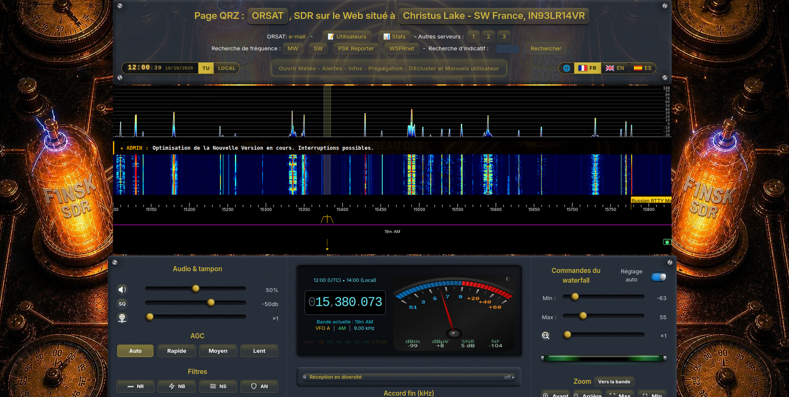
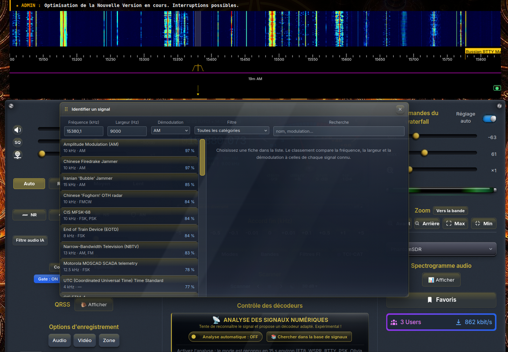
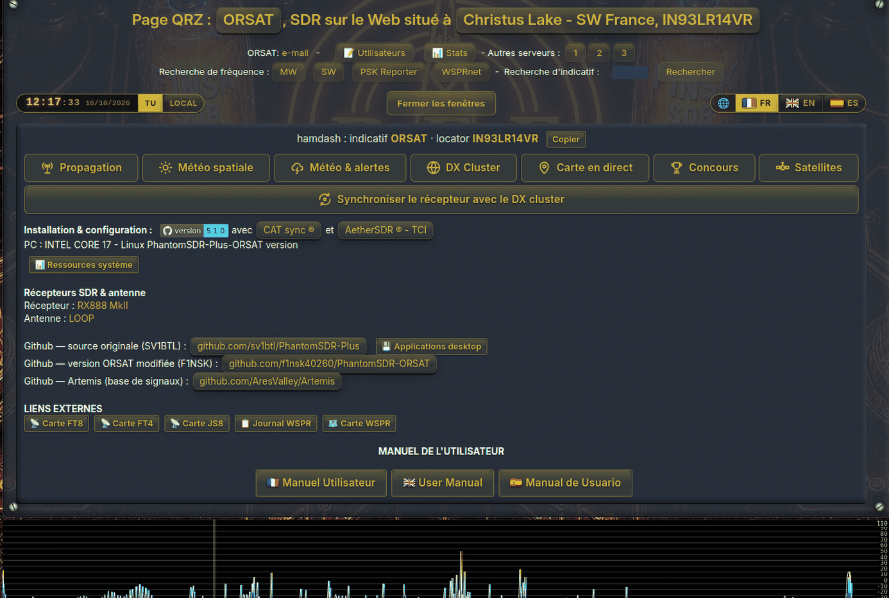

# PhantomSDR-Plus WebSDR — version française (5.1.0)

[](https://www.gnu.org/licenses/gpl-3.0)
[](https://github.com/sv1btl/PhantomSDR-Plus)

> [!IMPORTANT]
> **Ceci est une version modifiée, en français, de PhantomSDR-Plus, maintenue par F1NSK** sur
> **https://github.com/f1nsk40260/PhantomSDR-ORSAT**. Ce n'est pas le projet original.
>
> **L'original est maintenu par SV1BTL** : **https://github.com/sv1btl/PhantomSDR-Plus**. Version
> actuelle : 5.1.0. C'est là qu'il faut signaler les problèmes qui ne concernent pas la traduction.

PhantomSDR-Plus est distribué sous licence GPL v3, avec les [conditions supplémentaires](ADDITIONAL_TERMS.md) que permet son article 7 : toute copie ou tout fork doit garder visible la mention « original from github.com/sv1btl/PhantomSDR-Plus » sur la page du récepteur et sur /mobile. Cette version française la conserve.

🌐 **Site web : [phantomsdr.psychomed.gr](https://phantomsdr.psychomed.gr)** — ce que fait PhantomSDR-Plus, les décodeurs, l'application Desktop PhantomSDR+ et la documentation en PDF.

## Remarque : testé sur Debian 12 (Bookworm), Debian 13 (Trixie), Ubuntu 22.04 et Ubuntu 24.04.

**Nouveautés de la version 5.1.0**

* **Une fenêtre FLDIGI avec cinq modes de plus.** Le décodeur appelé auparavant RTTY s'appelle désormais **FLDIGI** (bouton et entrée de la liste déroulante). En plus du RTTY, du SITOR, du PSK31, de l'Olivia, du Packet et de l'APRS, il décode le **DominoEX**, le **THOR**, le **THROB / THROBX**, le **Hellschreiber** et le **MT63**, le tout dans le navigateur de l'auditeur, sans qu'aucun fldigi ne soit installé nulle part. Les modes **MFSK16/32/64** ont leur propre entrée, juste après l'Olivia. Chaque nouveau mode est un portage du récepteur de fldigi lui-même, vérifié sur de vrais enregistrements fldigi de chaque sous-mode (DominoEX 4 à 22, THOR 4 à 100 y compris les modes K=15, THROB et THROBX 1/2/4, les sept modes Hell, MT63-500/1000/2000 court et long). Le Hellschreiber s'affiche comme l'image qu'il est — deux copies de chaque ligne, comme le dessine fldigi — et peut être enregistré en PNG ; chaque autre nouveau mode a sa propre liste de modes et un squelch réglé pour n'imprimer rien sur deux minutes de bruit. Voir **[docs/DECODERS.md](docs/DECODERS.md)**.
* **Packet (AX.25) et APRS**, avec une carte en direct. Packet VHF/UHF à 1200 Bd (le récepteur passe en FM sur le canal) et packet HF à 300 Bd ; chaque trame est vérifiée avant d'être affichée. Positions, météo, messages, objets et télémesures APRS apparaissent en texte clair, et chaque station entendue avec une position s'affiche sur une carte OpenStreetMap sous le texte, avec sa trace, sa distance et son azimut depuis le récepteur. La molette de la souris gagne un pas de **12,5 kHz** pour la grille des canaux VHF.
* **Un repère de fréquence lance son décodeur.** Une entrée de `markers.json` dont le mode est un mode numérique — FT8, FT4, FT2, JS8, WSPR, SSTV, FAX, NAVTEX, RTTY, PSK31, OLIVIA, MFSK, DOMINOEX, THOR, THROB, HELL, MT63, PACKET, APRS et d'autres — s'accorde dessus et démarre ce décodeur en un clic.
* **Un assistant de station, et toutes les questions de l'installateur en premier.** `configure-station.sh` pose une seule fois les questions sur le récepteur, la bande, la station et les ports, garde les réponses dans `station.conf` et en écrit le `.toml`, le `site_information.json` et la configuration du relais, qui ne peuvent donc plus se contredire. Les quatre installateurs commencent par lui, puis travaillent seuls. Les nouvelles stations utilisent un seul port public (9000, `proxy.py`), tout le reste restant en interne derrière lui ; changer un port plus tard se fait en une commande, qui reporte le changement partout et le met en service.
* **https:// en plus de http://.** `setup-https.sh` (ou une question de plus dans l'assistant) installe Caddy sur le port 443 avec un certificat Let's Encrypt qui se renouvelle tout seul ; l'adresse http reste disponible pour websdr.org, les clients Kiwi et les partenaires qui ne parlent que http.
* **`update.sh` sans GitHub, et sans questions.** `./update.sh --from` prend la nouvelle version dans un dossier, un `.tar.gz` ou un `.zip` — une clé USB, pour une station sans connexion directe. Chaque version publiée contient l'empreinte de tous les fichiers jamais publiés : une première mise à jour reconnaît donc les anciens fichiers comme anciens, et ne pose de questions que sur les vraies modifications locales.
* **L'origine du projet.** La ligne de version, sur la page du récepteur et sur /mobile, indique « original from github.com/sv1btl/PhantomSDR-Plus », conservée par les [conditions supplémentaires](ADDITIONAL_TERMS.md) de la GPL ; les installateurs, `update.sh` et le panneau d'administration le signalent quand une copie vient d'un fork.
* **Une CAG comme sur un transceiver.** **Rapide**, **Moyenne** et **Lente** sont désormais de vrais réglages de CAG dans le serveur, pour chaque auditeur séparément : Rapide remonte en 0,3 s environ, Moyenne maintient 0,25 s et remonte en 1,2 s, Lente maintient 1 s et remonte en 3 s ; **Auto** reste la CAG du récepteur comme avant. Les quatre donnent le même volume — mesuré sur l'air à 0,6 dB près — et ne diffèrent que par ce qui se passe entre les mots et après la fin d'une station forte. Quand un décodeur est ouvert, la CAG est maintenue sur Lente pour lui, et une mention **Slow (decoder)** à côté du titre de la CAG l'indique. Nécessite le nouveau backend : `./recompile.sh --both` puis un redémarrage. Voir **[docs/USER_GUIDE.md](docs/USER_GUIDE.md)**.
* **Un nouveau réglage automatique de la cascade (Auto Adj.)** — luminosité et contraste automatiques. Il mesure le plancher de bruit sur toute la largeur affichée, en fait un fond sombre et uniforme et fait ressortir les signaux faibles, quelle que soit la palette ; la trace du spectre garde sa vraie échelle en dB.
* **Documentation :** une nouvelle **Annexe** — chaque commande que tape un administrateur, avec un lien vers la page qui l'explique — termine les PDF hors ligne, qui comptent maintenant 18 chapitres. La page gagne un bouton **Website** à côté du lien GitHub, et **💾 Desktop applications** ouvre la page de téléchargement du [site web](https://phantomsdr.psychomed.gr).
* **Corrections :** le chat compte les caractères et non les octets, si bien que les messages en grec ou en cyrillique ont droit à leurs 200 caractères, sans jamais couper une lettre en deux ; les pages Utilisateurs et Chat du panneau d'administration couvrent tous les récepteurs ; les modes 2 m suivent le plan de bande IARU Région 1 (FM à partir de 144,794 MHz, l'APRS sur 144,800 s'ouvre donc en FM).

------------------

Nous proposons aussi un large éventail de **fonctions** supplémentaires :

* Une nouvelle procédure d'installation `install.sh`, qui simplifie la première mise en service du serveur.
* Un script `recompile.sh` pour reconstruire rapidement le backend, le frontend ou les deux.
* Un outil `update.sh` qui met à jour le récepteur en une commande, sans toucher à vos configurations, repères, journaux et scripts modifiés ; la sauvegarde de chaque mise à jour est une archive datée dans `update-backups/`, restaurable avec `./update.sh --restore LAST`.
* Des installateurs qui arrêtent d'abord le récepteur en marche, encadrent chaque étape de son propre verdict et indiquent la valeur par défaut de chaque question.
* Une fonction de **protection thermique** dans le panneau d'administration, pour éviter la surchauffe du processeur et prendre les mesures qui s'imposent.
* Une interface au design moderne et futuriste.
* La prise en charge de **CATsync** par l'application [CATsync Tool for WebSDRs](https://catsyncsdr.wordpress.com/), du **TCI-CAT** directement sur la page du récepteur (ExpertSDR, AetherSDR, Thetis, ou tout transceiver Hamlib par le pont fourni), et un pilotage du transceiver dans les deux sens — fréquence, mode et filtre — dans [Desktop PhantomSDR+](https://www.dropbox.com/scl/fo/kjwj96zg3kj7dgq4fjef9/APnA3c9hhv4hk3YMGIGjH7s?rlkey=jfiwklly63kv73poalx631pk3&st=m37uvaym&dl=0). Voir [docs/RIG_CONTROL.md](docs/RIG_CONTROL.md).
* **Émulation de client KiwiSDR** — un pont facultatif qui permet aux clients Kiwi comme **AetherSDR** et `kiwiclient` de se connecter directement au récepteur, sur le même hôte et le même port, avec un vrai réaccord, la cascade et le S-mètre. Désactivé tant que `[kiwi_emulation] enabled = true` n'est pas ajouté à votre configuration. Voir [docs/Aether_config.md](docs/Aether_config.md).
* **Réception en diversité** — associe le récepteur à un second site (un autre PhantomSDR-Plus, un KiwiSDR, un UberSDR ou un WebSDR) et fait entendre celui des deux qui a le meilleur signal à cet instant. Cela fonctionne dans le navigateur de l'auditeur ; seul un WebSDR comme partenaire demande un petit relais sur votre propre serveur. Voir [docs/RECEIVE_DIVERSITY.md](docs/RECEIVE_DIVERSITY.md).
* **Plusieurs récepteurs sur un seul ordinateur** — par exemple un RX-888 pour les ondes courtes et un RTL-SDR pour le 2 m, chacun étant un serveur complet avec sa propre cascade, son chat, ses repères et ses auditeurs. `./add-receiver.sh` (proposé aussi à la fin de chaque installateur) en ajoute un, avec son pilote ; `start-all.sh` les démarre tous et `./stop-websdr.sh <nom>` en arrête un. Sur la page, une ligne *Receivers:*, présente aussi sur /mobile, permet de passer de l'un à l'autre, et `proxy.py` leur fait partager un seul port public. Voir [docs/MULTI_RECEIVER.md](docs/MULTI_RECEIVER.md).
* Un S-mètre qui affiche des **points S VHF au-dessus de 30 MHz** (IARU Région 1 : S9 y vaut −93 dBm, contre −73 dBm en dessous), avec en option un retour à zéro sur un canal VHF/UHF vide (`"siteSMeterGateDb"`).
* L'expulsion d'un auditeur par l'administrateur et l'en-tête `X-Forwarded-For` ne sont acceptés que depuis la machine elle-même : personne ne peut donc expulser des auditeurs ni contourner les limites par adresse IP en passant par le proxy.
* Des réglages serveur facultatifs pour les stations à plusieurs récepteurs : `[server] host`, `[server] html_fallback_root`, `[websdr] public_port`, et les liens `siteReceiverURL` / `siteAntennaURL` propres à chaque récepteur.
* Un panneau d'administration complet, protégé par mot de passe, pour gérer le serveur à distance sans accès SSH direct. Il donne accès aux journaux du serveur, à la modération du chat, aux messages aux utilisateurs, à la suppression de messages du chat sans redémarrer le serveur, à la déconnexion d'utilisateurs, à l'exécution de commandes, à l'édition de fichiers et à d'autres fonctions d'administration.
* Des décodeurs intégrés pour le **FT8, FT4, FT2, JS8, CW, QRSS Grabber, WSPR, fax HF, SSTV, NAVTEX, une fenêtre FLDIGI avec RTTY, PSK31, Olivia, MFSK16/32/64, DominoEX, THOR, THROB, Hellschreiber, MT63, Packet (AX.25) et APRS (avec une carte en direct des stations entendues), et FreeDV RADE V1**. Le RTTY, le PSK31, le FT8, le FT4 et le FT2 affichent un vrai rapport signal/bruit (les modes FT concordent avec WSJT-X), et le RTTY a un squelch. Voir la [documentation des décodeurs](docs/DECODERS.md).
* Un **scanner de canaux** sur la ligne d'accord : il balaie la bande — ou exactement ce que montre la cascade — et s'arrête sur le premier canal qui dépasse d'un nombre de dB choisi le plancher de bruit de la bande, repart tout seul quand le canal redevient silencieux, garde un pas aligné sur la grille de canaux du mode, et peut sauter les canaux vides en lisant le spectre. Les canaux verrouillés et les réglages restent dans le navigateur de l'auditeur.
* Un outil **Decoder ID** qui identifie un signal numérique inconnu et propose le décodeur correspondant en un clic. Désactivé par défaut.
* Choisir un mode numérique règle à la fois la bande latérale et la bande passante.
* Le JS8 s'affiche sous forme de conversation, les messages en plusieurs trames étant réassemblés.
* Décodage intégré de l'**AM stéréo C-QUAM**. L'audio C-QUAM utilise par défaut la compression Opus, les autres modes audio le FLAC.
* Tous les décodeurs ont quitté le fil principal du navigateur. Chacun tourne maintenant dans son propre Web Worker, si bien que le décodage n'entre plus en concurrence avec la lecture du son et l'affichage de l'interface.
* Envoi automatique des réceptions vers **PSK Reporter** et **WSPRnet**. Un moteur autorun intégré décode localement les signaux reçus et envoie les rapports de réception sans logiciel supplémentaire :
  * **FT8, FT4 et JS8 → [PSK Reporter](https://pskreporter.info/)** par le protocole natif IPFIX/UDP. Les réceptions sont groupées et envoyées à l'intervalle recommandé d'au moins cinq minutes. Le JS8 est signalé en vitesse Normal, à partir des heartbeats, des trames composées et des messages dirigés ; les destinations de groupe comme `@ALLCALL` et les indicatifs non résolus ne sont jamais signalés.
  * **WSPR → [WSPRnet](https://wsprnet.org/)** par le point d'envoi standard de WSPRnet. Les rapports WSPR ne sont envoyés qu'à WSPRnet, pour éviter les doublons.
* Outils **FreeDV Reporter et DX Cluster** intégrés.
* Un chat avec un bouton **↪ Reply** sur chaque message ; les réponses s'affichent en retrait sous le message auquel elles répondent, sur la page de bureau comme sur /mobile.
* **Indication automatique du C-QUAM.** Quand une émission C-QUAM est détectée, le libellé du bouton passe au vert. En mode AM, un nouvel appui sur le bouton active la détection AM synchrone sur la porteuse : le libellé passe alors au jaune et affiche `SAM`. Un appui de plus ramène le récepteur en AM classique.
* Un plan de bandes affichable sur la cascade, avec des réglages indépendants de luminosité, de plage de fréquences et de visibilité pour chaque bande.
* Un système de palettes de couleurs personnalisées amélioré. Le spectre et la cascade inversés sont utilisés par défaut dans toutes les variantes de l'interface, mais ce comportement peut être changé à la main.
* Des encodeurs FLAC et Opus optimisés, avec une latence équilibrée. Tous deux travaillent en 16 bits, soit une dynamique théorique d'environ 96 dB. ⭐
* De nombreuses fonctions repensées et optimisées, notamment :
  * Une latence de bout en bout réduite : le décodeur FLAC du navigateur joue chaque paquet dès son arrivée, et le tampon de lecture s'adapte à la connexion (environ 140 ms sur un téléphone en Wi-Fi ; ajoutez `?diag=1` à l'adresse pour voir les chiffres).
  * Réduction de bruit (spectrale, qui préserve les tonalités).
  * Annulation de bruit.
  * Suppresseur d'impulsions (noise blanker).
  * Suppression du bruit de fond.
  * Notch automatique contre les hétérodynes et les porteuses.
  * Réduction de bruit par IA (RNNoise, dans le navigateur de l'auditeur, modes phonie uniquement).
  * Aucun de ces traitements n'affecte les décodeurs, qui lisent l'audio brut.
  * AM synchrone activée par défaut.
  * Modes de CAG au choix.
  * Squelch automatique.
  * Squelch à tonalité CTCSS (FM), avec une fenêtre de choix de la sous-porteuse.
  * Réglages de tampon configurables.
  * Réglage automatique du niveau de la cascade.
  * Accord à la molette de la souris.
  * Raccourcis clavier.
  * Curseur de zoom.
  * Interface mobile améliorée.
  * Noise gate au choix, avec préréglages.
  * Accord précis à la souris, avec la fréquence affichée directement sur la cascade.
* Compresseur et égaliseur audio intégrés, avec réglage manuel et remise à zéro.
* Des signets repensés, avec étiquettes à l'écran et import/export.
* Quatre modèles d'interface au choix, accessibles par une fenêtre flottante.
* La possibilité de faire tourner l'interface en `localhost`.
* Un outil de surveillance facultatif, qui ajoute à PhantomSDR l'état du serveur en temps réel.
* Un spectrogramme audio en temps réel à l'écran.
* Un indicateur d'intensité « œil magique », qui imite les tubes indicateurs d'accord EM84 des récepteurs d'autrefois.
* L'enregistrement audio, et l'enregistrement vidéo et audio combiné de toute la cascade ou d'une zone choisie.
* Une liste des utilisateurs connectés en temps réel, avec leur géolocalisation, une carte et des statistiques sur des périodes au choix. Votre propre session y est marquée **you**, que la liste soit ouverte depuis l'interface ou comme page `users.html` indépendante.
* Une meilleure stabilité du serveur et un meilleur signalement des pannes. Si `spectrumserver` plante ou fonctionne mal, des informations de diagnostic sont écrites dans `crash.log`.
* Le fichier `crash.log` est accessible à la fois dans le dossier racine du serveur et par le panneau d'administration.
* Une interface mobile optimisée.
* Une consommation processeur et mémoire réduite au maximum côté client.
* **Limites de connexion, et une protection contre l'inondation.** Le récepteur peut désormais plafonner le nombre d'auditeurs simultanés et le rythme des nouvelles connexions par adresse, et borner les connexions à moitié ouvertes et silencieuses qu'aucune autre limite ne voit. Deux clés l'activent — `per_ip` et `per_ip_rate` dans `[limits]` — et tout est désactivé par défaut : une configuration existante se comporte donc comme avant. Un auditeur refusé en apprend la raison, au lieu de regarder une page qui ne se charge jamais. En dessous se trouve `setup-firewall.sh`, une couche nftables facultative qui écarte le trafic avant que le serveur ne lise un seul octet, et qui ne peut pas vous enfermer hors de votre propre machine. Manuel complet, y compris dans le PDF hors ligne : **[docs/CONNECTION_LIMITS.md](docs/CONNECTION_LIMITS.md)** — avec la façon de mesurer votre propre trafic avant de choisir les valeurs. **Une connexion perdue met désormais fin à la session.** La liaison audio ne se reconnecte plus toute seule. Sur un récepteur, c'était une erreur : les liaisons de la cascade et des événements ne revenaient pas avec elle, si bien qu'une session relancée donnait du son en direct attaché à une cascade figée, que l'arrêt du serveur ne nettoyait plus.
* **Le TCI-CAT sur la page du récepteur.** Un nouveau bouton **TCI-CAT**, à côté des filtres FI, permet à la page de suivre toute seule votre propre transceiver, sans application de bureau : le navigateur dialogue directement avec le serveur TCI d'ExpertSDR, d'AetherSDR ou de Thetis sur votre ordinateur. Fréquence, mode et largeur de filtre se suivent dans les deux sens — tournez le bouton du transceiver ou appuyez sur sa touche FIL et le récepteur suit, cliquez sur la cascade ou choisissez un filtre FI et le transceiver suit — et la page se tait pendant vos émissions.
* **Le pilotage du transceiver depuis l'application de bureau.** [Desktop PhantomSDR+](https://www.dropbox.com/scl/fo/kjwj96zg3kj7dgq4fjef9/APnA3c9hhv4hk3YMGIGjH7s?rlkey=jfiwklly63kv73poalx631pk3&st=m37uvaym&dl=0). **Un bouton 💾 Desktop applications**, sous Open Additional Info et à côté de System Resources, ouvre le dossier de téléchargement de Desktop PhantomSDR+.
* PhantomSDR est inscrit dans les annuaires de WebSDR suivants :
  * [sdr-list.xyz](https://sdr-list.xyz)
  * [sdr.shbrg.nl](https://sdr.shbrg.nl/sdr/)
  * [websdr.org](http://websdr.org/)
* Les récepteurs pris en charge sont actuellement le **RX-888, le RTL-SDR Blog V4, l'Airspy HF+ Discovery, le HackRF, le SDRplay RSP1A et le RigExpert Fobos SDR**, ainsi que les clones compatibles par SoapySDR. Les installateurs mettent en place toute la chaîne de pilotes de chacun, et `setup-rsp1a.sh`, `setup-fobos.sh`, `setup-airspyhf.sh` et `setup-hackrf.sh` en ajoutent un à une station déjà installée. D'autres récepteurs sont prévus.

- Et ce n'est pas fini !…

> [!NOTE]
> **🎯 Les anciens dépôts de SV1BTL se trouvent ici** : https://github.com/sv1btl/PhantomSDR-Plus_Archive

## Fonctions
- Un WebSDR capable de servir plusieurs centaines d'utilisateurs, selon le matériel.
- Les modes de démodulation courants.
- La prise en charge des SDR à haut débit d'échantillonnage (70 MSPS en réel, 35 MSPS en IQ).
- Les données IQ comme réelles.
- Une prise en charge complète des décodeurs.
- Un décodeur **HFDL** (HF Data Link, messages ACARS des avions en ondes courtes) dans l'interface F1NSK : bouton HFDL de « Decoders Control », liste des stations sol et de leurs fréquences, position des avions quand elle est transmise. Il repose sur dumphfdl compilé en WebAssembly (voir `jsdsp/hfdl_wasm`).
- Une vue mobile légère à l'adresse **/mobile**, pour les téléphones aux forfaits de données limités.

## Performances mesurées
- Ryzen 5 2600, tous les cœurs — RX888 MKII à 64 MHz d'échantillonnage, 32 MHz en IQ : 38 à 40 % ; chaque utilisateur ne coûte presque rien, 50 utilisateurs ne prennent même pas 1 % du processeur.
- RX 580 — RX888 MKII à 64 MHz d'échantillonnage, 32 MHz en IQ : 28 à 35 % ; comme pour le Ryzen, chaque utilisateur ne coûte presque rien (il devrait en supporter beaucoup).
- Intel i5-6500T — RX888 MKII à 60 MHz d'échantillonnage, 30 MHz en IQ, OpenCL installé et activé : environ 10 à 12 %. 100 utilisateurs ne posent aucun problème avec OpenCL, puisque c'est la carte graphique qui fait le gros du travail.

## Captures d'écran

Le WebSDR de SV1BTL : http://phantomsdr.no-ip.org:8900/

  

(https://sdr-list.xyz)

## Installation

Tout est installé par un seul script, et toutes les questions sont posées au début :

```
git clone https://github.com/f1nsk40260/PhantomSDR-ORSAT PhantomSDR-Plus
cd PhantomSDR-Plus
bash install.sh
```

Pour installer l'original en anglais, remplacez la première ligne par `git clone https://github.com/sv1btl/PhantomSDR-Plus`.

1. **Les questions sur la station** (deux minutes environ) : quel récepteur — celui qui est branché est reconnu —, ce que vous voulez recevoir, votre indicatif, votre locator, votre ville et votre antenne, votre adresse sur Internet, si vous voulez apparaître sur sdr-list.xyz et sur la carte de websdr.org, et les options souhaitées (panneau d'administration, FreeDV RADE, statistiques, relais WebSDR, démarrage au boot).
2. **Votre mot de passe sudo, une seule fois.**
3. **Ensuite, il installe tout seul** — de vingt minutes à une heure selon la machine et RADE — et ne demande plus rien.
4. **À la fin, il démarre le récepteur** et affiche l'adresse qu'utiliseront les auditeurs, ainsi que **le seul port** à ouvrir sur votre box : **9000**.

Il n'y a pas d'étape `chmod` ni de terminal à redémarrer : une copie téléchargée en ZIP ou par la page GitHub n'a pas les droits d'exécution, et l'installateur les pose lui-même. Les réponses sont gardées dans `station.conf`, à partir duquel l'installateur écrit votre `.toml`, votre `site_information.json` ainsi que la fréquence et le débit d'échantillonnage utilisés par votre script de démarrage : ils sont donc toujours cohérents. Modifiez-les quand vous voulez avec `bash configure-station.sh` (ENTRÉE garde chaque réponse) : sur une station installée, il déplace aussi les ports dans le panneau d'administration et le service de statistiques, et redémarre ce qui tourne ; changer un port tient donc en une commande. Le port public doit valoir 1024 ou plus — pour être joignable sur le port 80, redirigez le port 80 de la box vers le 9000. La description complète, avec chaque étape et chaque port, se trouve dans [docs/INSTALLATION.md](docs/INSTALLATION.md).

| Port | Rôle | À ouvrir sur la box |
|---|---|---|
| 9000 | la page du récepteur — `proxy.py`, qui transporte aussi `/admin`, `/rade`, `/stats` et `/relay` | **oui, uniquement celui-ci** |
| 9001 / 9010 / 9011 / 9012 / 9013 | spectrumserver / panneau d'administration / statistiques / RADE / relais WebSDR | non — interne à l'ordinateur |

**Le https:// en plus** — cadenas, chiffrement et meilleur chemin audio dans les navigateurs — tient en une question de plus dans l'assistant, ou plus tard `bash setup-https.sh`. Il faut un nom DNS (un nom DNS dynamique gratuit convient) et les ports 443 et 80 redirigés ; Caddy obtient et renouvelle tout seul un certificat Let's Encrypt, et l'adresse http continue de fonctionner. Voir **[Accès sécurisé (HTTPS)](docs/HTTPS.md)**.

> **PhantomSDR-Plus tourne déjà chez vous ? Ne le réinstallez pas.** Récupérez une fois l'outil de mise à jour, puis lancez-le. Il montre ce qui changerait et demande avant d'écrire quoi que ce soit ; votre configuration `.toml`, vos repères, votre mot de passe d'administration, votre liste de fréquences et l'historique du chat ne sont jamais touchés, et aucun port de votre station ne bascule vers les nouveaux : <br />
> ```
> cd ~/PhantomSDR-Plus
> curl -fLO https://raw.githubusercontent.com/f1nsk40260/PhantomSDR-ORSAT/main/update.sh
> bash update.sh
> ```
> Tous les détails dans **[L'outil de mise à jour](#loutil-de-mise-à-jour)**. Relancer `install.sh` sur un site qui fonctionne n'est utile que si une reconstruction échoue faute de paquets système.

Choisissez l'installateur qui correspond à votre système. Ils font le même travail et posent les mêmes questions ; seul le gestionnaire de paquets change :

| Système | Script |
|---|---|
| Ubuntu 22.04 / 24.04 / 26.04, Debian 12 / 13 | `./install.sh` |
| Fedora | `./install_fedora.sh` |
| Arch | `./install_arch.sh` |
| openSUSE Tumbleweed | `./install_opensuse.sh` |

> **Un seul installateur pour toutes les versions de Debian et d'Ubuntu.** `install.sh` lit `/etc/os-release` et la version de Boost installée, et s'y adapte ; les anciens `install_ubuntu22.sh`, `install-Deb12.sh` et `install_ubuntu26.sh` ont disparu. Il pose `DEBIAN_FRONTEND=noninteractive`, si bien que le paquet `tzdata` qui arrive avec `python3-matplotlib` ne peut pas interrompre l'installation pour demander votre fuseau horaire, puis avaler la réponse destinée à la question suivante. Sur Jammy, il appelle directement `install_rade_ubuntu22.sh`, car le `python3-websockets` de Jammy est en 10.1 alors que RADE demande la 11.0 ou plus. Il sait où se trouve `intel-opencl-icd` sur chaque version : dans les dépôts sur 22.04 et 26.04, dans `non-free` sur Debian 12, et dans le dépôt graphique d'Intel sur 24.04 et Debian 13. Et lorsque Boost est en 1.87 ou plus, le correctif des en-têtes de websocketpp n'est plus facultatif : l'installateur vérifie qu'il est en place et refuse de compiler sans lui. Aucun compilateur plus récent n'est nécessaire : le GCC fourni accepte `-std=c++23` sur les cinq versions, n'installez donc pas `gcc-12` pour cela.

L'installation se déroule en 22 étapes numérotées. Les questions sur la station étant posées au début, aucune ne s'arrête pour demander quoi que ce soit. `PHANTOM_CLASSIC=1` rétablit l'ancien fonctionnement, chaque question étant posée à son étape ; `PHANTOM_NONINTERACTIVE=1`, avec les variables `STATION_*`, fait tout tourner sans intervention (voir l'en-tête de `install.sh` et de `configure-station.sh`).

**Chaque exécution écrit `install.txt`.** Quand l'installateur se termine — ou s'arrête en chemin —, il écrit un rapport dans `install.txt`, dans le dossier de PhantomSDR-Plus : le résultat, chacune des 22 étapes notée OK / SKIPPED / PARTIAL / FAILED, ce qu'il a détecté (distribution, Boost, compilateur, Node.js), les composants installés et chaque avertissement rencontré. Une exécution qui échoue laisse un rapport qui s'arrête à l'étape fautive, avec la raison et une note indiquant que l'installateur peut être relancé sans risque. C'est le premier fichier à lire quand quelque chose n'a pas marché, et le premier à joindre à un rapport de bogue. Chaque exécution l'écrase : gardez-en une copie si vous voulez comparer deux installations.

> **Ubuntu 26.04, Arch et openSUSE Tumbleweed compilent, mais n'ont pas encore tourné sur l'air.** Tous trois fournissent un Boost plus récent que la 1.87, qui a supprimé l'API `io_service` sur laquelle a été écrite la version 0.8.2 de websocketpp incluse dans le projet. Les en-têtes corrigés que copie l'installateur comblent cet écart (`io_context`, `executor_work_guard`, `boost::asio::post`, le résolveur moderne), et lorsque Boost est en 1.87 ou plus, l'installateur considère ce correctif comme obligatoire et non facultatif : il vérifie que les copies sont en place et refuse de compiler sans elles. Une installation complète, pilote du récepteur et toutes les options comprises, a été vérifiée de bout en bout dans des conteneurs avec Boost 1.90 (Ubuntu 26.04), 1.91 (openSUSE Tumbleweed) et 1.92 (Arch). Cela prouve que le serveur compile et démarre — pas qu'il fait tourner un récepteur pendant des heures. Considérez ces trois systèmes comme non testés en production tant que personne n'a fait de retour.

> **openSUSE, c'est Tumbleweed.** C'est là que `install_opensuse.sh` est vérifié. Leap 15.6 ne fonctionne pas : ses dépôts ne contiennent aucun `liquid-dsp-devel`, dont le backend a besoin, et Boost n'y existe que sous des noms de paquets numérotés. Prendre Leap en charge demanderait d'ajouter des dépôts OBS tiers ; ce n'est donc pas prévu pour l'instant.

Chaque option est un script ordinaire, que vous pouvez aussi lancer seul à tout moment — `./setup_admin.sh` (`--proxy-only` pour le port public sans le panneau), `./install_rade.sh`, `./install-stats-server.sh`, `./setup_websdr_relay.sh`, `./setup-autostart.sh`, `./setup-rx888-udev.sh`, et pour les récepteurs `./setup-rsp1a.sh`, `./setup-fobos.sh`, `./setup-airspyhf.sh` et `./setup-hackrf.sh` : ce sont exactement ceux qu'appelle l'installateur.

> [!NOTE]
>
> **🎯 Apparaître sur la carte de websdr.org**
>
> Les questions sur la station écrivent ce bloc pour vous si vous répondez oui à la question websdr.org, avec `public_port` réglé sur votre port public (9000). Pour le régler à la main, préparez votre `.toml` comme décrit dans la section « Le fichier .toml » :
>
> [websdr.org] <br />
> enabled     = true # ou false <br />
> public_host = "votre_adresse_ip" <br />
> public_port = PORT <br />
> qth         = "Locator_QTH" <br />
> description = "INDICATIF PhantomSDR+" <br />
> email       = "mail@domaine.com" <br />
> logo        = "logo.jpg" <br />
>
> Le `.toml` est lu au démarrage du serveur : après l'avoir modifié, redémarrez le récepteur avec son script de démarrage (par exemple `./start-rtl.sh`).


## Exemples
Sur une station configurée avec les questions sur la station, tout ceci est déjà fait — la fréquence et le débit d'échantillonnage viennent de `station.conf`, et `bash configure-station.sh` les modifie. Les exemples ci-dessous servent à configurer un récepteur à la main. <br />
Pensez à régler correctement la fréquence et le débit d'échantillonnage dans le script de démarrage de votre récepteur (par exemple `start-rtl.sh`). Dans chaque script de démarrage, ils se trouvent dans le bloc **RECEIVER CONFIGURATION**, en haut du fichier — modifiez la ligne `RX_ARGS` (pour `start-rx888mk2.sh`, c'est `RX888_ARGS`). Les commandes ci-dessous montrent ce que deviennent ces arguments. <br />
Il faut aussi modifier le fichier .toml, par exemple config-rtl.toml.

### RTL-SDR
```
rtl_sdr -f 145000000 -s 2048000 - | ./build/spectrumserver --config config.toml
```
**dans le .toml** <br />
sps=2048000 # débit d'échantillonnage du RTL-SDR pour recevoir 144-146 MHz <br />
frequency=145000000 # fréquence de base <br />

frequency=145000000 # fréquence affichée par défaut à l'utilisateur <br />
modulation="FM" # modulation par défaut <br />

**et dans site_information.json** <br />
"siteSDRBaseFrequency": 145000000,<br />
"siteSDRBandwidth": 2048000,

### HackRF (10 Msps, WBFM ; format : s8)
```
hackrf_transfer -r - -f 100900000 -s 10000000 | ./build/spectrumserver --config config.toml
```
### Airspy HF+ (912 ksps, AM ; format : s16)
```
rx_sdr -d driver=airspyhf -f 648000 -s 912000 -F CS16 - | ./build/spectrumserver --config config.toml
```
### SDRplay RSP1A (8 Msps, LSB ; format : s16)
```
rx_sdr -d driver=soapyMiri -t flavour=SDRplay -f 7100000 -s 8000000 -F CS16 - | ./build/spectrumserver --config config.toml
```
Si c'est l'API de SDRplay qui est installée, le pilote est `-d driver=sdrplay`.
### RigExpert Fobos SDR, HF1/HF2 (échantillonnage direct 0-25 MHz, 50 Msps ; format : s16, signal=real)
```
rx_sdr -d driver=fobos -t direct_samp=1 -f 0 -s 50000000 -I CF32 -F CF32 - | ./cf32_to_real | ./build/spectrumserver --config config.toml
```
### RX888 MK2 (échantillonnage réel à 6 Msps ; format : s16, signal=real)
```
rx888_stream -s 6000000 | ./build/spectrumserver --config config.toml
```

## Scripts de démarrage et configurations ajoutés pour divers récepteurs
Le SDRplay RSP1A, le RigExpert Fobos SDR et l'Airspy HF+ ont besoin de SoapySDR et de rx_tools, sans quoi ils ne fonctionneront pas. Le HackRF One n'a besoin que du paquet `hackrf` de la distribution. L'installateur met tout cela en place pour le récepteur choisi à sa question SDR, et `setup-rsp1a.sh`, `setup-fobos.sh`, `setup-airspyhf.sh` et `setup-hackrf.sh` font de même sur une station déjà installée ; pour tout ce qu'ils ne couvrent pas, installez vous-même le pilote avant d'utiliser le script de démarrage correspondant.<br />
`psutils` est aussi installé pour vous, car il est nécessaire à la commande killall.<br />
Si l'installateur a signalé qu'OpenCL n'a pas pu être installé sur votre machine, gardez `accelerator="none"` dans votre `.toml`.

### Lanceur autonome et surveillance
Chaque script de démarrage — `start-rx888mk2.sh`, `start-airspyhf.sh`, `start-rtl.sh`, `start-rsp1a.sh`, `start-fobos-hf.sh`, `start-fobos.sh`, `start-hackrf.sh` — est un **script unique et autonome, qui démarre, redémarre, surveille et journalise** le serveur, lance aussi le **module RADE** et indique l'état de votre **inscription dans les annuaires**. Vous n'avez jamais besoin que de ce script de démarrage et du `stop-websdr.sh` commun ; il n'y a pas de fichier séparé à lancer pour vérifier, redémarrer, tuer ou gérer RADE.

```bash
./start-rtl.sh        # démarrer (ou redémarrer proprement), en affichant la progression dans le terminal
./start-rtl.sh -q     # pareil, mais discret : deux lignes au lieu du journal en direct
./stop-websdr.sh      # arrêter le serveur, sa surveillance et RADE (fonctionne pour TOUT récepteur)
```

Ce que fait un script de démarrage :
- Il arrête toute instance déjà en marche, puis lance la chaîne récepteur → `spectrumserver` et **se détache** (par `setsid`), si bien qu'elle continue de tourner après la fermeture du terminal.
- **Il vous montre ce qui se passe.** La surveillance doit être détachée du terminal, elle écrit donc dans le journal ; le lanceur recopie ce journal à l'écran pendant le démarrage du serveur, puis affiche un résumé et vous rend la main. Un `Ctrl-C` pendant cette recopie n'arrête que la recopie — le serveur et la surveillance continuent de tourner.
- Il lance une **surveillance** qui redémarre la chaîne sur place si le récepteur ou `spectrumserver` s'arrête — sans cron ni systemd externe.
- Il démarre le **module RADE** (`rade_helper.py`) une fois le récepteur et `spectrumserver` confirmés en marche, et le relance seul s'il s'arrête plus tard — sans redémarrer le serveur avec lui. Si RADE n'est pas installé, le serveur démarre normalement et le résumé indique simplement que le module n'a pas été activé.
- Il indique si **[websdr.org] enabled** et **[websdr] register_online** sont activés dans votre `.toml`, et attend la réponse de websdr.org pour que vous voyiez l'inscription réussir, plutôt que de la deviner.
- Il écrit une progression lisible dans **`logwebsdr.txt`** (`tail -f logwebsdr.txt` pour la suivre), et la sortie de `spectrumserver` lui-même dans **`spectrumserver.log`**, qui tourne à 10 Mo. Les lignes d'inscription `[WebSDROrg]` apparaissent dans les deux, sauf les messages de routine, gardés dans `spectrumserver.log` seul pour ne pas noyer `logwebsdr.txt` : le rappel `/~~orgstatus` (toutes les quelques secondes) et le ping de maintien de 60 secondes. Ce qui reste dans `logwebsdr.txt`, c'est l'histoire de l'inscription — connexion, premier ping, acceptation, une confirmation après chaque reconnexion ultérieure — ainsi que toutes les erreurs, qui ne sont jamais filtrées.
- Il utilise un **verrou `flock`**, pour qu'un seul récepteur et serveur tourne à la fois — démarrer un autre récepteur arrête d'abord celui en cours.

Un démarrage réussi se termine ainsi :

```
  ────────────────────────────────────────────────────────────
  ✔ server is up   (spectrumserver + rx888_stream running)
  ✔ RADE sidecar running
  ✔ websdr.org registered (your.host.example:8900)
  · SDR directory posting enabled (errors only, in spectrumserver.log)
  Full log: /path/to/PhantomSDR-Plus/logwebsdr.txt
```

Une ligne `·` n'est qu'une information, rien ne va mal ; `!` signale que quelque chose qui devrait tourner ne tourne pas, et `✖` que le serveur n'a pas démarré dans le temps imparti — dans ce dernier cas, la surveillance continue d'essayer : consultez `logwebsdr.txt`.

Les scripts sont entièrement autonomes (ils trouvent leur propre dossier, aucun chemin n'est écrit en dur). Réglages utiles, tous facultatifs :
- `SPECTRUM_CORES=0-3 ./start-rtl.sh` — attache `spectrumserver` à des cœurs précis (`none` désactive l'attachement ; sinon une plage raisonnable est déduite de `nproc`).
- `RX_ARGS="…" ./start-rtl.sh` — remplace les arguments du récepteur sans modifier le fichier (`RX888_ARGS` pour `start-rx888mk2.sh`).
- `RADE_ENABLED=0 ./start-rtl.sh` — démarre le serveur sans le module RADE.
- `RX_DRIVER=miri ./start-rsp1a.sh` (ou `sdrplay`) — choisit le pilote du RSP1A au lieu de laisser le script décider : libmirisdr-5, ou l'API de SDRplay.


## Le fichier site_information.json
Les questions sur la station écrivent ce fichier pour vous — indicatif, locator, ville, antenne, récepteur, adresse, limites de bande et région. Ne le modifiez à la main que pour ce qu'elles ne couvrent pas (`siteNote`, `siteHardware`, `siteAntennaURL` et autres), puis reconstruisez la page avec `./recompile.sh --frontend`.

	"siteSysop": "votre nom ou indicatif",
	"siteSysopEmailAddress": "mail@mail.net",
	"siteGridSquare": "locator QTH",
	"siteCity": "Ville Pays",
	"siteInformation": "https://github.com/sv1btl/PhantomSDR-Plus",
	"siteHardware": "Matériel utilisé, ",
	"siteSoftware": "Logiciel utilisé",
	"siteReceiver": "Modèle du récepteur",
	"siteAntenna": "Antenne de réception.",
	"siteNote": "Un tout nouveau projet de WebSDR open source, en plein développement.",
	"siteIP": "http://IP_de_votre_site:port",
	"siteStats": "http://IP_de_votre_site:3001",
	"siteSDRBaseFrequency": 0,
	"siteSDRBandwidth": 30000000,
	"siteRegion": 1,
	"siteChatEnabled": true


Où : <br />

**"siteInformation"** : "https://github.com/sv1btl/PhantomSDR-Plus" — merci de ne pas le changer. Il pointe vers le dépôt GitHub du projet original.<br />
**"siteIP": "http://IP_de_votre_site:port"** — par exemple http://monsite.com:9000 <br />
**"siteStats"** — `/stats` sur une station configurée avec les questions sur la station (le proxy le transporte sur le port public) ; sur une station plus ancienne, l'adresse complète, par exemple http://monsite.com:3001. <br />
**"siteRade"**, **"siteRelay"** — `/rade` et `/relay` sur une station configurée avec les questions sur la station ; absents sur une station plus ancienne, où la page utilise les ports 8074 et 8898 comme avant. <br />
**"siteSDRBandwidth"** : indiquez la bande passante utile de votre récepteur — par exemple 2048000 pour le RTL, ou 60000000 ou 1200000000 pour le RX-888, etc.<br />

**"siteRegion"** : choisissez votre région IARU :<br />
1 pour l'Afrique, l'Europe, le Moyen-Orient et l'Asie du Nord,<br />
2 pour les Amériques — Nord, Centre et Sud, ainsi que les Caraïbes —,<br />
3 pour l'Océanie, l'Asie de l'Est, l'Asie du Sud-Est et les îles du Pacifique.<br />

"siteChatEnabled" : **true** indique si la fenêtre de chat est activée.<br />


## Le fichier .toml

Il faut aussi modifier ces sections dans le fichier .toml que vous utilisez :

[server] port=PORT # Port du serveur html_root="frontend/dist/" # Fichiers HTML servis otherusers=1 # Indique où écoutent les autres utilisateurs, 0 pour désactiver threads=6

[websdr] register_online=true # Active les mises à jour d'inscription dans les annuaires register_urls=[ "https://sdr-list.xyz/api/update_websdr", "https://sdr.shbrg.nl/api/update_websdr" ] # Un ou plusieurs annuaires qui acceptent le même contenu JSON name="INDICATIF CATsync PhantomSDR+" # Nom affiché sur https://sdr-list.xyz et/ou https://sdr.shbrg.nl/sdr/ antenna="WIRE" # Antenne affichée sur https://sdr-list.xyz grid_locator="LOCATOR_QTH" # Locator à 4 ou 6 caractères, affiché sur https://sdr-list.xyz et utilisé pour la distance des signaux FT8 hostname="votre_IP" # Si vous utilisez un DNS dynamique ou un nom de domaine, indiquez-le ici pour https://sdr-list.xyz

[server]<br />
port=9002 # Port du serveur<br />
html_root="frontend/dist/" # Fichiers HTML servis<br />
otherusers=1 # Indique où écoutent les autres utilisateurs, 0 pour désactiver<br />
threads=2<br />

[websdr.org] enabled     = true # ou false public_host = "votre_adresse_ip" public_port = PORT qth         = "Locator_QTH" description = "INDICATIF PhantomSDR+" email       = "mail@domaine.com" logo        = "logo.jpg"

[websdr]<br />
register_online=true # ou false. Mettez true pour inscrire le SDR sur https://sdr-list.xyz<br />
name="Nom" # Nom affiché sur https://sdr-list.xyz<br />
antenna="Whip" # Antenne affichée sur https://sdr-list.xyz<br />
grid_locator="Locator QTH" # Locator à 4 ou 6 caractères, affiché sur https://sdr-list.xyz et utilisé pour la distance des signaux FT8<br />
hostname="votre IP, ou ddns, ou no-ip" # Si vous passez par un DNS dynamique ou un nom de domaine, indiquez-le ici pour https://sdr-list.xyz<br />

[input] # dépend du récepteur utilisé. Les réglages suivants sont ceux du RTL<br />
sps=1536000 # Débit d'échantillonnage du RTL. Pour le RX888, sps vaut 60000000 pour recevoir 0-30 MHz<br />
fft_size=131072 # Pour le RTL. Autres tailles de FFT pour le RX888 : 1048576, 2097152, 4194304 (par défaut pour le RX888), 8388608, 16777216, voir https://www.mymathtables.com/numbers/power-exponentiation/power-of-2.html<br />
brightness_offset=-10 # Décalage de luminosité de la cascade. Diminuez-le (valeur négative) si vous voyez des zones noires dans la cascade<br />
frequency=1242000 # Fréquence de base<br />
signal="iq" # real ou iq (real pour le RX888)<br />
fft_threads=2<br />
accelerator="none" # Accélérateur : none, cuda, opencl<br />
audio_sps=12000 # Débit d'échantillonnage audio. Gardez toujours 12000 pour le FT8 et Opus<br />
audio_compression="flac" # flac ou opus (flac par défaut)<br />
smeter_offset=-2<br />
waterfall_size=1024<br />
waterfall_compression="zstd"<br />

[input.driver]<br />
name="stdin" # Nom du pilote<br />
format="u8" # Format des échantillons : u8, s8, u16, s16, u32, s32, f32, f64 -> s16 pour le RX888<br />

[input.defaults]<br />
frequency=7120000 # Fréquence affichée par défaut à l'utilisateur<br />
modulation="LSB" # Modulation par défaut<br />


## Le fichier bands-config.js
Ce fichier se trouve dans frontend/src/bands-config.js et définit les bandes créées par l'administrateur. <br />
Votre plan de bandes vous appartient : **[L'outil de mise à jour](#loutil-de-mise-à-jour)** n'écrase jamais ce fichier en silence — il vous montre la différence avec la nouvelle version et vous laisse garder la vôtre, prendre la nouvelle, ou garder les deux. <br />
- Vous y verrez quelque chose comme ceci, que vous pouvez modifier à votre guise :
   ```
   - const bands = 
   .....
   - { ITU: 1,
            name: '40m', min: -30, max: 110, initFreq: '7120000', publishBand: '1', startFreq: 7000000, endFreq: 7200000,  stepi: 1000, color: 'rgba(50, 168, 72, 0.6)', 
	    modes: [
              { mode: MODES.CW, startFreq: 7000000, endFreq: 7040000 },
              { mode: MODES.LSB, startFreq: 7040000, endFreq: 7200000 }]
	},
	{ ITU: 2,
            name: '40m', min: -30, max: 110, initFreq: '', publishBand: '1', startFreq: 7000000, endFreq: 7300000,  stepi: 1000, color: 'rgba(50, 168, 72, 0.6)', 
	    modes: [
              { mode: MODES.CW, startFreq: 7000000, endFreq: 7050000 },
              { mode: MODES.LSB, startFreq: 7050000, endFreq: 7300000 }]
	},
	{ ITU: 3,
            name: '40m', min: -30, max: 110, initFreq: '', publishBand: '1', startFreq: 7000000, endFreq: 7200000,  stepi: 1000, color: 'rgba(50, 168, 72, 0.6)',
            modes: [
              { mode: MODES.CW, startFreq: 7000000, endFreq: 7040000 },
              { mode: MODES.LSB, startFreq: 7040000, endFreq: 7200000 }]
   .....
   etc
   ```
   **Où :** <br />
   - **ITU** est la région où se trouve le serveur,
   - **min et max** sont les limites de luminosité de la cascade pour la bande,
   - **initFreq** est la fréquence sur laquelle s'accorder quand la bande est choisie,
   - **publishBand** indique si la bande est affichée : 1 pour les bandes amateurs, 2 pour les bandes de radiodiffusion,
   - **startFreq et endFreq** définissent les limites de la bande,
   - **stepi** est le pas par défaut de la molette pour la bande, et **modes** le mode préféré par défaut pour la bande.

- Après vos modifications, **lancez ./recompile.sh dans un terminal**, depuis le dossier PhantomSDR-Plus.


## Image de fond

L'image se trouve dans PhantomSDR-Plus/frontend/src/assets/background.jpg<br />
Remplacez-la par l'image de votre choix, en gardant le même nom de fichier.


## La vue mobile

Quand l'adresse du serveur est saisie dans le navigateur d'un téléphone, l'**interface mobile** est choisie automatiquement. Elle est optimisée pour les écrans de smartphone et offre presque toutes les fonctions de la version de bureau dans une présentation compacte.<br />

Une **seconde interface web, beaucoup plus légère, pour les téléphones**, est accessible à l'adresse :
```
http://votre_serveur:port/mobile
```
C'est une page distincte, et non une nouvelle mise en page de l'application principale, et elle n'affiche **aucune cascade**. Elle n'ouvre que la liaison audio, d'où l'économie : mesurée sur un récepteur en service, l'interface complète transfère environ **68 Mio par heure** (son + cascade + événements), contre environ **30 Mio par heure** pour la vue mobile — un peu plus de **la moitié des données**. Le premier chargement de la page pèse 105 Kio contre 294 Kio. <br />

Elle contient : la saisie de fréquence et les pas d'accord, les modes (dont SAM et les décodeurs RADE **RADEL/RADEU**), un S-mètre numérique en barre avec l'échelle S1…+60 dB, les réglages de volume, de squelch et de tampon, les boutons de bande issus de `bands-config.js`, les signets, la liste des utilisateurs connectés avec un bouton pour s'accorder sur eux, et le chat. La présentation s'adapte au mode portrait comme au mode paysage. <br />

Deux boutons, en bas, mènent aux autres interfaces : **Mobile extended view** (la présentation mobile de l'application principale) et **Full desktop view** (l'interface complète, imposée sur un téléphone). La présentation mobile de l'application principale porte à son tour un bouton **Simple mobile view** qui ramène à `/mobile`. <br />

**L'accord vous suit d'une vue à l'autre.** Chacun de ces boutons transmet la fréquence et le mode en cours dans le lien (`?frequency=<Hz>&modulation=<MODE>`), et les deux pages les lisent au chargement : changer de vue vous garde donc sur le même signal, au lieu de revenir à la fréquence par défaut du récepteur. La barre d'adresse est tenue à jour pendant l'accord : recharger la page — ou la mettre en favori telle quelle, ou envoyer le lien à quelqu'un — ramène donc aussi à cette fréquence. Le **mode suit `bands-config.js`** : un mode explicite voyage avec le lien, mais quand l'autre vue n'a pas d'équivalent, c'est le plan de bandes de la fréquence d'arrivée qui décide — une fréquence de radiodiffusion arrive donc en AM, le 40 m en LSB, un segment CW en CW, au lieu de retomber sur une valeur par défaut. `SAM` sur `/mobile` correspond à l'AM avec détecteur synchrone dans la vue étendue, et inversement. `RADEL`/`RADEU` n'existent que sur mobile : la fréquence est transmise et le plan de bandes fixe le mode. Les valeurs hors limites ou mal formées sont ramenées dans la couverture du récepteur. <br />

Les signets sont enregistrés sur chaque appareil. Pour les passer d'un téléphone à un PC, utilisez les boutons Export / Import de l'onglet Marks : ils produisent un code QR et un bloc de texte à coller dans l'autre navigateur. <br />

La page est construite par **frontend/build-mobile.sh**, qu'appelle aussi `build-all.sh`. Elle est autonome dans `dist/mobile/`, avec son propre dossier `assets/`, et ce dossier peut donc être copié seul. <br />

## L'outil de mise à jour
Le script **update.sh** met à jour un récepteur installé à partir de l'arborescence publiée sur
**https://github.com/sv1btl/PhantomSDR-Plus**, sans toucher aux fichiers qui font de lui *votre* site. Il se trouve
dans le dossier racine : <br />
```
bash update.sh                    montre ce qui changerait, puis demande « Update these files now? »
bash update.sh --check            le rapport seulement, sans jamais rien demander — pour cron (code de sortie 10 = mise à jour en attente)
bash update.sh --from FICHIER|DOSSIER    la nouvelle version depuis un .zip/.tar.gz ou un dossier — sans réseau
bash update.sh --restore LAST     remet en place ce que la dernière exécution a écrasé
```

> [!NOTE]
> **Pour cette version française :** `update.sh` récupère les mises à jour depuis ce dépôt
> (github.com/f1nsk40260/PhantomSDR-ORSAT) ; l'outil le signale comme un fork, c'est normal.
> Pour revenir à l'original anglais de SV1BTL : `UPDATE_REPO=sv1btl/PhantomSDR-Plus bash update.sh`.

**Si votre installation n'a pas encore `update.sh`**, récupérez-le une fois — c'est la seule étape de cette procédure à faire à la main : <br />
```
cd ~/PhantomSDR-Plus
curl -fLO https://raw.githubusercontent.com/f1nsk40260/PhantomSDR-ORSAT/main/update.sh
```
Ensuite, tout, `update.sh` compris, est apporté par l'outil. <br />

À la question, **ENTRÉE veut dire non**, et rien du tout n'est écrit. Répondez `y` : il arrête le récepteur, le panneau d'administration, le proxy et le relais **de cette installation**, enregistre chaque fichier qu'il remplace dans une archive datée de `update-backups/`, écrit les nouveaux fichiers, **reconstruit uniquement ce qui a changé** (le serveur, la page web ou les deux — sans rien demander) et redémarre exactement ce qu'il a arrêté. <br />

Il n'utilise pas git : l'arborescence publiée est téléchargée en archive et comparée à la vôtre fichier par fichier, si bien qu'il se comporte de la même façon que vous ayez cloné le dépôt, décompressé un ZIP ou copié l'arborescence depuis une clé USB. Il travaille sur le dossier où il se trouve : un second clone se met donc à jour lui-même, et non celui qui est en service. <br />

**Trois sortes de fichiers :** <br />

| | |
|---|---|
| **Jamais touchés, jamais de question** | `station.conf`, vos `config.toml` et `config-<récepteur>.toml`, `markers.json`, `admin_config.json`, `autorun.json`, `frontend/site_information.json`, `frontend/variant.json`, `frequencylist/`, `chat_history.txt`, les journaux, `build/` et `frontend/dist/`. Ce sont eux qui font de votre machine votre récepteur. |
| **Mis à jour si vous ne les avez jamais modifiés, avec une question si vous l'avez fait** | `start-*.sh`, `stop-websdr.sh`, les unités `*.service`, `install*.sh`, `recompile.sh`, `setup_admin.sh`, `smeter_theme.sh`, `proxy.py`, `admin_server.py`, `thermal_guard.py`, `websdr_relay.py`, `frontend/src/bands-config.js`, les configurations d'exemple `config.example.*.toml`. |
| **Tout le reste** | mis à jour, après qu'une copie de l'ancien fichier est partie dans l'archive de sauvegarde. |

Chaque version publiée contient **`update-known.txt`**, l'empreinte de chaque version de chaque fichier jamais publié. Un de vos fichiers qui correspond à l'une d'elles est simplement plus ancien, et il est mis à jour sans question — même une première mise à jour ne pose donc de questions que sur les fichiers que vous avez vraiment modifiés. Pour chacun d'eux : <br />
```
  ❓ start-rx888mk2.sh  [K]eep mine / [u]pstream / [b]oth  (ENTER = Keep mine)
```
**Keep mine** laisse votre fichier tel quel. **Upstream** prend le nouveau (le vôtre est dans la sauvegarde). **Both** écrit la nouvelle version à côté de la vôtre, sous le nom `<fichier>.new`, pour que vous fassiez la fusion à votre rythme. Ajoutez vos propres règles « ne jamais toucher », un motif par ligne, dans `update-exclude.txt`, dans le dossier racine ; `bash update.sh --list-excludes` les affiche une fois résolues. Rien n'est jamais supprimé : les fichiers disparus du dépôt sont signalés, et retirés seulement avec `--prune`. <br />

Pour une machine devant laquelle vous n'êtes pas : <br />
```
bash update.sh --apply --yes   ne demande jamais rien ; chaque fichier que vous avez modifié est GARDÉ
bash update.sh --ref v5.1.0    une étiquette, une branche ou un commit au lieu de l'arborescence actuelle
```

**Sur une installation très ancienne, la reconstruction peut échouer**, car `update.sh` met à jour des fichiers, pas des paquets système. Si la reconstruction s'arrête sur une erreur du compilateur ou de meson, lancez `bash install.sh` — mis à jour lui aussi par la même exécution —, et votre configuration y survit également. <br />

> **Remarque :** chaque exécution enregistre les fichiers qu'elle écrase dans une archive datée, dans le dossier ordinaire et visible `update-backups/` — par exemple `update-backups/phantomsdr-backup-20260923-164530.zip` (`.tar.gz` si `zip` n'est pas installé) —, et les trois plus récentes sont gardées. `bash update.sh --restore LAST`, ou `--restore` suivi du nom de l'archive, les remet en place ; chaque archive contient aussi son propre `restore.sh`, qui fonctionne même si c'est `update.sh` qui pose problème. Les sauvegardes antérieures au 23 septembre 2026 sont toujours dans le dossier caché `.update-backups/` et se restaurent de la même façon. Ni ces dossiers ni `.update-state/` ne sont jamais distribués.


## L'outil de recompilation
Le script **recompile.sh** se trouve dans le dossier racine de PhantomSDR-Plus et se lance dans un terminal. <br />
Il propose les choix suivants : <br />
```
What would you like to recompile?

  [1] Backend only
  [2] Frontend only (with default variant selection)
  [3] Both backend and frontend
  [0] Exit

Select an option [0-3]: 
```
`[1]` reconstruit le backend seul, `[2]` le frontend seul (avec le choix de la variante par défaut), `[3]` les deux, `[0]` quitte. Si vous choisissez `[2]`, vous obtenez ces choix :

```
==========================================
Select Default Variant
==========================================

Which version should the site root (/) serve?

  [1] Analog S-Meter      (smeter=analog,  layout=v1)
  [2] Digital S-Meter     (smeter=digital, layout=v1)
  [3] V2 Analog S-Meter   (smeter=analog,  layout=v2)
  [4] V2 Digital S-Meter  (smeter=digital, layout=v2)

Select default variant [1-4]: 
```
Choisissez la présentation chargée au départ : S-mètre analogique ou numérique, en présentation v1 ou v2. Les autres variantes restent accessibles par une fenêtre flottante. <br />
Un nouveau menu apparaît ensuite : <br />
```
==========================================
Frontend Build Options
==========================================

Select which frontend build script to run:

  [1] build-all.sh           - Build the site (desktop + /mobile)  (recommended)
  [2] build-default.sh       - Build the desktop page only
  [3] build-mobile.sh        - Build the mobile page only (/mobile)
  [0] Skip frontend build

Select an option [0-3]: 
```
Le script construit la page de bureau dans `dist/` et la page mobile dans `dist/mobile/`, chacune avec son propre index.html, et ajoute le favicon.ico et le nom de l'administrateur dans le titre de chaque page web. <br />
L'option **[1]** construit les deux (recommandé) ; **[3]** ne reconstruit que `/mobile` et ne touche pas à la page de bureau ; **[2]** ne touche pas à `/mobile` ; **[0]** saute la construction du frontend. <br />

> **Variantes de S-mètre et de présentation :** il n'y a qu'une construction pour le bureau. Les quatre variantes (S-mètre analogique/numérique × présentation v1/v2) sont deux propriétés du fichier `App.svelte` fusionné, et le menu ⚙️ en haut à droite passe de l'une à l'autre **dans la page en cours** — sans rechargement, le son, la cascade et les décodeurs continuant de tourner. Le choix de chaque visiteur est gardé dans son navigateur (`localStorage`, clé `phantom.variant`) ; le choix de l'administrateur dans `recompile.sh` est la variante de départ d'un nouveau visiteur, enregistrée dans `frontend/variant.json`. Les anciennes adresses par variante (`/analog`, `/digital`, `/v2-analog`, `/v2-digital`) ne sont plus des constructions : chacune garde un petit `index.html` qui redirige vers `/`, et les anciens favoris fonctionnent donc toujours.

> **Remarque :** construisez toujours par ces scripts. Un simple `npx vite build` vide `dist/`, emportant avec lui `dist/mobile/` et le fichier `dist/users.json` utilisé en direct par le serveur.

Si vous comptez **modifier** l'interface et non simplement la reconstruire, voir **[Modifier les variantes](docs/EDITING_VARIANTS.md)** — on y trouve les indicateurs `isAnalog` / `isV2` du fichier `App.svelte` fusionné, l'emplacement de chaque bascule de variante, et la façon de vérifier une modification avant de s'y fier.


## L'outil de thème du S-mètre
Le S-mètre analogique a trois cadrans : **dark** (métal brossé), **amber** (clair, gris pâle) et **vintage** (ambre chaud et patiné). Un visiteur passe de l'un à l'autre en cliquant sur le S-mètre lui-même, et son navigateur garde ce choix (`localStorage`, clé `smeterTheme`). <br />
Pour choisir le cadran que **tout le monde** voit au départ, lancez **smeter_theme.sh** depuis le dossier racine : <br />
```
./smeter_theme.sh
```
Il indique le cadran par défaut actuel, propose un menu des trois cadrans, puis le même choix de construction du frontend que `recompile.sh`. Vous pouvez aussi nommer directement le cadran — `./smeter_theme.sh vintage`, en ajoutant `--build` pour reconstruire sans question, ou `--no-reset` pour ne changer le défaut que pour les nouveaux visiteurs. <br />
Derrière les deux réglages qu'il modifie dans `frontend/src/lib/SMeterAnalog.svelte` : le cadran par défaut n'atteint que les navigateurs sans choix enregistré ; le script incrémente donc aussi un compteur qui fait abandonner **une fois** le cadran enregistré à chaque navigateur existant, au profit du nouveau défaut. Les visiteurs continuent ensuite de changer librement. Le changement atteint un auditeur au prochain chargement de sa page — il n'y a pas de mise à jour en direct. <br />
Il ne touche jamais au backend et ne réécrit jamais `frontend/variant.json` : la variante de S-mètre et de présentation reste exactement celle choisie dans `recompile.sh`. Détails dans **[Modifier les variantes](docs/EDITING_VARIANTS.md)**.


## L'interface de bureau : F1NSK ou originale
Cette version française livre **deux interfaces de bureau**, au choix :

- **[1] F1NSK** (par défaut) — `frontend/src/App.svelte` : thème or, infobulles en français, boutons **Manuel Utilisateur** FR / EN / ES, menu **hamdash** (propagation, météo spatiale, alertes, DX cluster, carte, concours, satellites) et **synchronisation du récepteur avec le DX cluster**, disposition revue (section Audio DSP, Scanner à part, Decoders Control, QRSS et enregistrement dans la colonne de gauche).
- **[2] Originale** — `frontend/src/App.original.svelte` : l'interface de SV1BTL, PhantomSDR+ v5.1.0, sans modification.

**install.sh** pose la question au début de l'installation (en mode sans surveillance : `PHANTOM_INTERFACE=1` ou `2`). Une réinstallation propose par défaut le choix déjà fait. <br />
Pour changer d'interface ensuite, lancez **interface.sh** depuis le dossier racine : <br />
```
./interface.sh
```
Il indique l'interface actuelle, propose les deux, puis la recompilation du frontend (`build-all.sh`). Vous pouvez aussi nommer directement l'interface : `./interface.sh original --build` ou `./interface.sh f1nsk --no-build`. <br />
Le choix est enregistré dans `frontend/interface.json`, que **update.sh** conserve lors des mises à jour. Il ne change ni la variante de S-mètre (`frontend/variant.json`) ni la page **/mobile**, identique dans les deux cas. <br />
Le menu hamdash affiche par défaut l'indicatif (`siteSysop`) et le locator (`siteGridSquare`) du fichier `site_information.json` ; on peut en imposer d'autres avec les clés `siteHamdashCallsign` et `siteHamdashLocator`. La synchronisation DX cluster utilise le relais `/api/dxspots` du serveur.

## L'outil de surveillance
C'est une fonction facultative, qui ajoute à PhantomSDR une surveillance du serveur en temps réel par un script d'installation automatique.<br />
Reportez-vous au **[mode d'emploi](docs/sdr-stats/README.md)** pour les instructions détaillées.


## L'espace d'administration
C'est une fonction facultative, qui ajoute à PhantomSDR un panneau d'administration en temps réel par un script d'installation automatique.<br />
Reportez-vous au **[mode d'emploi](docs/ADMIN_PANEL_SETUP.md)** pour les instructions détaillées.


## La protection thermique

> 📖 **Manuel complet de l'administrateur : [docs/THERMAL_GUARD.md](docs/THERMAL_GUARD.md)** — les quatre modes et ce qu'il faut faire pour chacun, le service autonome, l'activation de l'étage de bridage sans root, les essais et le dépannage. Le résumé ci-dessous en est la version courte.

`thermal_guard.py` protège la machine contre la surchauffe du processeur. Il fait partie du panneau d'administration — sans installation ni configuration supplémentaires — et apparaît comme une carte **THERMAL GUARD** sur le tableau de bord et un bloc de réglages sous **Settings**. <br />
Il fonctionne avec **n'importe quelle** méthode de démarrage et d'arrêt : il agit par les scripts de démarrage et d'arrêt configurés dans le panneau et, tant que le processeur est en surchauffe, relance l'arrêt à chaque vérification, si bien que tout ce qui ranime le serveur (une surveillance, systemd, cron) est défait jusqu'à ce que la machine refroidisse. <br />

**Les seuils sont déduits de votre propre processeur**, à partir du point critique que publie le noyau : vous n'avez pas besoin de savoir ce qui est sûr pour votre matériel :

| Votre processeur indique | alerte | bridage | arrêt | reprise |
|---|---|---|---|---|
| Intel, limite 100 °C | 88 | 92 | **95** | 75 |
| AMD Ryzen, limite 95 °C | 83 | 87 | **90** | 70 |
| Raspberry Pi, limite 85 °C | 73 | 77 | **80** | 60 |

Chacun peut être remplacé par une valeur absolue dans Settings ; laissez un champ vide pour *auto*. Chaque étage doit durer au moins son temps de maintien (30 s pour l'alerte et le bridage, 60 s pour l'arrêt, par défaut) : un pic bref ne déclenche donc jamais rien.

**La réponse est graduée**, l'arrêt du serveur étant le dernier recours et non le seul outil :

1. **alerte (warn)** — simplement journalisée,
2. **bridage (throttle)** — abaisse la fréquence maximale du processeur, là où le panneau a le droit de l'écrire (cet étage se désactive tout seul quand ce n'est pas le cas, ce qui est normal pour un panneau sans privilèges ; lancez une fois `./setup-cpufreq-perms.sh` pour accorder ce droit sans faire tourner le panneau en root),
3. **arrêt (stop)** — lance votre script d'arrêt et maintient le serveur arrêté,
4. **reprise (resume)** — quand le processeur est resté froid cinq minutes, rétablit la fréquence et, en mode *stop+restart*, relance votre script de démarrage.

Les déclenchements répétés sont plafonnés (deux par heure par défaut) ; au-delà, le redémarrage automatique est désactivé tandis que la protection continue de fonctionner, pour qu'une machine en surchauffe ne puisse pas osciller. Tout ce qu'il fait est écrit dans `crash.log`, qui correspond à l'onglet **CRASH** du panneau :

```
[THERMAL] warn: 89.0C (warn=88.0 crit=100.0) sustained 31s
[THERMAL] STOPPED server: 96.0C sustained 62s (stop=95.0 crit=100.0) — Started stop-websdr.sh
[THERMAL] lockout: process reappeared at 94.0C — re-stopped [3 time(s) so far]
[THERMAL] recovered: 74.0C held below 75.0 — lockout cleared
```

**Il est livré inactif.** Le mode de départ est **log** : il note ce qu'il *aurait* fait et ne touche jamais à votre serveur. Laissez-le ainsi une semaine, comparez le journal CRASH avec vos propres moments de forte charge, et seulement ensuite passez le mode à **stop**. Avant de vous y fier, vérifiez toute la chaîne avec le champ **TEST TEMPERATURE** de Settings — il fournit au module une fausse température, pour que vous le voyiez arrêter et redémarrer le serveur sans attendre un jour de canicule. <br />
Seuls de vrais capteurs de processeur sont utilisés (`coretemp`, `k10temp`, `zenpower`, `cpu_thermal`) ; `acpitz` et les zones thermiques sans nom sont ignorés volontairement, car ils indiquent souvent la température du boîtier ou de la carte mère, plusieurs dizaines de degrés sous celle du processeur. Si votre machine n'a aucun capteur exploitable — comme beaucoup de VPS —, la carte le dit clairement au lieu de faire semblant de vous protéger.

Sur une machine sans panneau d'administration, le même fichier fonctionne seul, avec les mêmes réglages :

```bash
python3 thermal_guard.py --once              # affiche le capteur et les seuils détectés, puis quitte
python3 thermal_guard.py                     # le fait tourner comme service (journalisation seule tant qu'il n'est pas armé)
python3 thermal_guard.py --mode stop+restart # l'arme sans écrire de fichier de configuration
python3 thermal_guard.py --help              # toutes les options
```

`--mode` (`log` / `throttle` / `stop` / `stop+restart`) remplace le mode du fichier de configuration, et `--config` désigne un autre fichier : une machine sans panneau d'administration n'a donc besoin d'aucun JSON pour être protégée.

Une unité systemd toute prête, **`thermal-guard.service`**, se trouve dans le dossier racine — modifiez-y l'utilisateur et les deux chemins, copiez-la dans `/etc/systemd/system/` et activez-la. La marche à suivre complète sans panneau est dans [Installation → Protection thermique du processeur](docs/INSTALLATION.md#protection-thermique-du-processeur).

Si vous utilisez le panneau d'administration, la protection tourne à l'intérieur : c'est donc le panneau en marche qui protège la machine. Vous pouvez continuer à le démarrer à la main avec `./manage_admin.sh start`, ou laisser systemd s'en charger : **`phantomsdr-admin.service`** et **`phantomsdr-proxy.service`** se trouvent aussi dans le dossier racine, et démarrent le panneau et le proxy au boot puis les relancent après un plantage. Utilisez l'une ou l'autre méthode — mélangées, elles se disputent les mêmes ports. Les deux sont décrites dans [Panneau d'administration → Démarrer / arrêter / redémarrer](docs/ADMIN_PANEL_SETUP.md#étape-3--démarrer--arrêter--redémarrer).


## L'outil de plancher de la cascade
`./waterfall.sh` modifie le niveau minimal par défaut de la cascade (le plancher de bruit de l'affichage), qui vaut `-30` dB à l'origine. <br />
Une valeur **plus haute** (par exemple `-15`) donne une cascade **plus sombre**, une valeur **plus basse** (par exemple `-45`) une cascade **plus claire**. <br />
Le script demande la nouvelle valeur et met à jour chaque endroit où elle est définie — `this.minWaterfall` dans `frontend/src/waterfall.js`, ainsi que la valeur initiale, le cas de remise à zéro « min » et les valeurs par défaut des signets dans `frontend/src/App.svelte` —, puis propose de lancer `./recompile.sh` pour vous. <br />
Il trouve chaque emplacement par motif et non par numéro de ligne, si bien qu'il continue de fonctionner après les futures mises à jour, et il enregistre des sauvegardes horodatées `.bak-*` des deux fichiers avant de les modifier.

```bash
./waterfall.sh          # interactif
./waterfall.sh -s       # affiche seulement les valeurs actuelles
./waterfall.sh -v -15   # règle directement la valeur (ajoutez -y pour sauter les questions)
```


## Signaux de référence : Artemis et Signal Identification Wiki
La version française embarque la base de signaux d'**[Artemis](https://github.com/AresValley/Artemis)** (585 signaux : fiche, spectre et enregistrement de référence), dans `frontend/src/assets/references/`. Elle servira à un menu d'identification des signaux.

Tout le mérite de ce contenu revient aux contributeurs du **[Signal Identification Wiki](https://www.sigidwiki.com)** (SigIDWiki), d'où proviennent les données d'Artemis. Merci à l'équipe d'Artemis, qui a autorisé sa redistribution ici. Chaque fiche renvoie à sa page d'origine sur SigIDWiki. Voir aussi le fichier [NOTICE](NOTICE).

## Dernières remarques
Si vous réinstallez ou mettez à niveau, sauvegardez d'abord votre installation précédente, car vous pourriez avoir besoin de certains de ces fichiers : <br />
- site_information.json (dans frontend),
- markers.json, les scripts de démarrage et d'arrêt, votre fichier .toml et éventuellement chat_history.txt (tous dans le dossier racine de PhantomSDR-Plus),
- admin_config.json (dans le dossier racine) si vous utilisez le panneau d'administration — il contient le mot de passe du panneau, les scripts de démarrage et d'arrêt qu'il lance et vos réglages de protection thermique,
- bands-config.js (dans frontend/src). <br />
Remettez vos fichiers d'origine en place après l'installation, pour ne pas avoir à les modifier de nouveau. <br />
N'oubliez pas de recompiler ensuite.


## 📚 Documentation

Pour tout ce qui concerne l'installation, l'utilisation et la structure du projet, reportez-vous à la documentation complète, en français, dans le dossier **`docs`** :

### 📖 Pour les administrateurs :

- **[Mode d'emploi général](docs/README.md)**
  - Fonctions principales
  - Matériel pris en charge
  - Démarrage rapide
  - Installation
  - Performances mesurées
  - Utilisation
  - Configuration et personnalisation

- **[Guide d'installation](docs/INSTALLATION.md)** — ce que fait l'installateur, et tout ce qui l'entoure
  - Configuration requise et préparation
  - Ce que `install.sh` met en place pour vous
  - Configuration, `.toml` et informations du site
  - Réglages propres à chaque SDR
  - Démarrage automatique et services systemd
  - Protection thermique du processeur
  - Dépannage et optimisation
  - Annexe : faire chaque étape à la main, si jamais il le faut

- **[Émulation de client KiwiSDR](docs/Aether_config.md)** — connecter AetherSDR, kiwiclient et d'autres logiciels Kiwi
  - Ce que reçoit un client Kiwi, et ce qui n'est pas pris en charge
  - Installer le pont et l'activer
  - Tableau de référence de chaque clé `[kiwi_emulation]`
  - Niveau audio, S-mètre, échelle et rafraîchissement de la cascade
  - Tableau des symptômes, et jusqu'où le protocole a été vérifié

- **[Réception en diversité](docs/RECEIVE_DIVERSITY.md)** — écouter deux sites à la fois, et le relais WebSDR
  - Ce que fait la diversité, et ce qu'elle ne fait pas
  - Démarrage rapide, et les adresses qu'attend chaque type de récepteur
  - Utiliser un WebSDR : installer le relais, et se comporter en invité courtois
  - Lire le panneau, l'alignement, et l'ajustement du rapport signal/bruit distant
  - Choisir un second récepteur, et dépannage

- **[Phonie numérique RADE](docs/RADE_README.md)** — réception de FreeDV RADE v1, et comment elle est intégrée
  - Ce qu'est RADE, et la qualité obtenue à faible rapport signal/bruit
  - Le module `rade_helper.py` et la chaîne de décodage
  - L'utiliser depuis l'interface web

- **[Installation manuelle de RADE](docs/RADE_General_INSTALL_MANUAL_LINUX.md)** — compiler RADE à la main sur n'importe quel Linux
  - Ubuntu / Debian / Fedora / Arch / Raspberry Pi OS
  - Chaque dépendance, pas à pas
  - Vérifier l'installation avant de s'y fier

- **[Structure du projet](docs/PROJECT_STRUCTURE.md)** — arborescence et organisation du code
  - Arborescence complète des dossiers
  - Structure et organisation du code source
  - Formats des fichiers de configuration
  - Système de construction
  - Règles pour modifier les fichiers

- **[Modifier les variantes](docs/EDITING_VARIANTS.md)** — modifier le fichier `App.svelte` fusionné et le reconstruire
  - Ce que sont les variantes de S-mètre et de présentation
  - Quel fichier fait quoi
  - Faire une modification qui ne concerne que certaines variantes
  - Où se trouvent les bascules de variante
  - Reconstruire, et vérifier une modification avant de s'y fier

- **[Outil de surveillance](docs/sdr-stats/README.md)** — le serveur de statistiques que l'installateur met en place pour vous
  - Ce qu'il affiche et comment il se configure
  - Le faire tourner comme service
  - Installation manuelle, pour les rares cas où il le faut

- **[Espace d'administration](docs/ADMIN_PANEL_SETUP.md)** — le panneau d'administration que l'installateur met en place pour vous
  - Ce que fait le panneau, et ses ports
  - Démarrer / arrêter / redémarrer, à la main ou sous systemd
  - Protection thermique — contre la surchauffe du processeur
  - Installation manuelle, pour les rares cas où il le faut

- **[Protection thermique](docs/THERMAL_GUARD.md)** — manuel complet de l'administrateur pour la protection contre la surchauffe
  - Les quatre modes, et ce que vous devez faire pour chacun
  - Comment les seuils sont déduits de votre propre processeur
  - La faire tourner avec ou sans le panneau d'administration
  - Activer l'étage de bridage sans root
  - La tester, et lire le journal

- **[Limites de connexion](docs/CONNECTION_LIMITS.md)** — manuel complet de l'administrateur pour protéger un récepteur public des inondations de connexions
  - Contre quoi vous vous défendez vraiment, et ce qu'aucune limite côté serveur ne peut arrêter
  - Les limites d'auditeurs par adresse IP, et pourquoi un onglet de navigateur ouvre quatre connexions
  - Les connexions inactives : l'attaque que les autres limites ne voient pas
  - La protection nftables, et pourquoi elle ne peut pas vous enfermer dehors
  - Mesurer votre propre trafic pour choisir les valeurs
  - Lire les journaux et les compteurs

- **[Plusieurs récepteurs](docs/MULTI_RECEIVER.md)** — manuel complet de l'administrateur pour faire tourner deux récepteurs ou plus sur un ordinateur
  - Comment le proxy choisit un récepteur, et les deux façons de les publier
  - Ajouter un second récepteur, pas à pas (avec un RTL-SDR pour le 2 m en exemple)
  - `receivers.toml`, `start-all.sh` et les dossiers d'instance
  - Le sélecteur de récepteur, et les détails de la page propres à chaque récepteur
  - Le S-mètre au-dessus de 30 MHz, la sécurité, et combien de récepteurs peuvent tenir

- **[Accès sécurisé (HTTPS)](docs/HTTPS.md)** — servir le récepteur en https:// avec Caddy et un certificat Let's Encrypt gratuit : `setup-https.sh`, le mode réseau local, et un nginx ou un Apache déjà en place

### 👥 Pour les auditeurs :

- **[Pilotage du transceiver (CAT)](docs/RIG_CONTROL.md)** — garder votre propre transceiver et une fenêtre de récepteur synchronisés
  - Ce qu'il vous faut : Desktop PhantomSDR+, ou le CATsync Tool dans un navigateur
  - Récepteurs pris en charge : PhantomSDR-Plus, KiwiSDR, WebSDR de PA3FWM, UberSDR
  - Choisir comment joindre le transceiver, et les transceivers à pilote intégré
  - Sens de la synchronisation, modes, largeur de filtre, coupure à l'émission, décalage de transverter
  - L'interface `catsync_*` de la page, pour les développeurs
  - Dépannage

- **[Guide de l'utilisateur](docs/USER_GUIDE.md)** — le guide complet pour utiliser le WebSDR
  - Présentation de l'interface et navigation
  - Accord et modes de démodulation
  - Fonctions avancées (CAG, réduction de bruit, suppresseur d'impulsions, etc.)
  - Décodeurs de modes numériques (FT8)
  - Raccourcis clavier et signets
  - Utilisation sur appareil mobile
  - Dépannage et questions fréquentes
- **[Décodeurs](docs/DECODERS.md)** — le guide complet des décodeurs de PhantomSDR
- **[Annexe — Aide-mémoire des commandes](docs/Appendix.md)** — chaque commande qu'utilise un administrateur, avec une explication d'une ligne et un lien vers sa documentation

### 📄 Édition PDF hors ligne :

Tous les documents ci-dessus réunis dans un seul fichier imprimable — dix-huit chapitres dans l'ordre de lecture, avec une table des matières cliquable et des renvois qui fonctionnent. Pratique pour lire loin de la machine, ou pour imprimer les parties auxquelles vous revenez souvent.

**[PhantomSDR-Plus-Documentation-FR.pdf](docs/PhantomSDR-Plus-Documentation-FR.pdf)**

Le PDF est produit à partir des mêmes fichiers Markdown et n'est donc à jour qu'à la date de sa dernière génération — les fichiers Markdown du dossier `docs/` font toujours foi.

La documentation dans les autres langues (anglais, grec, allemand, espagnol, croate, russe) se trouve dans le projet original : https://github.com/sv1btl/PhantomSDR-Plus

### 🎯 Liens utiles :

- **Site web** : https://phantomsdr.psychomed.gr
- **Démonstration en direct** : http://phantomsdr.no-ip.org:8900/
- **Annuaire de WebSDR** : https://sdr-list.xyz
- **Signaler un problème** : sur la traduction, dans [cette version française](https://github.com/f1nsk40260/PhantomSDR-ORSAT/issues) ; sur le logiciel lui-même, dans [le projet original](https://github.com/sv1btl/PhantomSDR-Plus/issues)

---

## -- 73 de SV1BTL, 9A7AOF, F1NSK & SV2AMK --
