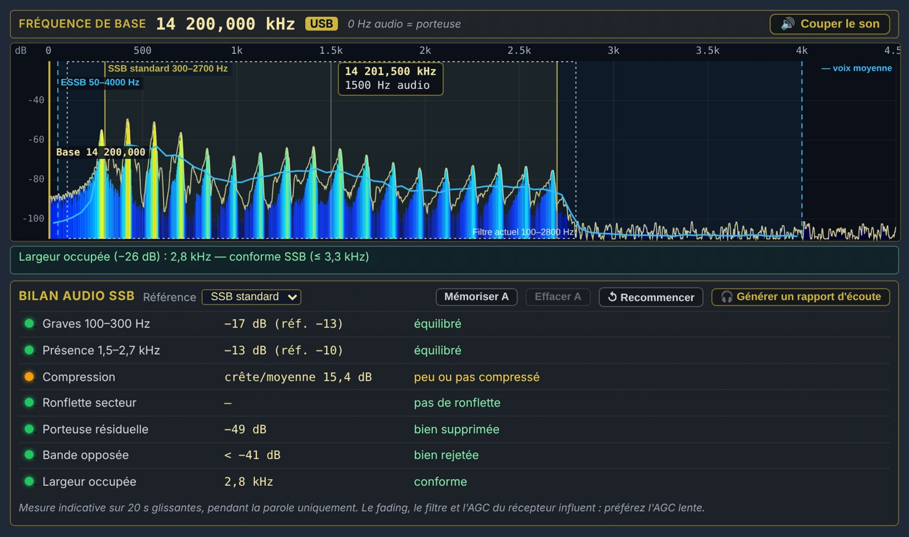
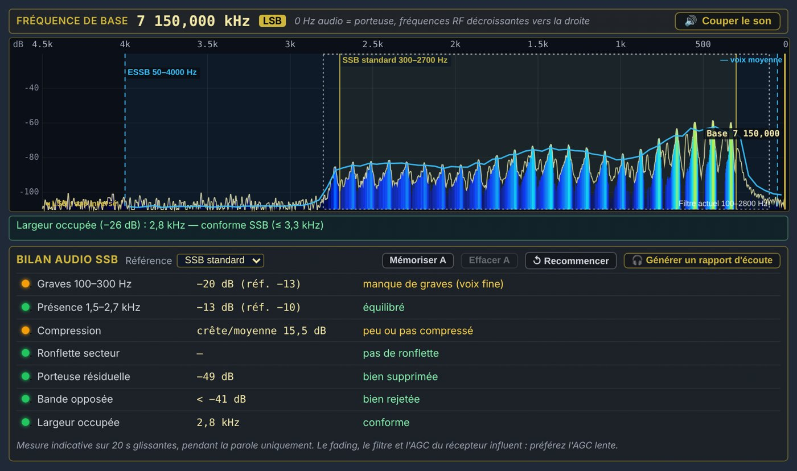
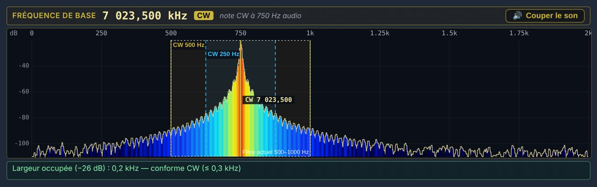
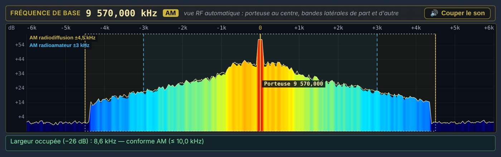
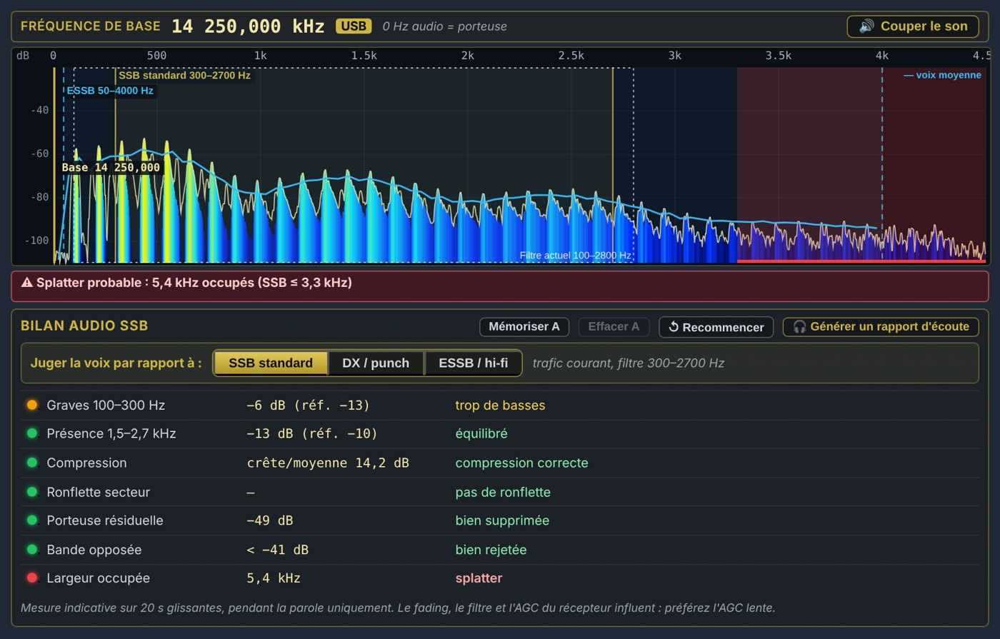
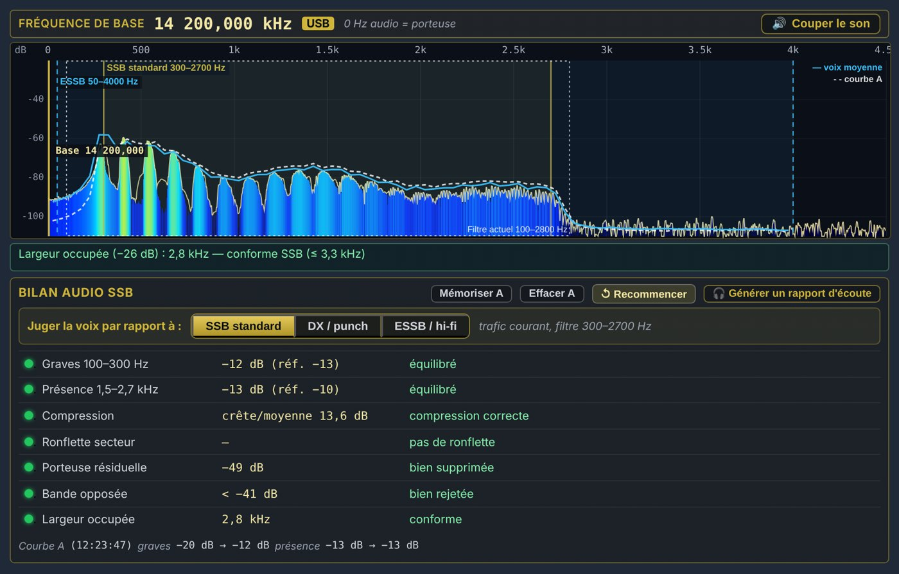
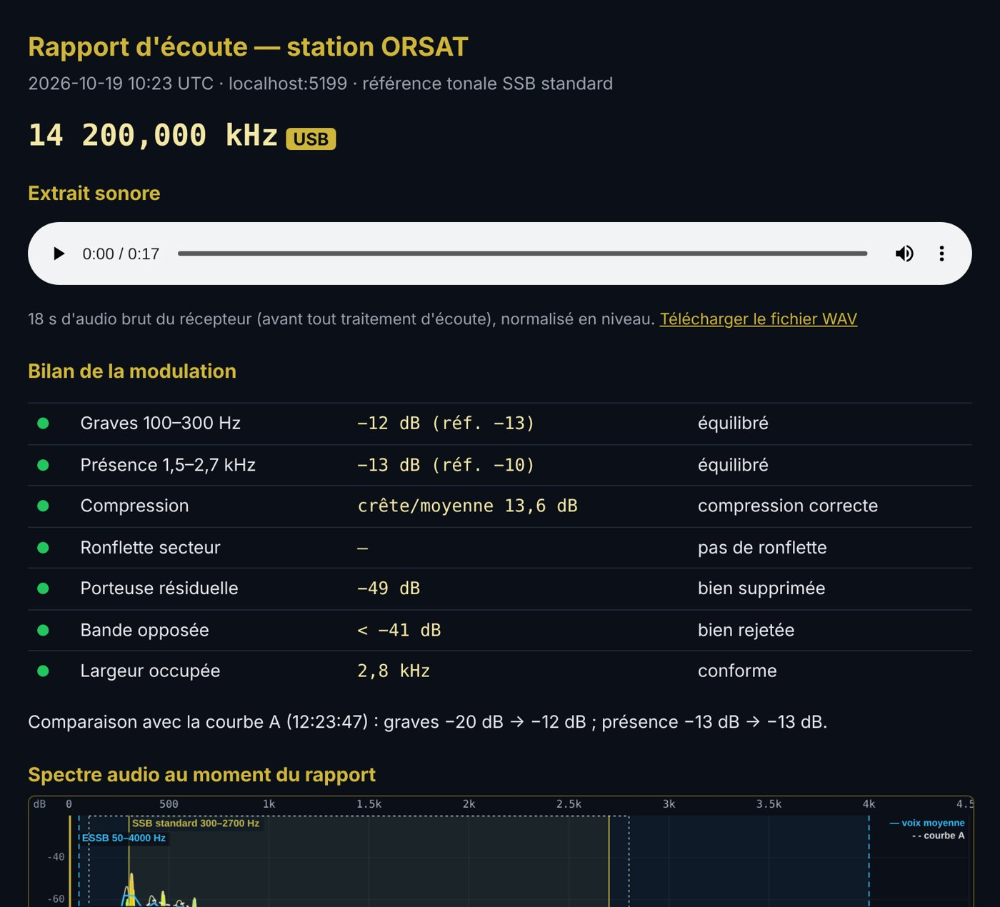

# 1. Overview

The **audio analyser** shows and measures the signal of the station you are listening to. It has two jobs:

- **seeing** the signal: audio spectrum, base frequency, bandwidth, receiver filter;
- **judging** an SSB modulation: a measured report, criterion by criterion, with a plain-language verdict and a report to send to the other station.

It sits in the right-hand column of the interface, under the title **AUDIO ANALYSER**. The **📊 Show** button opens it above the panels, **📊 Hide** closes it. The **Gain** slider only sets the display height.

## 1.1 An analyser working on raw audio

The analyser receives the receiver's sound **before** all listening processing: mute, squelch, browser AGC, noise reduction, notch, equaliser. Two consequences:

- your listening settings do not distort the measurements: you judge the station, not your own listening comfort;
- the analyser **keeps working when the sound is muted**.

> [Note] The only processing that remains visible is the **receive filter**, applied by the server before the sound is sent. The analyser displays it and takes it into account.

## 1.2 A display that adapts to the mode

| Mode | What the analyser shows |
| USB, LSB | Audio spectrum, SSB and ESSB markers, full SSB audio report |
| CW | Audio spectrum centred on the 750 Hz note, CW bandwidth markers |
| AM, FM | RF view: carrier in the centre, sidebands on either side |

# 2. Quick start

1. Tune the station and choose the mode (USB or LSB for a full report).
2. In the right-hand column, click **📊 Show** under **AUDIO ANALYSER**.
3. The waterfall zooms in on the station by itself when it is too wide to measure (occupied bandwidth, carrier, opposite sideband); it does so again whenever you change station.
4. Let the station talk: the report verdicts appear after **3 seconds of voice**.
5. To send the result, click **🎧 Generate a listening report**.

> [Tip] To analyse **your own transmission**, listen to yourself on ORSAT and click **Mute** in the banner: nothing goes back into your microphone, and the analysis carries on.

# 3. The “Base frequency” banner

At the top of the analyser, a banner shows:

- the **base frequency**, the dial frequency, in large digits;
- the **mode** in a gold badge;
- a short explanation: “0 Hz audio = carrier” in USB, the reversed axis in LSB, the 750 Hz note in CW, the RF view in AM and FM.

On the right, the **🔊 Mute** button mutes the receiver. It turns red, **🔇 Muted**, while the sound is off. It is the same setting as the receiver's mute button: the two stay in step. If the sound was muted from this button, it **comes back automatically when the analyser is closed**.

# 4. Reading the spectrum in USB

{w=482}

- **Horizontal axis**: audio frequency, 0 to 4.5 kHz. **Vertical axis**: level in dB.
- **Coloured fill**: the instantaneous spectrum. **Light line**: the peak hold, which falls back slowly.
- **Gold “Base” line**: the base frequency, at 0 Hz audio, i.e. the station's suppressed carrier.
- **Markers**: **standard SSB 300–2700 Hz** (gold) and **ESSB 50–4000 Hz** (blue, dashed).
- **White dotted box**: the receiver's **current filter**, with its edges shown at the bottom right.
- **Blue “average voice” curve**: the average shape of the voice over the last seconds, computed by the SSB report.
- **Mouse hover**: a bubble gives the **exact RF frequency** of the point and its audio frequency.

Under the spectrum, a line gives the measured **occupied bandwidth** and its verdict (see chapter 7).

# 5. LSB and CW

## 5.1 LSB: the axis is reversed

{w=482}

In LSB the voice lies below the carrier. So that the analyser reads the same way as the waterfall, the axis is **reversed**: the base frequency (0 Hz audio) is on the right and the treble on the left. Measurements and report are the same as in USB.

## 5.2 CW

{w=482}

In CW the axis runs from 0 to 2 kHz. The gold line marks the **750 Hz note**, which corresponds to the dial frequency. The **CW 500 Hz** and **CW 250 Hz** markers show the usual filters. The occupied bandwidth reveals **key clicks**: a clean CW signal stays under 300 Hz at −26 dB.

# 6. AM and FM: the RF view

{w=482}

In AM and FM the demodulated audio no longer contains the carrier. It moves to 0 Hz and both sidebands overlap. The analyser therefore switches **automatically** to an **RF view**, taken from the waterfall:

- **the carrier in the centre** (gold line), the sidebands to the left and right;
- an axis graduated in **offset from the carrier** (−6k … 0 … +6k) and a level in **dB above the noise**;
- symmetrical markers: AM broadcast **±4.5 kHz** and AM amateur **±3 kHz**, narrow FM **±5.5 kHz** (Carson bandwidth), wide FM **±100 kHz**;
- the current filter, symmetrical, and any splatter on both sides.

Displayed width: ±6 kHz in AM, ±8 kHz in FM, ±120 kHz in wide FM. Sideband symmetry and carrier level can be read at a glance.

> [Tip] The RF view needs a fine waterfall: at least 50 points across the displayed width, i.e. 240 Hz per point at most in AM. Otherwise the analyser shows “Zoom in on the station in the waterfall for the RF view”.

# 7. Occupied bandwidth and splatter

{w=482}

The analyser measures the station's **occupied bandwidth** on the waterfall: the width over which its spectrum exceeds the level 26 dB below its peak (the usual method in transmission standards). The measurement:

- covers 6 seconds and keeps a width that 80 % of the measurements do not exceed: an isolated peak does not count;
- ignores traces raised by a **static crash**;
- waits for 2 seconds of measurements before giving a verdict.

| Mode | Compliant | A little wide | Probable splatter |
| SSB | up to 3.3 kHz | up to 5 kHz | above 5 kHz |
| AM | up to 10 kHz | up to 12 kHz | above 12 kHz |
| CW | up to 0.3 kHz | up to 0.6 kHz | above (key clicks) |

On the spectrum, the part that overflows is tinted **amber** (a little wide) or **red** (splatter).

# 8. The SSB audio report

In USB and LSB, the **SSB AUDIO REPORT** box analyses the modulation over the **last 20 seconds**, and **only while the station is talking**. Verdicts appear after 3 s of voice. Each line has a light: **green** (good), **amber** (to watch), **red** (fault), **grey** (cannot be measured, with the reason).

## 8.1 The criteria

| Criterion | What is measured | Green | Amber | Red |
| Bass 100–300 Hz | Bass energy relative to the midrange (300–1500 Hz), compared with the reference | within 4 dB | within 8 dB | beyond |
| Presence 1.5–2.7 kHz | Presence energy relative to the midrange | within 4 dB | within 8 dB | beyond |
| Compression | Peak-to-average ratio of the voice | 10 to 15 dB | above 15 dB | below 10 dB |
| Mains hum | Stable lines at 50/100/150 Hz or 60/120/180 Hz | none | — | detected |
| Residual carrier | Carrier level below the voice peaks | ≥ 40 dB | 30 to 40 dB | < 30 dB |
| Opposite sideband | Energy in the other sideband | ≥ 40 dB | 30 to 40 dB | < 30 dB |
| Occupied bandwidth | Chapter 7 measurement | compliant | a little wide | splatter |

**How to read the verdicts:**

- **Bass**: “too much bass” gives a boomy voice and wastes power; “lacks bass” gives a thin voice.
- **Presence**: “lacks presence” gives a muffled voice, hard to copy in DX; “too much treble” gives a harsh voice.
- **Compression**: “little or no compression” is natural but punches less; “heavily compressed, probable clipping” points to a compressor pushed too far, often with background noise pumping up in the pauses.
- **Hum**: a grounding or power supply fault at the other station.
- **Residual carrier** and **opposite sideband**: measured on the waterfall, because the receive filter hides them in the audio. A value preceded by “<” means the defect is below the noise: you only know it is at least as good as the value shown. If the other sideband is occupied by another station, the analyser reports it (QRM) instead of blaming the other operator.

## 8.2 The tonal reference

The row of buttons **Judge the voice against:**, at the top of the report, chooses the tonal curve the voice is compared with; the gold button is the active reference:

| Reference | Bass / mid | Presence / mid | Intended use |
| Standard SSB | −13 dB | −10 dB | Everyday operating, 300–2700 Hz filter |
| DX / punch | −16 dB | −6 dB | Boosted presence to cut through the noise |
| ESSB / hi-fi | −3 dB | −12 dB | Wideband, bass kept |

The same setting can therefore be “balanced” for ESSB and have “too much bass” for DX: choose the reference that matches what the other operator is trying to do.

**Wider filter for ESSB.** With the usual SSB filter (2.7 kHz), everything an ESSB station transmits above it would be cut before analysis. Choosing the **ESSB / hi-fi** reference therefore automatically widens the IF filter to **50–4,000 Hz**; the original filter comes back as soon as another reference is chosen or the analyser is closed. The occupied-bandwidth measurement, taken on the waterfall, is not affected: when it reports “wide (ESSB?)”, that is the moment to switch to ESSB.

## 8.3 Static crashes

Static crashes (very short, with a flat spectrum) are detected and **discarded** from the report. The bass and presence ratios are also computed as a **median**: a crash that slipped through does not shift the result. When more than 10 % of the measurements are discarded, the bottom line shows “Static crashes rejected: xx %”.

# 9. Comparing before and after: curve A

{w=482}

To help another operator adjust their audio:

1. Let them talk for a few seconds, then click **Store A**: the average voice curve is frozen as a **white dotted line**.
2. They change their equaliser or compressor. Click **↺ Restart** to start from a fresh measurement.
3. The new blue curve is drawn over curve A. The bottom line shows the change, for example “bass −21 dB → −12 dB”.

Curve A is aligned on the current midrange level: fading changes the level, not the shape. **Clear A** removes it.

# 10. The listening report

{w=420}

The **🎧 Generate a listening report** button downloads a self-contained HTML file, for example “Rapport-ORSAT-14200,000kHz-USB-20261019-0934.html”. It opens in any browser, offline, and can be sent by e-mail. It contains:

- the frequency, mode, UTC date and time, and tonal reference;
- an **audio player** with the **last 20 seconds** of the receiver's raw audio, level-normalised, and a link to download that audio as WAV;
- the table of verdicts with their lights;
- the comparison with curve A, if there is one;
- an **image of the spectrum** at the time of the report.

> [Note] The file is about 1 MB. The clip is taken from the raw audio: what the other operator hears does not depend on your listening settings. The report itself is written in French.

# 11. Tips for reliable measurements

- **Keep the waterfall zoomed** on the station: occupied bandwidth, carrier, opposite sideband and the RF view all depend on it. The analyser zooms in by itself in SSB, CW and AM; if you zoom out, it only zooms in again when you change station.
- **Open the receive filter**: to judge the bass it must go down to about 120 Hz; for presence, up to about 2.6 kHz. A 100–2800 Hz filter is fine.
- **Prefer a station with more than 15 dB signal-to-noise ratio**. Below that, the report shows “Weak signal: reduced reliability”.
- **Selective fading** distorts the spectrum from moment to moment: the 20 s average reduces it, but a report taken during heavy fading remains indicative.
- **Compare like with like**: same tonal reference, same filter, same waterfall zoom.

# 12. Messages and troubleshooting

| Message | Meaning and remedy |
| Waiting for modulation… | Less than 3 s of voice analysed: let the station talk. |
| Zoom in on the station in the waterfall… | The waterfall is too wide to measure: zoom in on the station. |
| cannot be measured: the RX filter cuts… | The receive filter hides the measured area: widen it. |
| occupied by another station (QRM) | The opposite sideband contains another signal: measurement impossible. |
| Weak signal: reduced reliability | Signal-to-noise ratio below 15 dB. |
| Static crashes rejected: xx % | The band is crackling: the report rests on less voice. |
| No audio clip (report) | The analyser had not been open long enough: wait a few seconds. |
