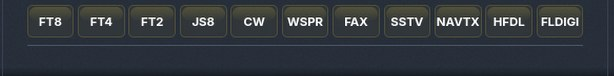
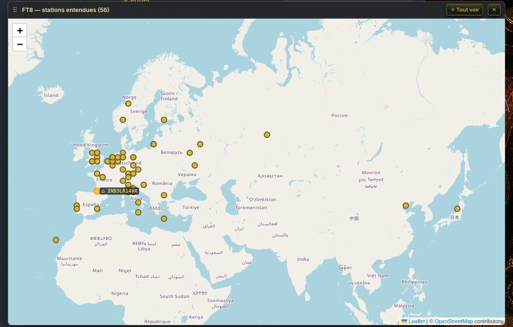
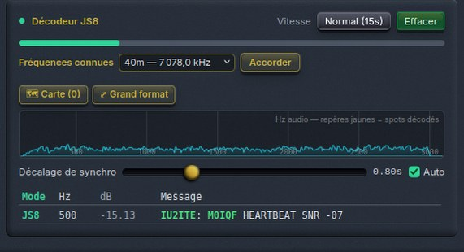
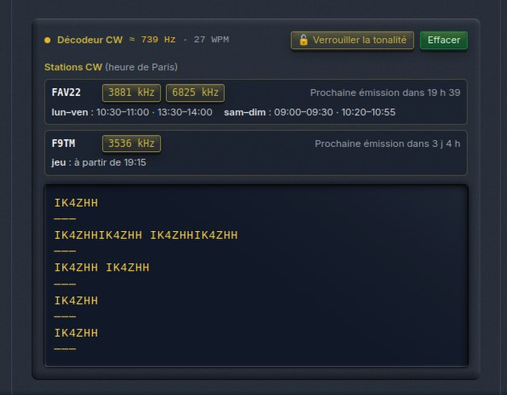
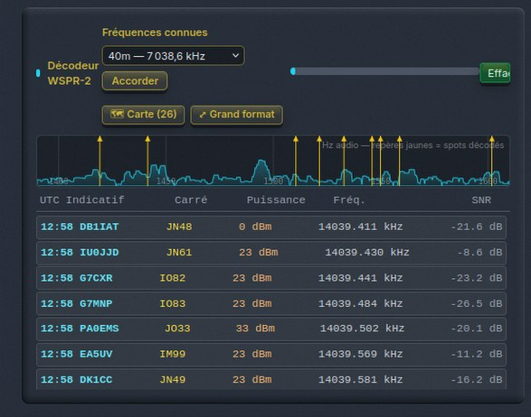
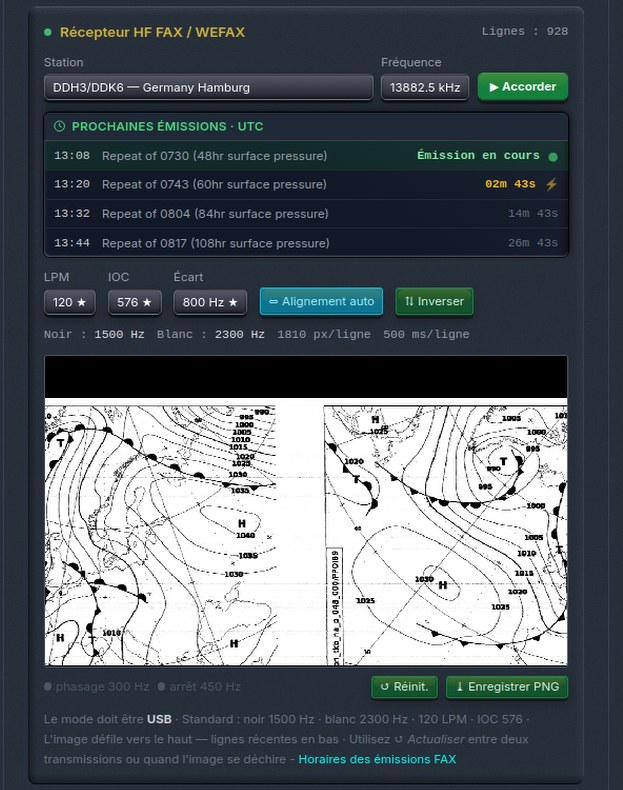
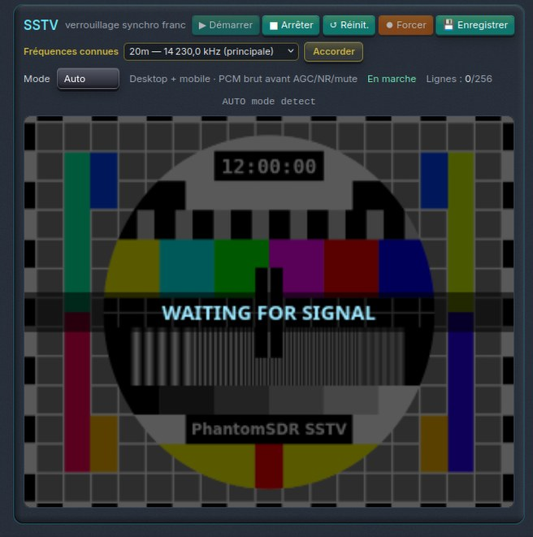
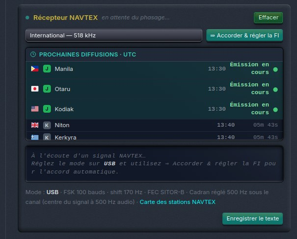

# 1. Principios comunes

## 1.1 Dónde están los decodificadores

Todos los decodificadores están agrupados en la fila **Control de decodificadores**, en la columna central, bajo la recepción en diversidad. Cada botón inicia un decodificador; un segundo clic en el mismo botón lo detiene. **Solo funciona un decodificador a la vez**: iniciar otro detiene el anterior.

{w=380}

| Botón | Decodificador | Capítulo |
| FT8 / FT4 / FT2 | Modos WSJT de señal débil | 2 |
| JS8 | JS8Call | 3 |
| CW | Telegrafía Morse | 4 |
| WSPR | Balizas WSPR-2 | 5 |
| FAX | Facsímil meteorológico HF (WEFAX) | 6 |
| SSTV | Televisión de barrido lento | 7 |
| NAVTX | NAVTEX (avisos a los navegantes) | 8 |
| HFDL | HF Data Link (aviación) | 9 |
| FLDIGI | Familia fldigi: RTTY, SITOR, PSK31, Olivia, MFSK… | 10 |

Los modos de voz digital **RADE (FreeDV)** no están en esta fila: tienen sus propios botones **RADEL / RADEU** en el selector de modos (capítulo 11).

## 1.2 Qué hace un decodificador al arrancar

Un decodificador no se limita a escuchar el audio: **toma el control del receptor** para situarse en las condiciones adecuadas.

- **Modo de demodulación** — FT8, FT4, FT2, JS8 y WSPR pasan el receptor a **USB**, sea cual sea el modo habitual de la banda. FAX y NAVTEX también trabajan en USB. SSTV elige la banda lateral habitual (ver capítulo 7).
- **Filtro FI** — el ancho de banda se ajusta al del modo: toda la subbanda de 3 kHz para FT8/FT4/FT2/JS8, la ventana estrecha de las balizas para WSPR.
- **Vuelta a la normalidad** — al detener el decodificador, el receptor recupera el **modo por defecto de la banda** (LSB, CW, AM…).
- **Análisis automático** — si el módulo «Análisis de señales digitales» estaba en marcha, se detiene: ya ha cumplido su papel, que era ayudar a elegir un decodificador.

> [Consejo] Los decodificadores trabajan con el audio **bruto** del receptor, antes de la reducción de ruido, el AGC de audio y el volumen. Silenciar el audio o bajar el volumen no impide decodificar.

## 1.3 Herramientas compartidas

**Frecuencias conocidas.** Los paneles FT8/FT4, JS8, WSPR y SSTV ofrecen un menú **Frecuencias conocidas**: elegir una banda sintoniza directamente el receptor en la frecuencia «dial» habitual del modo. FAX, NAVTEX, HFDL y FLDIGI tienen sus propias listas de estaciones, descritas en sus capítulos.

**Mapa de estaciones.** FT8/FT4/FT2, JS8 y WSPR tienen un botón **🗺 Mapa (n)**: cada estación cuyo mensaje contiene un locator aparece en él. **⤢ Gran formato** abre el mapa en una ventana flotante, que se puede mover y redimensionar. Al pasar sobre un punto se ven el indicativo y el mensaje; un clic abre la ficha QRZ de la estación.

{w=380}

**Espectro de audio del decodificador.** FT8/FT4/FT2, JS8 y WSPR muestran bajo sus ajustes una **cascada de audio** del ancho de banda: se ven llegar las señales y cada decodificación queda marcada.

**Sincronización horaria.** Los modos de intervalos fijos (FT8, FT4, FT2, JS8, WSPR) dependen de la hora UTC. ORSAT compensa el retardo del flujo de audio entre el servidor y su navegador con el ajuste **Desfase de sincronización** (sección 2.4).

# 2. FT8, FT4 y FT2

## 2.1 Los tres modos

Estos tres modos de la familia WSJT-X transmiten mensajes cortos normalizados (indicativos, locator, reporte) con una sensibilidad muy alta. Funcionan por **intervalos** sincronizados con la hora UTC.

| Modo | Duración del intervalo | Uso |
| FT8 | 15 s | El más extendido: DX, propagación, tráfico habitual |
| FT4 | 7,5 s | Más rápido, sobre todo en concursos |
| FT2 | 3,75 s | Variante muy rápida, aún poco usada |

## 2.2 Puesta en marcha

1. Haga clic en **FT8**, **FT4** o **FT2**.
2. En **Frecuencias conocidas**, elija una banda (FT8 y FT4; FT2 aún no tiene lista). El receptor se sintoniza en USB.
3. Espere al final del intervalo en curso: las primeras decodificaciones aparecen al cabo de 15 s (FT8), 7,5 s (FT4) o 3,75 s (FT2).

| Banda | FT8 (kHz) | FT4 (kHz) |
| 160 m | 1 840,0 | — |
| 80 m | 3 573,0 | 3 575,0 |
| 60 m | 5 357,0 | — |
| 40 m | 7 074,0 | 7 047,5 |
| 30 m | 10 136,0 | 10 140,0 |
| 20 m | 14 074,0 | 14 080,0 |
| 17 m | 18 100,0 | 18 104,0 |
| 15 m | 21 074,0 | 21 140,0 |
| 12 m | 24 915,0 | 24 919,0 |
| 10 m | 28 074,0 | 28 180,0 |
| 6 m | 50 313,0 | 50 318,0 |

## 2.3 Leer el panel

{w=375}

- **Más lejano** — distancia de la estación más lejana escuchada desde el inicio de la sesión.
- **Forma de onda de audio** — las marcas señalan cada señal decodificada dentro del ancho de banda.
- **Tabla de mensajes** — una línea por decodificación:

| Columna | Contenido |
| Mode | FT8, FT4 o FT2 |
| dB | Relación señal/ruido estimada (una señal a −20 dB aún se decodifica) |
| Hz | Frecuencia de audio de la señal dentro del ancho de banda |
| DT | Desfase de sincronización, en segundos |
| Message | El texto: CQ F1ABC JN03, F1ABC DL1XYZ -12, RR73… |
| Locator / Dist | Locator Maidenhead de la estación y distancia estimada desde ORSAT |

## 2.4 Desfase de sincronización y Auto

El audio tarda un poco en llegarle. **Desfase de sincronización** retrasa el inicio de la captura tras el comienzo del intervalo UTC para compensar ese retardo (valor indicado en segundos).

- **Auto** marcado (recomendado) — ORSAT ajusta él mismo el desfase a partir de los valores **DT** medidos por el decodificador.
- **Auto** desmarcado — ajuste el cursor a mano: si la mayoría de los DT son claramente positivos o negativos, desplácelo en el mismo sentido.

> [Consejo] Unos DT cercanos a 0 (entre −0,5 y +0,5 s) indican una sincronización correcta. Unos DT dispersos más allá de ±1 s hacen perder decodificaciones.

# 3. JS8 (JS8Call)

## 3.1 El modo

JS8 retoma la modulación de FT8 pero transporta **texto libre**: mensajería por teclado, retransmisión entre estaciones, balizas de presencia. Un mensaje largo se divide en varias tramas.

## 3.2 Ajustes

- **Velocidad** — la velocidad JS8 escuchada. Todas las estaciones de un QSO usan la misma; **Normal** es la velocidad de llamada habitual.

| Velocidad | Intervalo |
| Normal | 15 s |
| Fast | 10 s |
| Turbo | 6 s |
| Slow | 30 s |
| Ultra | 4 s |

- **Frecuencias conocidas** — 160 m 1 842,0 · 80 m 3 578,0 · 40 m 7 078,0 · 30 m 10 130,0 · 20 m 14 078,0 · 17 m 18 104,0 · 15 m 21 078,0 · 12 m 24 922,0 · 10 m 28 078,0 kHz.
- **Barra de progreso** — avance del intervalo en curso.
- **Desfase de sincronización / Auto** — como en FT8 (sección 2.4).
- **Borrar** — borra los mensajes.

{w=375}

## 3.3 Leer los mensajes

Cada línea muestra el modo, la SNR y el mensaje, con el **indicativo del emisor resaltado**. Un mensaje en recepción se muestra **a medida que llega**, seguido de un cursor ▌, antes de completarse con las tramas siguientes. Si la última trama no llega, la línea lo indica (tiempo agotado).

> [Consejo] «Escuchando el ciclo Normal…» indica que el decodificador espera. En una banda tranquila pueden pasar varios minutos antes del primer mensaje.

# 4. CW (telegrafía Morse)

## 4.1 Funcionamiento

El decodificador CW **encuentra solo el tono** de la señal dentro del ancho de banda y **mide solo la velocidad**. Sigue velocidades de unas **5 a 65 palabras por minuto**.

- **≈ … Hz** — frecuencia de audio de la nota decodificada.
- **· … WPM** — velocidad medida.
- **buscando…** — todavía no se ha enganchado ninguna nota.
- **🔓 Bloquear tono** — fija el decodificador en la nota actual: ya no va a buscar otra señal cercana. Un nuevo clic lo libera.
- El texto se escribe de forma continua; una línea **───** marca un silencio (fin de emisión).
- **Borrar** borra el texto.

{w=375}

## 4.2 Ajustar bien la recepción

1. Escuche en modo **CW** con un filtro estrecho (300 a 500 Hz).
2. Deje **una sola señal** en el ancho de banda: dos notas simultáneas hacen perder la sincronización.
3. Espere unos caracteres, el tiempo de medir la velocidad.

## 4.3 Estaciones CW regulares

Bajo el texto decodificado, una tabla recuerda las **emisiones CW programadas** (hora de París, con el cambio de hora tenido en cuenta), con un botón para sintonizarlas directamente:

| Estación | Frecuencias | Horarios |
| FAV22 (Marina francesa) | 3 881 y 6 825 kHz | entre semana 10:30–11:00 y 13:30–14:00; fin de semana 09:00–09:30 y 10:20–10:55 |
| F9TM | 3 536 kHz | jueves a partir de las 19:15 |

> [Consejo] Las emisiones de FAV22 son ideales para practicar: velocidad regular y texto bien formado.

# 5. WSPR

## 5.1 El modo

WSPR («whisper») es un modo de **balizas de muy baja potencia** que sirve para estudiar la propagación. Cada emisión dura casi 2 minutos y empieza al inicio de un **minuto UTC par**. El decodificador de ORSAT recibe el WSPR-2 clásico.

## 5.2 Puesta en marcha

1. Haga clic en **WSPR**.
2. Elija una banda en **Frecuencias conocidas**:

| Banda | kHz | Banda | kHz |
| 2200 m | 136,0 | 30 m | 10 138,7 |
| 630 m | 474,2 | 20 m | 14 095,6 |
| 160 m | 1 836,6 | 17 m | 18 104,6 |
| 80 m | 3 568,6 | 15 m | 21 094,6 |
| 80 m EU | 3 592,6 | 12 m | 24 924,6 |
| 60 m | 5 287,2 | 10 m | 28 124,6 |
| 40 m | 7 038,6 | | |

3. Espere: «Esperando el próximo intervalo UTC de minuto par…» se muestra hasta el inicio del siguiente intervalo; luego la barra de progreso avanza durante la recepción. Los resultados llegan **al final** del intervalo.

## 5.3 Leer la tabla

{w=375}

- **UTC** — hora del intervalo;
- **Indicativo** y **Cuadrícula** — indicativo y locator de la baliza;
- **Potencia** — potencia declarada (en dBm: 37 dBm = 5 W, 30 dBm = 1 W, 23 dBm = 200 mW);
- **Frec.** — frecuencia exacta de la baliza;
- **SNR** — relación señal/ruido (WSPR decodifica hasta unos −28 dB).

> [Consejo] Los botones **WSPR log** y **WSPR map** del apartado «Enlaces externos» del menú Información muestran en los sitios de referencia las balizas recibidas por ORSAT.

# 6. FAX (facsímil meteorológico HF)

## 6.1 El modo

Las estaciones meteorológicas y militares difunden **mapas meteorológicos** (análisis, previsiones, estado del mar, hielos) por facsímil radio. Cada imagen va precedida de una señal de arranque y de fase, y termina con una señal de parada.

## 6.2 Elegir una estación

- **Estación** — elija una estación de la lista, luego una **Frecuencia**, y haga clic en **▶ Sintonizar**.

| Estación | Frecuencias (kHz) |
| GYA — Northwood (Reino Unido) | 2 618,5 · 4 610 · 8 040 · 11 086,5 |
| DDH3 / DDK6 — Hamburgo (Alemania) | 3 855 · 7 880 · 13 882,5 |
| SVJ4 — Atenas (Grecia) | 4 482,9 · 8 106,9 |
| RBW41 — Múrmansk (Rusia) | 5 336 · 6 445,5 · 7 908,8 · 8 444 · 10 130 |
| HLL2 — Seúl (Corea del Sur) | 3 585 · 5 857,5 · 7 433,5 · 9 165 · 13 570 |
| JMH — Tokio (Japón) | 3 622,5 · 7 795 · 13 988,5 |
| JFX — Kagoshima (Japón) | 4 274 · 8 658 · 13 074 · 16 907,5 · 22 559,6 |

- **Próximas emisiones · UTC** — las próximas emisiones de la estación elegida, con cuenta atrás. Una emisión **en curso** se marca en verde (●), una emisión **inminente** en rojo. El enlace **Horarios de emisiones FAX** abre los horarios completos.

## 6.3 Ajustes de la imagen

| Ajuste | Valores | Por defecto |
| LPM (líneas por minuto) | 100 · 120 · 240 | 120 |
| IOC (índice de cooperación) | 288 · 576 | 576 |
| Desplazamiento (negro/blanco) | 400 Hz · 800 Hz | 800 Hz |

Los valores marcados con ★ en los menús son la norma; casi todas las estaciones la usan. La línea de información recuerda las frecuencias del **negro** (1 500 Hz) y del **blanco** (2 300 Hz), la resolución en píxeles por línea y la duración de una línea.

- **⇔ Alineación auto** — alinea automáticamente las líneas con los impulsos de sincronización: la imagen deja de inclinarse.
- **⇅ Invertir** — invierte el negro y el blanco (recepción en LSB o estación con polaridad invertida).

## 6.4 Durante la recepción

{w=375}

- Los pilotos **fase 300 Hz** y **parada 450 Hz** se encienden durante la fase y la señal de parada; la cabecera muestra **[PHASING]**, **[STOP]** y el número de líneas recibidas (**Líneas**).
- La imagen se construye línea a línea, **las más recientes abajo**.
- **↺ Reiniciar** borra la imagen y reinicia el decodificador: úselo entre dos emisiones o si la imagen se rompe.
- **⤓ Guardar PNG** guarda la imagen.

> [Consejo] Inicie el decodificador uno o dos minutos antes de la hora prevista: captará la fase y la imagen empezará bien alineada.

# 7. SSTV (televisión de barrido lento)

## 7.1 El modo

Los radioaficionados intercambian **imágenes fijas** en SSTV; la Estación Espacial Internacional también las emite durante eventos puntuales. Una imagen tarda de 36 segundos a varios minutos según el modo.

## 7.2 Banda lateral

Por convención, la SSTV se practica en **LSB en 80 y 40 m** y en **USB a partir de 30 m**. Al arrancar, el decodificador elige la banda lateral correspondiente. Si una estación no sigue la convención, cambie la banda lateral a mano: ORSAT respeta su elección. En la banda lateral equivocada no se decodifica nada.

## 7.3 Ajustes

- **Frecuencias conocidas** — 80 m 3 730,0 (Europa) y 3 845,0 (Américas) · 40 m 7 171,0 · 20 m 14 230,0 (principal) y 14 233,0 · 17 m 18 160,0 · 15 m 21 340,0 · 12 m 24 975,0 · 10 m 28 680,0 kHz.
- **Modo** — **Auto** (recomendado) reconoce el modo gracias a la cabecera VIS enviada al inicio de cada imagen. También se puede imponer: Martin M1, Martin M2, Scottie S1, Scottie S2, Scottie DX, Robot 36, Robot 72.
- **▶ Iniciar** / **■ Detener** — inicia o detiene la recepción.
- **↺ Reiniciar** — borra la imagen.
- **⏺ Forzar** — inicia la decodificación de inmediato en el modo elegido, sin esperar la cabecera VIS. Útil cuando se llega en mitad de una imagen. No funciona en modo Auto.
- **💾 Guardar** — guarda la imagen.

## 7.4 Indicadores

{w=375}

- **[modo detectado]** — por ejemplo [Martin M1].
- **sincronía firme** — sincronización franca con los impulsos de línea; **sincronía suave** — sincronización mantenida a pesar de una señal débil.
- **En marcha / Detenido** y **Líneas** — estado y número de líneas recibidas sobre el total de la imagen.

> [Consejo] Una imagen inclinada se debe a una mala sincronización; una imagen con colores falsos, a un modo o una banda lateral equivocados.

# 8. NAVTEX

## 8.1 El modo

El NAVTEX difunde a los barcos los **avisos a los navegantes**, la meteorología marina y las alertas de socorro. Cada estación costera tiene una **letra de identificación** (A a Z) e intervalos de emisión de 10 minutos, repetidos cada 4 horas. Transmisión: FSK de 100 baudios, desplazamiento de 170 Hz, código SITOR-B.

- **518 kHz** — NAVTEX internacional, en inglés;
- **490 kHz** — NAVTEX nacional, en el idioma del país.

## 8.2 Puesta en marcha

1. Haga clic en **NAVTX**: el receptor pasa a USB.
2. Elija una estación y haga clic en **⇒ Sintonizar y ajustar FI**: el receptor se sintoniza 500 Hz por debajo del canal (la señal cae a 500 Hz de audio) y el filtro FI se ajusta.
3. La cabecera indica «esperando la fase…» hasta que empieza una emisión.

## 8.3 La tabla de difusiones

{w=375}

**Próximas difusiones · UTC** lista las estaciones en el orden de sus próximas emisiones: bandera, letra de identificación, nombre, zona, hora UTC y cuenta atrás. La estación **que está emitiendo** se marca en verde, la siguiente en rojo cuando es inminente.

- Un botón permite **armar el decodificador de inmediato**, sin esperar la fase.
- **Mapa de estaciones NAVTEX** abre el mapa de las estaciones.
- **Borrar** y **Guardar texto** borran o guardan el texto recibido.

> [Consejo] De noche, los 518 kHz llegan lejos: se captan con regularidad estaciones de toda Europa occidental y del Mediterráneo.

# 9. HFDL (HF Data Link)

## 9.1 El modo

Los aviones que vuelan sobre los océanos intercambian mensajes **ACARS** con estaciones de tierra HF repartidas por el mundo. El decodificador de ORSAT es **dumphfdl**, compilado para funcionar en su navegador.

## 9.2 Ajustes y lectura

{w=204,side}
- **Estación de tierra HFDL** — Shannon, Reykjavik, Canarias, Riverhead, Johannesburg… luego una de sus frecuencias, y sintonice: el filtro FI se ajusta a la vez.
- **Dial** — indica si está fuera de una frecuencia HFDL.
- **Ruido**, **Tramas**, **Ritmo** — calidad de la recepción.
- **Mensajes** y **Squitters** — contadores; marque **Squitters** para mostrar también las balizas de las estaciones de tierra.
- Pase el ratón sobre un mensaje para ver la trama completa; los botones de guardar y borrar gestionan el registro.

**Identificadores clicables.** El **número de vuelo**, la **matrícula** y el **código ICAO** del avión abren su ficha FlightAware en una pestaña nueva.

**Mapa de los aviones.** **🗺 Mapa** muestra los aviones de los que se ha recibido una posición; **⤢ Gran formato** lo abre en una ventana flotante; **⌖ Ver todo** encuadra todos los aviones. Cada avión se dibuja orientado según su rumbo, con su traza en rojo; un clic abre su ficha FlightAware.

> [Consejo] Las estaciones de tierra emiten un squitter cada 32 s. Elija una frecuencia con propagación abierta hacia la estación y espere unos minutos: solo algunos mensajes contienen una posición.

# 10. FLDIGI: RTTY, SITOR, PSK, Olivia y los demás

## 10.1 Un decodificador, catorce variantes

El botón **FLDIGI** abre un decodificador único que reúne los modos del programa fldigi. El menú **Variante** elige la familia; el título del panel cambia en consecuencia (FSK / RTTY, PSK31, Olivia, Packet, APRS…).

| Variante | Uso |
| Maritime FSK / SITOR | NAVTEX, avisos marítimos SITOR, NBDP |
| Weather RTTY | Boletines meteorológicos en RTTY (DWD) |
| Amateur RTTY | RTTY de radioaficionado |
| PSK31 (BPSK) | Conversación por teclado de radioaficionado |
| Olivia | Texto muy robusto en condiciones difíciles |
| MFSK16 · 32 · 64 | Texto robusto, buena resistencia al desvanecimiento |
| DominoEX | Texto, resiste la deriva y los multitrayectos |
| THOR | DominoEX con corrección de errores |
| THROB / THROBX | Modo lento de tonos múltiples |
| Hellschreiber | Texto transmitido como una imagen (facsímil de caracteres) |
| MT63 | Modo ancho y muy robusto, usado a menudo en emergencias |
| Packet (AX.25) | Tráfico packet radio |
| APRS | Posiciones y mensajes APRS |

> [Consejo] Mientras funciona, este decodificador toma el control del modo y del filtro FI. Elija primero una frecuencia conocida y luego afine la sintonía hasta que el texto se estabilice.

## 10.2 Los mandos comunes

{w=204,side}
- **Frecuencia conocida** y luego **Sintonizar** — sintoniza una frecuencia de referencia de la variante.
- **Próximas difusiones · UTC** — horarios de las difusiones para las variantes que los tienen (estaciones NAVTEX, DWD).
- **⇒ Ajustar pasabanda FI** — ajusta el filtro FI al ancho del modo.
- **⟳ Centrado auto** — busca la señal y centra el decodificador en ella.
- **Borrar** — borra el texto; un botón permite **guardar el texto**.
- La cabecera muestra el estado del decodificador; «esperando enganche…» mientras no se engancha ninguna señal.

## 10.3 RTTY y SITOR (FSK)

Las tres variantes FSK comparten los mismos ajustes:

- **Centro de audio (Hz)** — frecuencia de audio del centro de la señal.
- **Desplazamiento (Hz)** — separación entre los tonos mark y space.
- **Baud** — velocidad.
- **Trama** — 5N1, 5N1.5, 5N2, 7N1, 7E1, 7O1, 8N1.
- **Codificación** — CCIR-476 (SITOR), ITA2 / Baudot (RTTY), ASCII.
- **Invertir mark / space** — invierte los dos tonos.
- **Detección auto del desplazamiento** — mide el desplazamiento automáticamente.
- **Squelch (S/R)** — impide que se muestre el ruido. El ruido solo se lee hacia −12 a −15 dB; el RTTY sigue siendo legible hasta unos −4 dB. Cursor a la izquierda del todo: squelch desactivado («off»).

| Variante | Centro | Desplaz. | Baud | Código | Invertir |
| Maritime FSK / SITOR | 500 Hz | 170 Hz | 100 | CCIR-476, 7N1 | no |
| Weather RTTY | 1 000 Hz | 450 Hz | 50 | ITA2, 5N1.5 | **sí** |
| Amateur RTTY | 1 000 Hz | 170 Hz | 45,45 | ITA2, 5N1.5 | no |

Indicadores: **Mark** y **Space** (frecuencias medidas de los dos tonos), **Tonos**, **SNR**, enganche y temporización.

**Frecuencias conocidas:**

- *Maritime* — 518 kHz (NAVTEX internacional), 490 kHz (NAVTEX nacional), 2 174,5 kHz (NBDP), 4 209,5 kHz (NAVTEX HF), SITOR MSI en 4 210, 6 314, 8 416,5, 12 579, 16 806,5, 19 680,5, 22 376 y 26 100,5 kHz.
- *Weather* — DWD Pinneberg: 4 583 (DDK2), 7 646 (DDH7), 10 100,8 (DDK9), 11 039 (DDH9), 14 467,3 (DDH8) y 147,3 kHz (DDH47, en onda larga, desplazamiento de 85 Hz).
- *Amateur* — RTTY en 3 590, 7 043, 10 143, 14 083, 21 083 y 28 083 kHz.

> [Consejo] El RTTY meteorológico del DWD llega con el tono mark abajo: deje **Invertir mark / space** marcado. Para el RTTY de radioaficionado y el SITOR, déjelo desmarcado.

## 10.4 PSK31

- **Centro de audio** — sitúe el decodificador sobre la traza de la señal (un trazo fino de 31 Hz de ancho en la cascada), o use **⟳ Centrado auto**.
- Indicadores: **Portadora** (frecuencia de la portadora), **IMD** (calidad de la emisión: −25 dB o menos es limpia; por encima de −20 dB el emisor está saturado), **DCD** (● cuando se detecta una señal), **Audio** (nivel).
- Frecuencias conocidas: 3 580,15 · 7 040,15 · 10 142,15 · 14 070,15 · 18 100,15 · 21 080,15 · 24 920,15 · 28 120,15 kHz.

## 10.5 Olivia

- **Modo** — número de tonos / ancho: 8/250, 16/500, 32/1000, 16/1000. Debe ser el mismo que el de la estación escuchada.
- **Squelch (S/R FEC)** — por debajo de 3,5 el ruido empieza a mostrarse; una buena señal se lee entre 8 y 9.
- Frecuencias conocidas: 20 m 14 072,5 (8/250) y 14 108,5 (32/1000), 80 m 3 583, 40 m 7 040 y 7 072,5, 12 m 24 922,5, 10 m 28 122,5 kHz…

## 10.6 MFSK, DominoEX, THOR, THROB, Hellschreiber, MT63

Todos estos modos tienen dos ajustes: un **Modo** (submodo, que se elige igual que la estación escuchada) y un **Squelch** propio de cada familia. Los indicadores **Centro**, **Modo** y **Audio** siguen la recepción.

| Variante | Submodos | Por defecto |
| MFSK | MFSK16, MFSK32, MFSK64 | MFSK16 |
| DominoEX | Micro, 4, 5, 8, 11, 16, 22, 44, 88 | DominoEX 11 |
| THOR | Micro, 4, 5, 8, 11, 16, 22, 25 x4, 50 x1, 50 x2, 100 | THOR 16 |
| THROB | THROB 1, 2, 4 · THROBX 1, 2, 4 | THROB 2 |
| Hellschreiber | Feld Hell, Slow Hell, Hell X5, Hell X9, FSK Hell 245, FSK Hell 105, Hell 80 | Feld Hell |
| MT63 | 500, 1000, 2000 (entrelazado corto o largo) | MT63-1000 largo |

> [Consejo] En Hellschreiber el texto no se decodifica sino que se **dibuja**: se lee a ojo, como una cinta. Un texto en doble altura es normal.

## 10.7 Packet y APRS

- **Velocidad** — 1 200 baudios (VHF) o 300 baudios (HF); tonos 1 200 / 2 200 Hz en VHF.
- **Mostrar paquete bruto** — muestra también la trama AX.25 bruta.
- Indicadores: **Tramas** (tramas válidas recibidas), **Estaciones** (número de estaciones distintas), **DCD**, **Audio**.
- En APRS, las estaciones que envían una posición pueden **mostrarse en el mapa**.
- Frecuencias conocidas: 144,800 MHz (APRS Europa), 144,390 (Norteamérica), 145,175 (Australia), 144,640 (China), 144,660 (Japón), 145,825 MHz (digipeater de la ISS) y 10 147,6 kHz (APRS HF, 300 baudios).

> [Consejo] Las frecuencias VHF solo se pueden usar si el receptor de ORSAT cubre la banda de 2 m.

# 11. RADE (FreeDV, voz digital)

RADE v1 es el modo de voz digital de FreeDV, basado en una red neuronal. No se inicia desde la fila de decodificadores sino desde los botones **RADEL** (LSB, para 160, 80 y 40 m) y **RADEU** (USB, para 20, 17, 15 y 10 m) del selector de modos. La decodificación se hace **en el servidor**.

- Piloto **verde**: sincronizado, con la SNR; **amarillo**: buscando señal; **rojo**: servicio de decodificación del servidor inaccesible.
- Ancho de banda: 1 500 Hz; la voz se reconstruye con el vocoder FARGAN.
- **📡 FreeDV Reporter** muestra la lista de estaciones FreeDV activas en el mundo (qso.freedv.org).

# 12. Ayudas a la identificación

## 12.1 Análisis de señales digitales

El módulo, situado al principio de la fila de decodificadores, **intenta reconocer el modo** de la señal escuchada (FT8, WSPR, RTTY, PSK, Olivia, CW…) y propone el decodificador adecuado. Esta función es **experimental**.

{w=380}

- **Análisis automático: OFF / ON** — el modo suele reconocerse en unos quince segundos.
- **Medida actual** — ancho, separación entre tonos, velocidad, cadencia, relación señal/ruido.
- **Modos reconocidos, por relevancia** — **▶** abre el decodificador correspondiente (con sus ajustes), el icono **i** muestra la ficha del modo.
- **Recentrar y reintentar** — aparece cuando la señal está demasiado cerca del borde del filtro.

## 12.2 Identificar una señal (base Artemis)

El botón de la base de señales busca entre **583 señales de referencia** las que corresponden a la frecuencia, al ancho del filtro y a la demodulación actuales, clasificadas por porcentaje de coincidencia. Cada ficha ofrece un espectrograma, una **muestra de audio** para comparar, la modulación, el rango de frecuencias y un enlace al Signal Identification Wiki.

{w=440}

# 13. Resolución de problemas

| Síntoma | Causa probable | Remedio |
| Ninguna decodificación FT8 / FT4 / WSPR | Frecuencia errónea o banda cerrada | Use **Frecuencias conocidas**; compruebe en la cascada que hay señales |
| Pocas decodificaciones FT8, DT dispersos | Sincronización horaria | Marque **Auto** junto a Desfase de sincronización |
| CW ilegible | Varias señales en el filtro | Filtro CW estrecho, una sola señal |
| Imagen FAX inclinada | Sincronización de línea | **⇔ Alineación auto** |
| Imagen FAX en negativo | Polaridad | **⇅ Invertir** |
| SSTV: colores falsos o nada | Banda lateral o modo equivocados | Cambie de banda lateral; pruebe un modo impuesto y luego **⏺ Forzar** |
| NAVTEX mudo | Fuera del intervalo | Espere el intervalo de la estación (tabla de difusiones) |
| RTTY: caracteres aleatorios | Mark / space invertidos | Marque o desmarque **Invertir mark / space** |
| RTTY: no se muestra nada | Squelch demasiado alto | Baje el **Squelch** |
| PSK31 / Olivia: texto entrecortado | Decodificador descentrado | **⟳ Centrado auto** |
| HFDL: ningún mensaje | Propagación hacia la estación de tierra | Pruebe otra frecuencia u otra estación |
| RADE: piloto rojo | Servicio del servidor detenido | Avise al administrador de ORSAT |

> [Consejo] Con cualquier decodificador, compruebe primero de oído y en la cascada que hay realmente una señal y que está bien centrada: la mayoría de los fallos vienen de una sintonía aproximada.
