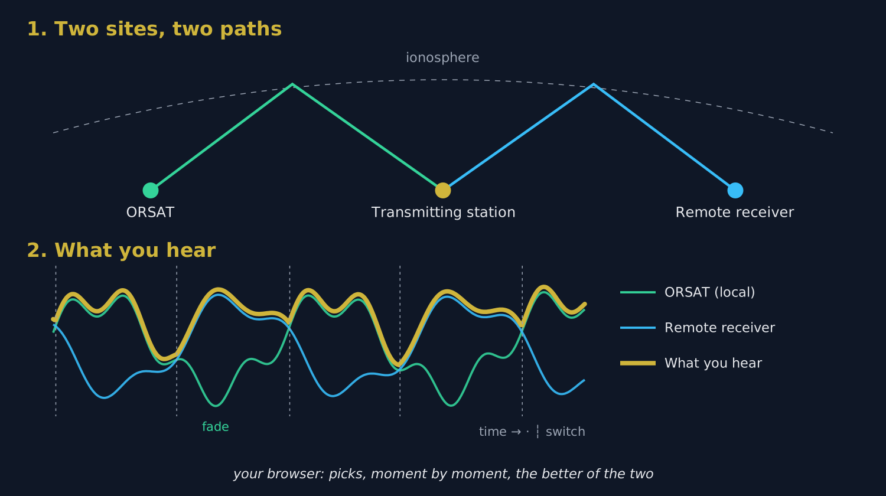
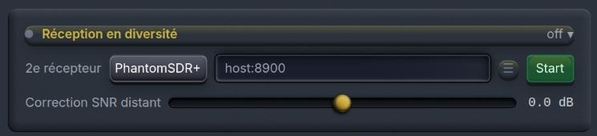

# 1. The problem: QSB

## 1.1 Why a signal fades

On shortwave, the signal of a distant station does not reach you in a straight line: it bounces off the **ionosphere**, a layer of the atmosphere that never stops moving. It often arrives by **several slightly different paths at once**. Those paths add up, sometimes reinforcing each other, sometimes cancelling out.

The result: the signal **rises and falls** every few seconds. This is **QSB**, or fading. At the bottom of a fade the station can vanish completely for a second or two, just long enough to lose a callsign or a report.

## 1.2 What a single receiver cannot do

Turning up the volume, changing the filter or switching on noise reduction changes nothing: when the signal cancels out **where the antenna is**, there is nothing left to amplify. The only remedy is to listen **somewhere else**.

# 2. The solution: listen in two places

## 2.1 The principle

{w=482}

Two receivers several hundred kilometres apart hear the same station over **two different ionospheric paths**. Their fades are **independent**: when the signal dips at ORSAT, it is usually fine at the other receiver, and the other way round.

Receive diversity connects ORSAT to **a second web receiver located elsewhere**, on the **same frequency**, and lets you hear **the better of the two** at every moment. The dips of one are filled in by the other: the station stays readable where, with a single receiver, it would have disappeared.

> [Tip] The gain is measured in **continuity** rather than strength: diversity does not make the signal louder, it stops it from disappearing.

## 2.2 Why choose rather than add

You might think adding the two sounds together would be even better. In fact the two paths have different phase and a slightly different frequency offset: added together, the two sounds give a **hollow, metallic** voice, as if spoken down a pipe. Clean adding would need two receivers locked to the same clock, which is impossible between two sites linked over the internet.

ORSAT therefore **chooses** between the two (this is called *selection combining*). When it switches from one to the other, it makes a **30-millisecond crossfade**, too short to be heard: there is no audible break.

## 2.3 How ORSAT decides

- It continuously measures the **signal-to-noise ratio (SNR)** of both receivers.
- It only switches if the other receiver is **better by at least 2.5 dB**, and only if the current one has held for **at least 0.4 second**. This avoids jumping back and forth on every syllable.
- If the current receiver **collapses** (below 6 dB for half a second), it switches without waiting.
- If the remote receiver **stops responding** for 1.5 seconds, ORSAT falls straight back on itself. **Diversity never cuts the sound**: at worst you hear ORSAT alone, as usual.

# 3. The delay between the two receivers

## 3.1 Why alignment is needed

The remote receiver's audio does not reach you at the same moment as ORSAT's: each receiver has its own buffers, and the internet path adds its own delay. The gap is usually between a few tenths of a second and 1.5 seconds, and can be up to 4 seconds.

Without correction, switching from one receiver to the other would **skip or repeat** part of a sentence. ORSAT must therefore first measure that exact delay.

## 3.2 How it is measured

ORSAT compares the **rhythm of speech** in the two sounds: the sequence of syllables and pauses, which stays recognisable despite the different paths and audio compression. It looks for the offset that makes the two rhythms line up.

- It first searches a **±1.5-second** window (about 9 seconds of listening), which is nearly always enough, then widens to **±4 seconds** if needed.
- It waits for **two successive measurements to agree** within 40 milliseconds before declaring itself aligned.
- Once aligned, it **re-checks the delay every minute**, since the clocks of the two sites drift very slowly.

Allow **10 to 20 seconds** between pressing **Start** and diversity being operational. **Someone must be talking** during that time: on a bare carrier or an empty frequency there is no rhythm to compare.

> [Tip] Once aligned, the sound you hear is about **0.3 second behind** ORSAT alone. That is the price of the margin that allows smooth switching; when listening, you do not notice it.

# 4. Using the panel step by step

## 4.1 The panel

The **Receive Diversity** panel is in the centre column, below fine tuning. Click its title bar to unfold it.

{w=482}

## 4.2 Starting

1. **Tune ORSAT first** to the station you want, in the right mode.
2. In **Second RX**, choose the type of the remote receiver: **PhantomSDR+**, **KiwiSDR**, **UberSDR** or **WebSDR** (PA3FWM's classic WebSDR).
3. In the address field, type its address as *host:port* (for example **mywebsdr.example.org:8073**). The greyed text in the field shows the expected form for the chosen type.
4. Click **Start**.
5. Wait: the title bar shows **Please wait…** during alignment, then **Ready** when diversity is operational.

**You do not have to tune the remote receiver.** ORSAT automatically puts it on the same frequency, mode and filter as itself, and follows every retune.

To stop, click **Stop**: you are instantly back to ORSAT alone.

## 4.3 The title-bar light

| Colour | Meaning |
| Grey | Diversity off |
| Blinking amber | Connecting or aligning |
| Blinking green | Aligned, you are hearing **ORSAT** |
| Blinking cyan | Aligned, you are hearing **the remote receiver** |

Listening to a fluctuating station, you will see the light switch between green and cyan as the fades come and go: that is diversity at work.

## 4.4 The detailed indicators

While running, a table shows the state of the link:

| Indicator | What it tells you |
| link | State of the connection to the remote receiver (connecting, ready, closed, error) and the reason for a drop |
| aligned | Measured delay between the two sounds, in seconds; “searching” until it is found |
| corr | How alike the two sounds are once aligned: the higher, the more reliable the alignment |
| remote audio | Amount of audio received from the remote and its sample rate; “none” means it is sending nothing |
| SNR local / SNR remote | Signal-to-noise ratio of each receiver, in dB, on which the choice is made |
| switches | Number of changes from one receiver to the other since starting |

If the message **“remote does not cover this frequency”** appears, the second receiver does not receive the band you are on: choose another one.

## 4.5 Remote SNR trim

The **Remote SNR trim** slider (−15 to +15 dB) is added to the remote receiver's SNR before comparison.

- With **another PhantomSDR+**, leave it at **0 dB**: the two measurements are directly comparable.
- With a receiver that **compresses its audio heavily** (a classic WebSDR sends 8-bit audio), its noise floor is partly hidden by the compression and its SNR looks lower than it really is. Raise the trim by a few dB if ORSAT never hands over to it although it is clearly better.
- Conversely, lower it if ORSAT switches too readily to a remote receiver that sounds worse.

# 5. Saved receivers

The **☰** button, next to the address, opens your list of receivers, kept **per type**: a KiwiSDR address is only offered when the KiwiSDR type is selected.

- Every receiver started successfully is **added automatically** at the top of the list.
- **add** adds a receiver by hand; **✎** edits its name and address; **✕** removes it; **clear all** empties the list for the current type.
- Clicking a row puts its address in the field; **▲ ▼** or drag-and-drop change the order; **🌍** opens the receiver's page in a new tab.
- The receiver in use is shown in bold in the list.
- **⭳ export** saves all the lists to a file; **⭱ import** reads them back, offering to **merge** with the current list or **replace** it.
- **▦ QR** shows the lists as a QR code: scan it with a phone to get your receivers on ORSAT's mobile page (Div tab).

These lists are kept **in your browser**: they do not travel from one computer to another without an export or the QR code.

# 6. Choosing the second receiver well

This is the most important choice: diversity is only worth the difference between the two sites.

- **Far enough from ORSAT**: from **a few hundred kilometres**, fades become independent. Two receivers in the same town fade together and add almost nothing.
- **Not too far either**: it must **hear the station**. For a European station, a receiver in another European country works better than one in Australia.
- **Covering the band** you are on, with a decent antenna.
- **Preferably a PhantomSDR+**: same audio quality, same SNR measurement, no trim to set.
- **Available**: a receiver overloaded with listeners or with an unstable connection will often make diversity fall back to ORSAT alone.

> [Tip] WebSDR directories such as **sdr-list.xyz** list PhantomSDR+, KiwiSDR and WebSDR receivers by country.

# 7. What diversity does not do

- **It only feeds the speaker.** The decoders (FT8, CW, RTTY…) keep using **ORSAT alone**: a change of receiver mid-slot would break decoding that needs continuous audio.
- **It does not replace a good antenna.** If neither receiver hears the station, diversity cannot help.
- **It does not mix the two sounds**, except during the 30 ms crossfades (see section 2.2).
- **It cannot align on an unmodulated signal**: it needs a voice, Morse or any signal that varies over time.

# 8. Troubleshooting

| Symptom | Likely cause | Remedy |
| Stays on “Please wait…” | Nobody is talking, or the remote does not hear the station | Wait for a transmission; check on the remote receiver's page (🌍) that it hears the station |
| link: error or closed | Wrong address, wrong type, receiver offline or full | Check the address and type; try another receiver |
| remote audio: none | The remote accepts the connection but sends no audio | Try another receiver of the same type |
| “does not cover this frequency” | The second receiver does not receive this band | Choose a receiver that covers the band |
| Light stays green, 0 switches | ORSAT is always better, or the remote is underrated | Normal if ORSAT is better; otherwise raise the remote SNR trim |
| Constant switching | The two receivers are about equal | Harmless to listen to; lower the trim slightly to favour ORSAT |
| A word repeated or skipped at a switch | Alignment being corrected | Fixes itself at the next check (within a minute) |

> [Tip] When in doubt, click **Stop**: the sound returns immediately to ORSAT alone, with no side effects.
