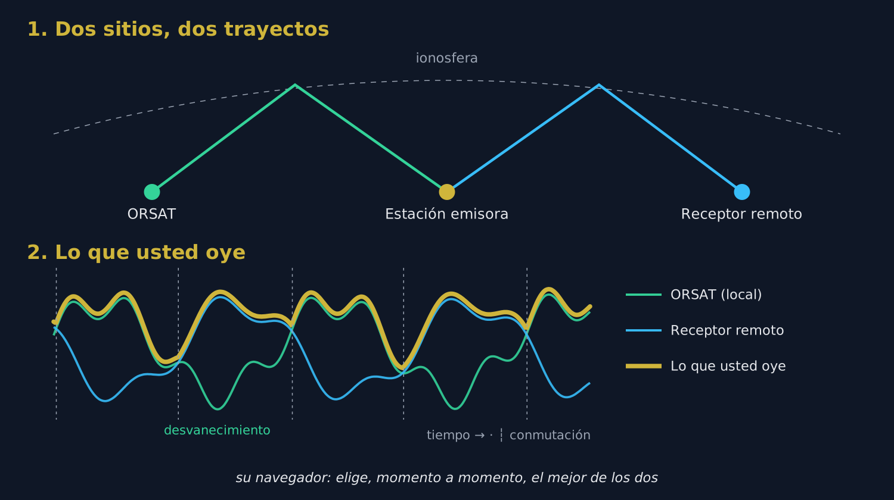

# 1. El problema: el QSB

## 1.1 Por qué se desvanece una señal

En onda corta, la señal de una estación lejana no le llega en línea recta: rebota en la **ionosfera**, una capa de la atmósfera que se mueve sin cesar. A menudo llega incluso por **varios trayectos a la vez**, ligeramente distintos. Esos trayectos se suman, unas veces reforzándose y otras anulándose.

Resultado: la señal **sube y baja** cada pocos segundos. Es el **QSB**, o desvanecimiento (en inglés *fading*). En el fondo de un desvanecimiento la estación puede desaparecer por completo durante uno o dos segundos, justo lo necesario para perder un indicativo o un reporte.

## 1.2 Lo que no puede hacer un solo receptor

Subir el volumen, cambiar de filtro o activar la reducción de ruido no cambia nada: cuando la señal se anula **en el lugar donde está la antena**, ya no queda nada que amplificar. El único remedio es escuchar **en otro lugar**.

# 2. La solución: escuchar en dos lugares

## 2.1 El principio

{w=482}

Dos receptores separados por varios cientos de kilómetros reciben la misma estación por **dos trayectos ionosféricos distintos**. Sus desvanecimientos son **independientes**: cuando la señal cae en ORSAT, suele estar bien en el otro receptor, y al revés.

La recepción en diversidad conecta ORSAT a **un segundo receptor web situado en otro lugar**, en la **misma frecuencia**, y le hace oír en cada momento **el mejor de los dos**. Los huecos de uno los llena el otro: la estación sigue siendo legible donde, con un solo receptor, habría desaparecido.

> [Consejo] La ganancia se mide en **continuidad** más que en potencia: la diversidad no hace la señal más fuerte, evita que desaparezca.

## 2.2 Por qué elegir y no sumar

Podría pensarse que sumar los dos sonidos daría un resultado aún mejor. En realidad, los dos trayectos no tienen la misma fase ni el mismo ligero desplazamiento de frecuencia: sumados, los dos sonidos dan una voz **hueca y metálica**, como dentro de un tubo. Para sumar limpiamente harían falta dos receptores sincronizados con un mismo reloj, algo imposible entre dos sitios unidos por Internet.

ORSAT **elige** por tanto entre los dos (se habla de *combinación por selección*). Al pasar de uno a otro hace un **fundido de 30 milisegundos**, demasiado corto para percibirse: no se oye ningún corte.

## 2.3 Cómo decide ORSAT

- Mide continuamente la **relación señal/ruido (SNR)** de los dos receptores.
- Solo conmuta si el otro receptor es **mejor en al menos 2,5 dB**, y solo si el receptor en curso se mantiene desde **al menos 0,4 segundos**. Así evita saltar de uno a otro en cada sílaba.
- Si el receptor en curso **se hunde** (menos de 6 dB durante medio segundo), conmuta sin esperar.
- Si el receptor remoto **deja de responder** durante 1,5 segundos, ORSAT vuelve enseguida a sí mismo. **La diversidad nunca corta el sonido**: en el peor de los casos oye ORSAT solo, como siempre.

# 3. El desfase entre los dos receptores

## 3.1 Por qué hay que alinear

El sonido del receptor remoto no le llega al mismo tiempo que el de ORSAT: cada receptor tiene sus propias memorias intermedias, y el trayecto por Internet añade su retardo. La diferencia suele estar entre unas décimas de segundo y 1,5 segundos, y puede llegar a 4 segundos.

Sin corrección, pasar de un receptor a otro haría **saltar o repetir** un trozo de frase. ORSAT debe pues medir primero ese desfase exacto.

## 3.2 Cómo lo mide

ORSAT compara el **ritmo del habla** de los dos sonidos: la sucesión de sílabas y silencios, que sigue siendo reconocible pese a los trayectos distintos y a la compresión del sonido. Busca el desfase que hace coincidir los dos ritmos.

- Empieza buscando en una ventana de **±1,5 segundos** (unos 9 segundos de escucha), que casi siempre basta, y luego amplía a **±4 segundos** si hace falta.
- Espera a que **dos medidas sucesivas coincidan** con 40 milisegundos de margen antes de declararse alineado.
- Una vez alineado, **vuelve a comprobar el desfase cada minuto**, porque los relojes de los dos sitios derivan muy lentamente.

Cuente pues **de 10 a 20 segundos** entre la pulsación de **Start** y el momento en que la diversidad está operativa. Es necesario que **alguien hable** durante ese tiempo: en una portadora pura o una frecuencia vacía no hay ritmo que comparar.

> [Consejo] Una vez alineado, el sonido que oye lleva unos **0,3 segundos de retraso** respecto a ORSAT solo. Es el precio del margen que permite conmutar sin brusquedad; al escuchar, no se nota.

# 4. Usar el panel paso a paso

## 4.1 El panel

El panel **Recepción en diversidad** está en la columna central, bajo la sintonía fina. Haga clic en su barra de título para desplegarlo.

{w=482}

## 4.2 Puesta en marcha

1. **Sintonice primero ORSAT** en la estación que desea escuchar, en el modo correcto.
2. En **Segundo RX**, elija el tipo de receptor remoto: **PhantomSDR+**, **KiwiSDR**, **UberSDR** o **WebSDR** (el WebSDR clásico de PA3FWM).
3. En el campo de dirección, escriba su dirección en la forma *host:puerto* (por ejemplo **miwebsdr.example.org:8073**). El texto gris del campo muestra la forma esperada para el tipo elegido.
4. Haga clic en **Start**.
5. Espere: la barra de título muestra **Espere…** durante la alineación y luego **Ready** cuando la diversidad está operativa.

**No tiene que ajustar el receptor remoto.** ORSAT lo coloca automáticamente en la misma frecuencia, el mismo modo y el mismo filtro que él, y lo sigue en cada cambio de sintonía.

Para detenerla, haga clic en **Stop**: vuelve al instante a ORSAT solo.

## 4.3 El piloto de la barra de título

| Color | Significado |
| Gris | Diversidad detenida |
| Ámbar parpadeante | Conexión o alineación en curso |
| Verde parpadeante | Alineado, está oyendo **ORSAT** |
| Cian parpadeante | Alineado, está oyendo **el receptor remoto** |

Al escuchar una estación que fluctúa, verá el piloto pasar del verde al cian al ritmo de los desvanecimientos: es la diversidad trabajando.

## 4.4 Los indicadores detallados

Durante el funcionamiento, una tabla muestra el estado del enlace:

| Indicador | Lo que indica |
| enlace | Estado de la conexión con el receptor remoto (connecting, ready, closed, error) y el motivo de un corte |
| alineado | Desfase medido entre los dos sonidos, en segundos; «buscando» mientras no se encuentra |
| corr | Parecido entre los dos sonidos una vez alineados: cuanto más alto, más fiable es la alineación |
| audio remoto | Cantidad de sonido recibida del receptor remoto y su frecuencia de muestreo; «none» indica que no envía nada |
| SNR local / SNR remoto | Relación señal/ruido de cada receptor, en dB, sobre la que se hace la elección |
| conmutaciones | Número de cambios de un receptor a otro desde el arranque |

Si aparece el mensaje **«el receptor remoto no cubre esta frecuencia»**, el segundo receptor no recibe la banda escuchada: elija otro.

## 4.5 La corrección SNR remoto

El cursor **Corrección SNR remoto** (−15 a +15 dB) se suma al SNR del receptor remoto antes de la comparación.

- Con **otro PhantomSDR+**, déjelo en **0 dB**: las dos medidas son directamente comparables.
- Con un receptor que **comprime mucho su sonido** (un WebSDR clásico envía un sonido de 8 bits), su ruido de fondo queda en parte oculto por la compresión y su SNR parece más bajo de lo que es. Suba la corrección unos dB si ORSAT nunca le cede el paso aunque sea claramente mejor.
- Al contrario, bájela si ORSAT conmuta con demasiada facilidad hacia un receptor remoto que suena peor.

# 5. Los receptores guardados

El botón **☰**, junto a la dirección, abre la lista de sus receptores, organizada **por tipo**: una dirección KiwiSDR solo se propone cuando está elegido el tipo KiwiSDR.

- Cada receptor arrancado con éxito se **añade automáticamente** al principio de la lista.
- **add** añade un receptor a mano; **✎** modifica su nombre y dirección; **✕** lo elimina; **borrar todo** vacía la lista del tipo en curso.
- Un clic en una línea pone su dirección en el campo; **▲ ▼** o arrastrar y soltar cambian el orden; **🌍** abre la página del receptor en una pestaña nueva.
- El receptor en uso aparece en negrita en la lista.
- **⭳ exportar** guarda todas las listas en un archivo; **⭱ importar** las vuelve a leer, proponiendo **combinar** con la lista actual o **reemplazarla**.
- **▦ QR** muestra las listas como código QR: escanéelo con un teléfono para recuperar sus receptores en la página móvil de ORSAT (pestaña Div).

Estas listas se guardan **en su navegador**: no pasan de un ordenador a otro sin exportación o código QR.

# 6. Elegir bien el segundo receptor

Es la elección más importante: la diversidad solo vale por la diferencia entre los dos sitios.

- **Lo bastante lejos de ORSAT**: a partir de **unos cientos de kilómetros**, los desvanecimientos se vuelven independientes. Dos receptores en la misma ciudad se desvanecen juntos y no aportan casi nada.
- **Tampoco demasiado lejos**: debe **oír la estación**. Para un corresponsal europeo, un receptor en otro país de Europa conviene más que uno en Australia.
- **Que cubra la banda** escuchada, con una antena correcta.
- **Preferiblemente un PhantomSDR+**: misma calidad de sonido, misma medida del SNR, sin corrección que ajustar.
- **Disponible**: un receptor saturado de oyentes o con conexión inestable hará que la diversidad vuelva a menudo a ORSAT solo.

> [Consejo] Los directorios de WebSDR, como **sdr-list.xyz**, permiten encontrar receptores PhantomSDR+, KiwiSDR y WebSDR clasificados por país.

# 7. Lo que no hace la diversidad

- **Solo alimenta el altavoz.** Los decodificadores (FT8, CW, RTTY…) siguen usando **ORSAT solo**: un cambio de receptor a mitad de intervalo haría fallar una decodificación que necesita un sonido continuo.
- **No sustituye a una buena antena.** Si ninguno de los dos receptores oye la estación, la diversidad no puede hacer nada.
- **No mezcla los dos sonidos**, salvo durante los fundidos de 30 ms (ver sección 2.2).
- **No puede alinearse con una señal sin modulación**: necesita una voz, Morse o cualquier señal que varíe en el tiempo.

# 8. Resolución de problemas

| Síntoma | Causa probable | Remedio |
| Se queda en «Espere…» | Nadie habla, o el receptor remoto no oye la estación | Espere una transmisión; compruebe en la página del receptor remoto (🌍) que oye la estación |
| enlace: error o closed | Dirección errónea, tipo incorrecto, receptor fuera de línea o completo | Compruebe la dirección y el tipo; pruebe otro receptor |
| audio remoto: none | El receptor remoto acepta la conexión pero no envía sonido | Pruebe otro receptor del mismo tipo |
| «no cubre esta frecuencia» | El segundo receptor no recibe esta banda | Elija un receptor que cubra la banda |
| El piloto sigue verde, 0 conmutaciones | ORSAT siempre es mejor, o el remoto está infravalorado | Normal si ORSAT es mejor; si no, suba la corrección SNR remoto |
| Conmutaciones constantes | Los dos receptores son parecidos | No molesta al escuchar; baje un poco la corrección para favorecer a ORSAT |
| Una palabra repetida o saltada al conmutar | Alineación reajustándose | Se corrige sola en la siguiente comprobación (como mucho un minuto) |

> [Consejo] En caso de duda, haga clic en **Stop**: el sonido vuelve de inmediato a ORSAT solo, sin ninguna consecuencia.
