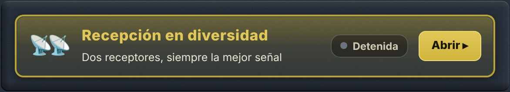

# 1. El problema: el QSB

## 1.1 Por qué se desvanece una señal

En onda corta, la señal de una estación lejana no le llega en línea recta: rebota en la **ionosfera**, una capa de la atmósfera que se mueve sin cesar. A menudo llega incluso por **varios trayectos a la vez**, ligeramente distintos. Esos trayectos se suman, unas veces reforzándose y otras anulándose.

Resultado: la señal **sube y baja** cada pocos segundos. Es el **QSB**, o desvanecimiento (en inglés *fading*). En el fondo de un desvanecimiento la estación puede desaparecer por completo durante uno o dos segundos, justo lo necesario para perder un indicativo o un reporte.

## 1.2 Lo que no puede hacer un solo receptor

Subir el volumen, cambiar de filtro o activar la reducción de ruido no cambia nada: cuando la señal se anula **en el lugar donde está la antena**, ya no queda nada que amplificar. El único remedio es escuchar **en otro lugar**.

# 2. La solución: escuchar en dos lugares

## 2.1 El principio

{w=482}

Dos receptores separados por varios cientos de kilómetros reciben la misma estación por **dos trayectos ionosféricos distintos**. Sus desvanecimientos son **independientes**: cuando la señal cae en ORSAT, suele estar bien en el otro receptor, y al revés.

La recepción en diversidad conecta ORSAT a **un segundo receptor web situado en otro lugar**, en la **misma frecuencia**, y le hace oír en cada momento **el mejor de los dos**. Los huecos de uno los llena el otro: la estación sigue siendo legible donde, con un solo receptor, habría desaparecido.

> [Consejo] La ganancia se mide en **continuidad** más que en potencia: la diversidad no hace la señal más fuerte, evita que desaparezca.

## 2.2 Por qué elegir y no sumar

Podría pensarse que sumar los dos sonidos daría un resultado aún mejor. En realidad, los dos trayectos no tienen la misma fase ni el mismo ligero desplazamiento de frecuencia: sumados, los dos sonidos dan una voz **hueca y metálica**, como dentro de un tubo. Para sumar limpiamente harían falta dos receptores sincronizados con un mismo reloj, algo imposible entre dos sitios unidos por Internet.

ORSAT **elige** por tanto entre los dos (se habla de *combinación por selección*). Al pasar de uno a otro hace un **fundido de 30 milisegundos**, demasiado corto para percibirse: no se oye ningún corte.

## 2.3 Cómo decide ORSAT

- Mide continuamente la **relación señal/ruido (SNR)** de los dos receptores.
- Solo conmuta si el otro receptor es **mejor en al menos 2,5 dB**, y solo si el receptor en curso se mantiene desde **al menos 0,4 segundos**. Así evita saltar de uno a otro en cada sílaba.
- Si el receptor en curso **se hunde** (menos de 6 dB durante medio segundo), conmuta sin esperar.
- Si el receptor remoto **deja de responder** durante 1,5 segundos, ORSAT vuelve enseguida a sí mismo. **La diversidad nunca corta el sonido**: en el peor de los casos oye ORSAT solo, como siempre.

# 3. El desfase entre los dos receptores

## 3.1 Por qué hay que alinear

El sonido del receptor remoto no le llega al mismo tiempo que el de ORSAT: cada receptor tiene sus propias memorias intermedias, y el trayecto por Internet añade su retardo. La diferencia suele estar entre unas décimas de segundo y 1,5 segundos, y puede llegar a 4 segundos.

Sin corrección, pasar de un receptor a otro haría **saltar o repetir** un trozo de frase. ORSAT debe pues medir primero ese desfase exacto.

## 3.2 Cómo lo mide

ORSAT compara el **ritmo del habla** de los dos sonidos: la sucesión de sílabas y silencios, que sigue siendo reconocible pese a los trayectos distintos y a la compresión del sonido. Busca el desfase que hace coincidir los dos ritmos.

- Empieza buscando en una ventana de **±1,5 segundos** (unos 9 segundos de escucha), que casi siempre basta, y luego amplía a **±4 segundos** si hace falta.
- Espera a que **dos medidas sucesivas coincidan** con 40 milisegundos de margen antes de declararse alineado.
- Una vez alineado, **vuelve a comprobar el desfase cada minuto**, porque los relojes de los dos sitios derivan muy lentamente.

Cuente pues **de 10 a 20 segundos** entre la pulsación de **▶ Iniciar** y el momento en que la diversidad está operativa. Es necesario que **alguien hable** durante ese tiempo: en una portadora pura o una frecuencia vacía no hay ritmo que comparar.

> [Atención] **El uso de la recepción en diversidad aumenta notablemente la latencia de la recepción.** El sonido que oye se retrasa (al menos 0,3 segundos, más según el asociado) para dar a ORSAT el margen de alinear los dos receptores y conmutar sin brusquedad. Para un QSO en directo, donde cada fracción de segundo cuenta, detenga la diversidad: la latencia normal vuelve al instante.

# 4. Usar el panel paso a paso

## 4.1 El panel

El panel **Recepción en diversidad** está en la columna central, bajo la sintonía fina. Su barra dorada indica el estado en claro; haga clic en **Abrir ▸** para desplegarlo.

{w=330}

{w=330}

## 4.2 Iniciar

1. **Sintonice primero ORSAT** en la estación que quiere escuchar, en un **modo de fonía**: USB, LSB, AM, SAM, QUAM, FM o WBFM. En cualquier otro modo, o con un decodificador en marcha, el botón de inicio aparece atenuado y el motivo se muestra encima.
2. **Elija un receptor asociado** haciendo clic en su tarjeta: se rodea de oro. Preferiblemente el que lleva la insignia **★ Recomendado** (sección 5).
3. Haga clic en el gran botón verde **▶ Iniciar con…**.
4. Espere: el estado pasa de **Sincronizando…** a **En marcha** cuando la diversidad está operativa.

**No hay nada que ajustar en el asociado.** ORSAT lo coloca automáticamente en la misma frecuencia, modo y filtro, y lo sigue en cada cambio de sintonía.

Para detenerla, haga clic en **■ Detener la diversidad**: vuelve al instante a ORSAT solo. Su navegador recuerda su último asociado para la próxima vez.

## 4.3 Durante la escucha

Bajo el botón, la parte **3. Escuche** muestra lo que ocurre:

- **🎧 Está escuchando: ORSAT** (en verde) o **el nombre del asociado** (en azul) — el receptor que oye en ese momento.
- **El estado en claro** — «Sincronizando los dos receptores…», luego «Sincronizado ✓ — se elige continuamente la mejor señal»; en rojo, «El receptor asociado no responde» con el motivo.
- **Dos barras de calidad de señal**, ORSAT y asociado, con su relación señal/ruido en dB; la barra verde es la del receptor elegido.
- **La parte del tiempo** pasada en el asociado y el **número de conmutaciones** desde el inicio.

## 4.4 El estado en la barra del panel

| Estado | Significado |
| ● Detenida (gris) | Diversidad detenida |
| ● Sincronizando… (ámbar) | Conexión o alineación en curso |
| ● En marcha, punto verde | Alineado, oye **ORSAT** |
| ● En marcha, punto azul | Alineado, oye **el asociado** |
| ● Error (rojo) | El asociado ya no responde: oye ORSAT solo |

Escuchando una estación que fluctúa, verá el punto pasar de verde a azul al ritmo de los desvanecimientos: es la diversidad trabajando.

## 4.5 Detalles técnicos

Durante la escucha, **▸ Detalles técnicos** despliega una tabla para los curiosos:

| Indicador | Lo que dice |
| enlace | Estado de la conexión con el asociado (connecting, ready, closed, error) y el motivo de un corte |
| retardo | Desfase medido entre los dos sonidos, en segundos; «buscando» mientras no se encuentra |
| correlación | Parecido entre los dos sonidos una vez alineados: cuanto más alto, más segura la alineación |
| audio remoto | Cantidad de sonido recibido del asociado y su frecuencia de muestreo; «ninguno» indica que no envía nada |
| SNR ORSAT / SNR asociado | Relación señal/ruido de cada receptor, en dB, sobre la que se hace la elección |
| corrección | Corrección añadida a la SNR del asociado, ajustada por el sysop (ver sección 6) |
| conmutaciones | Número de pasos de un receptor a otro desde el inicio |

Si aparece el mensaje **«Este receptor no recibe esta frecuencia»**, elija otro.

# 5. El receptor asociado recomendado

## 5.1 Lo que dicen las insignias

Cada tarjeta lleva una insignia que vale **para la banda que escucha**; cambia cuando cambia de banda.

| Insignia | Significado |
| ★ Recomendado en 40m | El mejor asociado ahora en esta banda |
| Posible · 41 % | Útil en parte: oye aproximadamente ese porcentaje de la zona que oye ORSAT |
| Poco útil en 40m | No oye las mismas estaciones que ORSAT en esta banda ahora |
| Fuera de línea | El receptor no responde; su tarjeta aparece atenuada |

Pase el ratón sobre una insignia para leer la explicación completa. Sin insignia, el servidor aún no tiene consejo (al arrancar, o asociado sin locator conocido).

## 5.2 Cómo se calcula el consejo

Un buen asociado no es necesariamente el que recibe más fuerte: es el que oye **las mismas estaciones que ORSAT, por otro camino**. Un receptor que oye muy bien otra región no aporta nada.

- Cada 10 minutos, el servidor de ORSAT calcula, a partir de las **ionosondas** de todo el mundo (red KC2G), la zona que oye ORSAT en cada banda, hasta 3000 km.
- Hace el mismo cálculo **desde el locator de cada asociado**, y mide la parte de la zona de ORSAT que el asociado oye también: es el porcentaje de la insignia.
- Tiene en cuenta la **distancia** entre los dos receptores: a menos de 100 km sus desvanecimientos están ligados y la diversidad no sirve; a partir de 300 km son independientes.
- Comprueba también cada 10 minutos que cada asociado **responde**: un receptor fuera de línea nunca se recomienda.

Ejemplo: en 40 m de día, ORSAT oye sobre todo Francia, a menos de 900 km. Un asociado en Bélgica oye entonces otra zona y será «Poco útil»; por la tarde, cuando los 40 m se abren a larga distancia, vuelve a ser un excelente asociado.

> [Nota] Este consejo se calcula aparte: nunca entra en el **índice de rendimiento** de ORSAT mostrado encima de la cascada.

# 6. Los receptores asociados propuestos

Los asociados los **elige el sysop de ORSAT** en el panel de administración: receptores fiables, a buena distancia, cada uno con la **corrección de SNR** que equilibra la comparación (un receptor que comprime mucho su sonido parece más ruidoso de lo que es). No hay pues dirección que escribir ni ajuste que hacer.

Cada tarjeta indica la **bandera** del país, el **nombre** y el **indicativo** del receptor, su **lugar** y su **distancia** a ORSAT, su **locator** y su **acimut** desde ORSAT.

Algunos receptores (a menudo KiwiSDR) solo son accesibles por **http**, lo que un navegador rechaza desde una página segura https. En ese caso la conexión pasa automáticamente por el **servidor de ORSAT**, que hace de relé: no hay nada que hacer. El asociado ve entonces la dirección del servidor de ORSAT, no la suya.

# 7. Lo que no hace la diversidad

- **Solo se aplica a los modos de fonía.** Se desactiva si usa un decodificador (FT8, CW, RTTY…): iniciar un decodificador la detiene al instante, igual que cambiar a un modo que no sea de fonía. Un cambio de receptor a mitad de intervalo haría además fallar una decodificación que necesita un sonido continuo.
- **Aumenta notablemente la latencia** de la recepción (ver sección 3.2).
- **No sustituye a una buena antena.** Si ninguno de los dos receptores oye la estación, la diversidad no puede hacer nada.
- **No mezcla los dos sonidos**, salvo durante los fundidos de 30 ms (ver sección 2.2).
- **No puede alinearse con una señal sin modulación**: necesita una voz, con sus sílabas y silencios.

# 8. Resolución de problemas

| Síntoma | Causa probable | Remedio |
| Se queda en «Sincronizando…» | Nadie habla, o el asociado no oye la estación | Espere una transmisión; pruebe el asociado recomendado |
| Estado «Error», «El receptor asociado no responde» | Receptor fuera de línea o completo | Elija otro asociado; evite las tarjetas «Fuera de línea» |
| audio remoto: ninguno | El asociado acepta la conexión pero no envía sonido | Pruebe otro asociado |
| «no recibe esta frecuencia» | El asociado no cubre esta banda | Elija otro asociado |
| Siempre en ORSAT, 0 conmutaciones | ORSAT es mejor ahora | Normal: la diversidad solo pasa al asociado si lo hace mejor |
| Conmutaciones constantes | Los dos receptores se equivalen | Sin molestia en la escucha |
| Una palabra repetida o saltada al conmutar | Alineación en reajuste | Se corrige sola en la siguiente comprobación (un minuto como máximo) |
| Botón «Iniciar» atenuado, mensaje naranja | Hay un decodificador en marcha, o el modo no es de fonía | Detenga el decodificador; pase a USB, LSB, AM o FM |
| Ninguna insignia en las tarjetas | El servidor aún no ha calculado, o el asociado no tiene locator | Espere unos minutos; puede elegir igualmente sin insignia |

> [Consejo] En caso de duda, haga clic en **■ Detener la diversidad**: el sonido vuelve inmediatamente a ORSAT solo, sin ninguna consecuencia.
