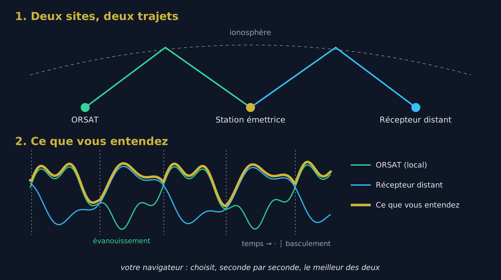

# 1. Le problème : le QSB

## 1.1 Pourquoi un signal s'évanouit

En ondes courtes, le signal d'une station lointaine ne vous parvient pas en ligne droite : il rebondit sur l'**ionosphère**, une couche de l'atmosphère qui bouge sans cesse. Souvent, il arrive même par **plusieurs trajets à la fois**, légèrement différents. Ces trajets s'additionnent tantôt en se renforçant, tantôt en s'annulant.

Résultat : le signal **monte et descend** toutes les quelques secondes. C'est le **QSB**, ou évanouissement (en anglais *fading*). Au fond d'un évanouissement, la station peut disparaître complètement pendant une ou deux secondes, juste le temps de perdre un indicatif ou un report.

## 1.2 Ce qu'on ne peut pas faire avec un seul récepteur

Monter le volume, changer de filtre ou activer la réduction de bruit ne change rien : quand le signal s'annule **à l'endroit où se trouve l'antenne**, il n'y a plus rien à amplifier. La seule parade est d'écouter **à un autre endroit**.

# 2. La solution : écouter à deux endroits

## 2.1 Le principe

{w=482}

Deux récepteurs distants de plusieurs centaines de kilomètres reçoivent la même station par **deux trajets ionosphériques différents**. Leurs évanouissements sont **indépendants** : quand le signal plonge à ORSAT, il est généralement correct chez l'autre récepteur, et inversement.

La réception en diversité branche ORSAT sur **un second récepteur Web situé ailleurs**, sur la **même fréquence**, et vous fait entendre à chaque instant **le meilleur des deux**. Les creux de l'un sont comblés par l'autre : la station reste lisible là où, avec un seul récepteur, elle aurait disparu.

> [Astuce] Le gain se mesure en **continuité** plus qu'en puissance : la diversité ne rend pas le signal plus fort, elle évite qu'il disparaisse.

## 2.2 Pourquoi choisir, et pas additionner

On pourrait croire qu'additionner les deux sons donnerait encore mieux. En réalité, les deux trajets n'ont pas la même phase ni le même léger décalage de fréquence : additionnés, les deux sons donnent une voix **creuse et métallique**, comme dans un tuyau. Pour additionner proprement, il faudrait deux récepteurs synchronisés sur une même horloge, ce qui est impossible entre deux sites reliés par Internet.

ORSAT **choisit** donc entre les deux (on parle de *combinaison par sélection*). Au moment de passer de l'un à l'autre, il fait un **fondu de 30 millisecondes**, trop court pour être perçu : vous n'entendez pas de coupure.

## 2.3 Comment ORSAT décide

- Il mesure en permanence le **rapport signal/bruit (SNR)** des deux récepteurs.
- Il ne bascule que si l'autre récepteur est **meilleur d'au moins 2,5 dB**, et seulement si le récepteur en cours tient depuis **au moins 0,4 seconde**. Cela évite de sauter de l'un à l'autre à chaque syllabe.
- Si le récepteur en cours **s'effondre** (moins de 6 dB pendant une demi-seconde), il bascule sans attendre.
- Si le récepteur distant **ne répond plus** pendant 1,5 seconde, ORSAT repasse aussitôt sur lui-même. **La diversité ne coupe jamais le son** : au pire, vous entendez ORSAT seul, comme d'habitude.

# 3. Le décalage entre les deux récepteurs

## 3.1 Pourquoi il faut aligner

Le son du récepteur distant ne vous arrive pas au même moment que celui d'ORSAT : chaque récepteur a ses propres mémoires tampons, et le trajet par Internet ajoute son retard. L'écart est en général compris entre quelques dixièmes de seconde et 1,5 seconde, et peut aller jusqu'à 4 secondes.

Sans correction, passer d'un récepteur à l'autre ferait **sauter ou répéter** un morceau de phrase. ORSAT doit donc d'abord mesurer ce décalage exact.

## 3.2 Comment il le mesure

ORSAT compare le **rythme de la parole** des deux sons : la succession des syllabes et des silences, qui reste reconnaissable malgré les trajets différents et la compression du son. Il cherche le décalage qui fait coïncider les deux rythmes.

- Il commence par chercher dans une fenêtre de **±1,5 seconde** (environ 9 secondes d'écoute), qui suffit presque toujours, puis élargit à **±4 secondes** si besoin.
- Il attend que **deux mesures successives concordent** à 40 millisecondes près avant de se déclarer aligné.
- Une fois aligné, il **revérifie le décalage chaque minute**, car les horloges des deux sites dérivent très lentement.

Comptez donc **10 à 20 secondes** entre l'appui sur **Start** et le moment où la diversité est opérationnelle. Il faut qu'**une station parle** pendant ce temps : sur une porteuse pure ou une fréquence vide, il n'y a pas de rythme à comparer.

> [Astuce] Une fois l'alignement trouvé, le son que vous entendez a environ **0,3 seconde de retard** sur ORSAT seul. C'est le prix de la marge qui permet de basculer sans à-coup ; à l'écoute, on ne le remarque pas.

# 4. Utiliser le panneau pas à pas

## 4.1 Le panneau

Le panneau **Réception en diversité** se trouve dans la colonne centrale, sous l'accord fin. Cliquez sur sa barre de titre pour le déplier.

{w=482}

## 4.2 Démarrer

1. **Accordez d'abord ORSAT** sur la station à écouter, dans le bon mode.
2. Dans **2e récepteur**, choisissez le type du récepteur distant : **PhantomSDR+**, **KiwiSDR**, **UberSDR** ou **WebSDR** (WebSDR classique de PA3FWM).
3. Dans le champ d'adresse, tapez son adresse, sous la forme *hôte:port* (par exemple **monwebsdr.example.org:8073**). Le texte grisé du champ montre la forme attendue pour le type choisi.
4. Cliquez sur **Start**.
5. Patientez : la barre de titre affiche **Veuillez patienter…** pendant l'alignement, puis **Ready** quand la diversité est opérationnelle.

**Vous n'avez pas à régler le récepteur distant.** ORSAT le place automatiquement sur la même fréquence, le même mode et le même filtre que lui, et le suit à chaque changement d'accord.

Pour arrêter, cliquez sur **Stop** : vous revenez instantanément à ORSAT seul.

## 4.3 Le voyant de la barre de titre

| Couleur | Signification |
| Gris | Diversité arrêtée |
| Ambre clignotant | Connexion ou alignement en cours |
| Vert clignotant | Aligné, vous entendez **ORSAT** |
| Cyan clignotant | Aligné, vous entendez **le récepteur distant** |

En écoutant une station qui fluctue, vous verrez le voyant passer du vert au cyan au gré des évanouissements : c'est la diversité qui travaille.

## 4.4 Les indicateurs détaillés

Pendant le fonctionnement, un tableau affiche l'état de la liaison :

| Indicateur | Ce qu'il dit |
| liaison | État de la connexion au récepteur distant (connecting, ready, closed, error) et la raison d'une coupure |
| aligné | Décalage mesuré entre les deux sons, en secondes ; « recherche » tant qu'il n'est pas trouvé |
| corr | Ressemblance entre les deux sons une fois alignés : plus elle est haute, plus l'alignement est sûr |
| audio distant | Quantité de son reçue du récepteur distant et sa fréquence d'échantillonnage ; « none » signale qu'il n'envoie rien |
| SNR local / SNR distant | Rapport signal/bruit de chaque récepteur, en dB, celui sur lequel se fait le choix |
| basculements | Nombre de passages d'un récepteur à l'autre depuis le démarrage |

Si le message **« le récepteur distant ne couvre pas cette fréquence »** apparaît, le second récepteur ne reçoit pas la bande écoutée : choisissez-en un autre.

## 4.5 La correction SNR distant

Le curseur **Correction SNR distant** (−15 à +15 dB) est ajouté au SNR du récepteur distant avant la comparaison.

- Avec un **autre PhantomSDR+**, laissez-le à **0 dB** : les deux mesures sont directement comparables.
- Avec un récepteur qui **compresse fortement son son** (un WebSDR classique envoie un son 8 bits), son bruit de fond est en partie masqué par la compression et son SNR paraît plus faible qu'il n'est. Montez la correction de quelques dB si ORSAT ne lui donne jamais la main alors qu'il est manifestement meilleur.
- À l'inverse, baissez-la si ORSAT bascule trop volontiers vers un récepteur distant qui sonne moins bien.

# 5. Les récepteurs enregistrés

Le bouton **☰**, à côté de l'adresse, ouvre la liste de vos récepteurs, rangée **par type** : une adresse KiwiSDR n'est proposée que lorsque le type KiwiSDR est choisi.

- Chaque récepteur démarré avec succès est **ajouté automatiquement** en tête de liste.
- **add** ajoute un récepteur à la main ; **✎** modifie son nom et son adresse ; **✕** le retire ; **tout effacer** vide la liste du type en cours.
- Un clic sur une ligne met son adresse dans le champ ; **▲ ▼** ou un glisser-déposer changent l'ordre ; **🌍** ouvre la page du récepteur dans un nouvel onglet.
- Le récepteur en cours d'utilisation est signalé en gras dans la liste.
- **⭳ exporter** enregistre toutes les listes dans un fichier ; **⭱ importer** les relit, en proposant de **fusionner** avec la liste actuelle ou de la **remplacer**.
- **▦ QR** affiche les listes sous forme de QR code : scannez-le avec un téléphone pour retrouver vos récepteurs sur la page mobile d'ORSAT (onglet Div).

Ces listes sont gardées **dans votre navigateur** : elles ne passent pas d'un ordinateur à l'autre sans export ou QR code.

# 6. Bien choisir le second récepteur

C'est le choix le plus important : la diversité ne vaut que par la différence entre les deux sites.

- **Assez loin d'ORSAT** : à partir de **quelques centaines de kilomètres**, les évanouissements deviennent indépendants. Deux récepteurs dans la même ville évanouissent ensemble et n'apportent presque rien.
- **Pas trop loin non plus** : il doit **entendre la station**. Pour un correspondant européen, un récepteur dans un autre pays d'Europe convient mieux qu'un récepteur en Australie.
- **Qui couvre la bande** écoutée, avec une antenne correcte.
- **De préférence un PhantomSDR+** : même qualité de son, même mesure du SNR, pas de correction à régler.
- **Disponible** : un récepteur saturé d'auditeurs ou à la connexion instable fera souvent retomber la diversité sur ORSAT seul.

> [Astuce] Les annuaires de WebSDR, comme **sdr-list.xyz**, permettent de trouver des récepteurs PhantomSDR+, KiwiSDR et WebSDR classés par pays.

# 7. Ce que la diversité ne fait pas

- **Elle n'alimente que le haut-parleur.** Les décodeurs (FT8, CW, RTTY…) continuent d'utiliser **ORSAT seul** : un changement de récepteur en plein créneau ferait échouer un décodage qui exige un son continu.
- **Elle ne remplace pas une bonne antenne.** Si aucun des deux récepteurs n'entend la station, la diversité n'y peut rien.
- **Elle ne mélange pas les deux sons**, sauf pendant les fondus de 30 ms (voir section 2.2).
- **Elle ne s'aligne pas sur un signal sans modulation** : il lui faut une voix, du Morse ou tout signal qui varie dans le temps.

# 8. Dépannage

| Symptôme | Cause probable | Remède |
| Reste sur « Veuillez patienter… » | Personne ne parle, ou le récepteur distant n'entend pas la station | Attendez une transmission ; vérifiez sur la page du récepteur distant (🌍) qu'il reçoit bien la station |
| liaison : error ou closed | Adresse erronée, mauvais type, récepteur hors ligne ou complet | Vérifiez l'adresse et le type ; essayez un autre récepteur |
| audio distant : none | Le récepteur distant accepte la connexion mais n'envoie pas de son | Essayez un autre récepteur du même type |
| « ne couvre pas cette fréquence » | Le second récepteur ne reçoit pas cette bande | Choisissez un récepteur qui couvre la bande |
| Le voyant reste vert, 0 basculement | ORSAT est toujours meilleur, ou le distant est sous-évalué | Normal si ORSAT est meilleur ; sinon montez la correction SNR distant |
| Basculements incessants | Les deux récepteurs se valent | Pas gênant à l'écoute ; baissez légèrement la correction pour favoriser ORSAT |
| Un mot répété ou sauté au basculement | Alignement en cours de recalage | Se corrige seul à la vérification suivante (au plus une minute) |

> [Astuce] En cas de doute, cliquez sur **Stop** : le son revient immédiatement à ORSAT seul, sans aucune conséquence.
