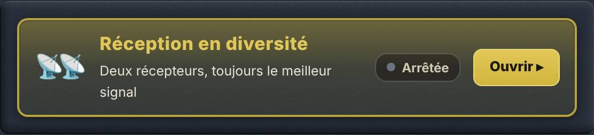

# 1. Le problème : le QSB

## 1.1 Pourquoi un signal s'évanouit

En ondes courtes, le signal d'une station lointaine ne vous parvient pas en ligne droite : il rebondit sur l'**ionosphère**, une couche de l'atmosphère qui bouge sans cesse. Souvent, il arrive même par **plusieurs trajets à la fois**, légèrement différents. Ces trajets s'additionnent tantôt en se renforçant, tantôt en s'annulant.

Résultat : le signal **monte et descend** toutes les quelques secondes. C'est le **QSB**, ou évanouissement (en anglais *fading*). Au fond d'un évanouissement, la station peut disparaître complètement pendant une ou deux secondes, juste le temps de perdre un indicatif ou un report.

## 1.2 Ce qu'on ne peut pas faire avec un seul récepteur

Monter le volume, changer de filtre ou activer la réduction de bruit ne change rien : quand le signal s'annule **à l'endroit où se trouve l'antenne**, il n'y a plus rien à amplifier. La seule parade est d'écouter **à un autre endroit**.

# 2. La solution : écouter à deux endroits

## 2.1 Le principe

{w=482}

Deux récepteurs distants de plusieurs centaines de kilomètres reçoivent la même station par **deux trajets ionosphériques différents**. Leurs évanouissements sont **indépendants** : quand le signal plonge à ORSAT, il est généralement correct chez l'autre récepteur, et inversement.

La réception en diversité branche ORSAT sur **un second récepteur Web situé ailleurs**, sur la **même fréquence**, et vous fait entendre à chaque instant **le meilleur des deux**. Les creux de l'un sont comblés par l'autre : la station reste lisible là où, avec un seul récepteur, elle aurait disparu.

> [Astuce] Le gain se mesure en **continuité** plus qu'en puissance : la diversité ne rend pas le signal plus fort, elle évite qu'il disparaisse.

## 2.2 Pourquoi choisir, et pas additionner

On pourrait croire qu'additionner les deux sons donnerait encore mieux. En réalité, les deux trajets n'ont pas la même phase ni le même léger décalage de fréquence : additionnés, les deux sons donnent une voix **creuse et métallique**, comme dans un tuyau. Pour additionner proprement, il faudrait deux récepteurs synchronisés sur une même horloge, ce qui est impossible entre deux sites reliés par Internet.

ORSAT **choisit** donc entre les deux (on parle de *combinaison par sélection*). Au moment de passer de l'un à l'autre, il fait un **fondu de 30 millisecondes**, trop court pour être perçu : vous n'entendez pas de coupure.

## 2.3 Comment ORSAT décide

- Il mesure en permanence le **rapport signal/bruit (SNR)** des deux récepteurs.
- Il ne bascule que si l'autre récepteur est **meilleur d'au moins 2,5 dB**, et seulement si le récepteur en cours tient depuis **au moins 0,4 seconde**. Cela évite de sauter de l'un à l'autre à chaque syllabe.
- Si le récepteur en cours **s'effondre** (moins de 6 dB pendant une demi-seconde), il bascule sans attendre.
- Si le récepteur distant **ne répond plus** pendant 1,5 seconde, ORSAT repasse aussitôt sur lui-même. **La diversité ne coupe jamais le son** : au pire, vous entendez ORSAT seul, comme d'habitude.

# 3. Le décalage entre les deux récepteurs

## 3.1 Pourquoi il faut aligner

Le son du récepteur distant ne vous arrive pas au même moment que celui d'ORSAT : chaque récepteur a ses propres mémoires tampons, et le trajet par Internet ajoute son retard. L'écart est en général compris entre quelques dixièmes de seconde et 1,5 seconde, et peut aller jusqu'à 4 secondes.

Sans correction, passer d'un récepteur à l'autre ferait **sauter ou répéter** un morceau de phrase. ORSAT doit donc d'abord mesurer ce décalage exact.

## 3.2 Comment il le mesure

ORSAT compare le **rythme de la parole** des deux sons : la succession des syllabes et des silences, qui reste reconnaissable malgré les trajets différents et la compression du son. Il cherche le décalage qui fait coïncider les deux rythmes.

- Il commence par chercher dans une fenêtre de **±1,5 seconde** (environ 9 secondes d'écoute), qui suffit presque toujours, puis élargit à **±4 secondes** si besoin.
- Il attend que **deux mesures successives concordent** à 40 millisecondes près avant de se déclarer aligné.
- Une fois aligné, il **revérifie le décalage chaque minute**, car les horloges des deux sites dérivent très lentement.

Comptez donc **10 à 20 secondes** entre l'appui sur **▶ Démarrer** et le moment où la diversité est opérationnelle. Il faut qu'**une station parle** pendant ce temps : sur une porteuse pure ou une fréquence vide, il n'y a pas de rythme à comparer.

> [Astuce] Une fois l'alignement trouvé, le son que vous entendez a environ **0,3 seconde de retard** sur ORSAT seul. C'est le prix de la marge qui permet de basculer sans à-coup ; à l'écoute, on ne le remarque pas.

# 4. Utiliser le panneau pas à pas

## 4.1 Le panneau

Le panneau **Réception en diversité** se trouve dans la colonne centrale, sous l'accord fin. Sa barre dorée indique l'état en clair ; cliquez sur **Ouvrir ▸** pour le déplier.

{w=330}

{w=330}

## 4.2 Démarrer

1. **Accordez d'abord ORSAT** sur la station à écouter, dans le bon mode.
2. **Choisissez un récepteur partenaire** en cliquant sur sa vignette : elle s'entoure d'or. De préférence celui qui porte le badge **★ Conseillé** (section 5).
3. Cliquez sur le grand bouton vert **▶ Démarrer avec…**.
4. Patientez : l'état passe de **Synchronisation…** à **En marche** quand la diversité est opérationnelle.

**Vous n'avez rien à régler sur le partenaire.** ORSAT le place automatiquement sur la même fréquence, le même mode et le même filtre que lui, et le suit à chaque changement d'accord.

Pour arrêter, cliquez sur **■ Arrêter la diversité** : vous revenez instantanément à ORSAT seul. Votre dernier partenaire est retenu par votre navigateur pour la fois suivante.

## 4.3 Pendant l'écoute

Sous le bouton, la partie **3. Écoutez** montre ce qui se passe :

- **🎧 Vous écoutez : ORSAT** (en vert) ou **le nom du partenaire** (en bleu) — le récepteur que vous entendez à cet instant.
- **L'état en clair** — « Synchronisation des deux récepteurs… », puis « Synchronisé ✓ — le meilleur signal est choisi en continu » ; en rouge, « Le partenaire ne répond pas » avec la raison.
- **Deux barres de qualité du signal**, ORSAT et partenaire, avec leur rapport signal/bruit en dB ; la barre en vert est celle du récepteur retenu.
- **La part du temps** passée sur le partenaire et le **nombre de bascules** depuis le démarrage.

## 4.4 L'état dans la barre du panneau

| État | Signification |
| ● Arrêtée (gris) | Diversité arrêtée |
| ● Synchronisation… (ambre) | Connexion ou alignement en cours |
| ● En marche, point vert | Aligné, vous entendez **ORSAT** |
| ● En marche, point bleu | Aligné, vous entendez **le partenaire** |
| ● Erreur (rouge) | Le partenaire ne répond plus : vous entendez ORSAT seul |

En écoutant une station qui fluctue, vous verrez le point passer du vert au bleu au gré des évanouissements : c'est la diversité qui travaille.

## 4.5 Les détails techniques

Pendant l'écoute, **▸ Détails techniques** déplie un tableau pour les curieux :

| Indicateur | Ce qu'il dit |
| liaison | État de la connexion au partenaire (connecting, ready, closed, error) et la raison d'une coupure |
| décalage | Décalage mesuré entre les deux sons, en secondes ; « recherche » tant qu'il n'est pas trouvé |
| corrélation | Ressemblance entre les deux sons une fois alignés : plus elle est haute, plus l'alignement est sûr |
| son distant | Quantité de son reçue du partenaire et sa fréquence d'échantillonnage ; « aucun » signale qu'il n'envoie rien |
| SNR ORSAT / SNR partenaire | Rapport signal/bruit de chaque récepteur, en dB, celui sur lequel se fait le choix |
| correction | Correction ajoutée au SNR du partenaire, réglée par le sysop (voir section 6) |
| bascules | Nombre de passages d'un récepteur à l'autre depuis le démarrage |

Si le message **« Ce partenaire ne reçoit pas cette fréquence »** apparaît, choisissez-en un autre.

# 5. Le partenaire conseillé

## 5.1 Ce que disent les badges

Chaque vignette porte un badge qui vaut **pour la bande que vous écoutez** ; il change quand vous changez de bande.

| Badge | Signification |
| ★ Conseillé sur 40m | Le meilleur partenaire en ce moment sur cette bande |
| Possible · 41 % | Utile en partie : il entend environ ce pourcentage de la zone entendue par ORSAT |
| Peu utile sur 40m | Il n'entend pas les mêmes stations qu'ORSAT sur cette bande en ce moment |
| Hors ligne | Le récepteur ne répond pas ; sa vignette est grisée |

Survolez un badge pour lire l'explication complète. Sans badge, le serveur n'a pas encore d'avis (au démarrage, ou partenaire sans locator connu).

## 5.2 Comment le conseil est calculé

Un bon partenaire n'est pas forcément celui qui reçoit le plus fort : c'est celui qui entend **les mêmes stations qu'ORSAT, par un autre chemin**. Un récepteur qui entend très bien une autre région n'apporte rien.

- Toutes les 10 minutes, le serveur d'ORSAT calcule, à partir des **ionosondes** du monde entier (réseau KC2G), la zone qu'ORSAT entend sur chaque bande, jusqu'à 3000 km.
- Il fait le même calcul **depuis le locator de chaque partenaire**, et mesure la part de la zone d'ORSAT que le partenaire entend aussi : c'est le pourcentage du badge.
- Il tient compte de la **distance** entre les deux récepteurs : à moins de 100 km, leurs évanouissements sont liés et la diversité ne sert à rien ; à partir de 300 km, ils sont indépendants.
- Il vérifie aussi toutes les 10 minutes que chaque partenaire **répond** : un récepteur hors ligne n'est jamais conseillé.

Exemple : sur 40 m en journée, ORSAT entend surtout la France, à moins de 900 km. Un partenaire en Belgique entend alors une autre zone et sera « Peu utile » ; le soir, quand le 40 m s'ouvre au loin, il redevient un excellent partenaire.

> [Remarque] Ce conseil est calculé à part : il n'entre jamais dans l'**indice de performance** d'ORSAT affiché au-dessus de la cascade.

# 6. Les partenaires proposés

Les partenaires sont **choisis par le sysop d'ORSAT** dans le panneau d'administration : il retient des récepteurs fiables, à bonne distance, et règle pour chacun la **correction de SNR** qui équilibre la comparaison (un récepteur qui compresse fortement son son paraît plus bruyant qu'il n'est). Vous n'avez donc ni adresse à saisir ni réglage à faire.

Chaque vignette indique le **drapeau** du pays, le **nom** et l'**indicatif** du récepteur, son **lieu** et sa **distance** à ORSAT, son **locator** et son **azimut** vu d'ORSAT.

Certains récepteurs (souvent des KiwiSDR) ne sont joignables qu'en **http**, ce qu'un navigateur refuse depuis une page sécurisée en https. Dans ce cas, la connexion passe automatiquement par le **serveur d'ORSAT**, qui sert de relais : vous n'avez rien à faire. Le partenaire voit alors l'adresse du serveur d'ORSAT, pas la vôtre.

# 7. Ce que la diversité ne fait pas

- **Elle n'alimente que le haut-parleur.** Les décodeurs (FT8, CW, RTTY…) continuent d'utiliser **ORSAT seul** : un changement de récepteur en plein créneau ferait échouer un décodage qui exige un son continu.
- **Elle ne remplace pas une bonne antenne.** Si aucun des deux récepteurs n'entend la station, la diversité n'y peut rien.
- **Elle ne mélange pas les deux sons**, sauf pendant les fondus de 30 ms (voir section 2.2).
- **Elle ne s'aligne pas sur un signal sans modulation** : il lui faut une voix, du Morse ou tout signal qui varie dans le temps.

# 8. Dépannage

| Symptôme | Cause probable | Remède |
| Reste sur « Synchronisation… » | Personne ne parle, ou le partenaire n'entend pas la station | Attendez une transmission ; essayez le partenaire conseillé |
| État « Erreur », « Le partenaire ne répond pas » | Récepteur hors ligne ou complet | Choisissez un autre partenaire ; les vignettes « Hors ligne » sont à éviter |
| son distant : aucun | Le partenaire accepte la connexion mais n'envoie pas de son | Essayez un autre partenaire |
| « ne reçoit pas cette fréquence » | Le partenaire ne couvre pas cette bande | Choisissez un autre partenaire |
| Toujours sur ORSAT, 0 bascule | ORSAT est meilleur en ce moment | Normal : la diversité ne passe sur le partenaire que s'il fait mieux |
| Bascules incessantes | Les deux récepteurs se valent | Sans gêne à l'écoute |
| Un mot répété ou sauté au basculement | Alignement en cours de recalage | Se corrige seul à la vérification suivante (au plus une minute) |
| Aucun badge sur les vignettes | Le serveur n'a pas encore calculé, ou le partenaire n'a pas de locator | Patientez quelques minutes ; le choix reste possible sans badge |

> [Astuce] En cas de doute, cliquez sur **■ Arrêter la diversité** : le son revient immédiatement à ORSAT seul, sans aucune conséquence.
