# 1. General introduction

PhantomSDR-Plus is a software-defined radio (SDR) receiver that you use from an ordinary web browser, with nothing to install. The interface shows the receiver’s RF spectrum and waterfall in real time, and lets you listen to, tune and decode received signals straight from the browser. PhantomSDR aims to be a modern alternative to the PA3FWM WebSDR.

The **ORSAT** station runs PhantomSDR-Plus version 5.1.0 (original project by SV1BTL), modified by F1NSK under the name **ORSAT 1.0**: “old gold” theme, interface fully translated into French, English and Spanish, DX cluster synchronisation, extra decoders (HFDL with an aircraft map, the FLDIGI family), signal analysis and identification, 3D spectrum, audio analyser and SSB modulation report, receive diversity and built-in hamdash tools.

This manual describes, area by area, every control visible on screen: where it is, what it does and how to use it. Each complex feature comes with a screenshot of the window or panel exactly as it appears in the interface.

> [Note] The ORSAT interface is designed for a **computer** or a **tablet**, whatever the screen size. A phone is automatically sent to the lightweight **/mobile** page.

## 1.1 Screen layout

- **Top banner** — station identification, links, clock, language and the “Information” menu (section 2).
- **Central area** — “Performance index” banner, spectrum, waterfall, frequency scale and band markers (section 3).
- **Left column** — audio, AGC, noise filters, DSP, QRSS and recording (sections 5 to 7).
- **Middle column** — frequency dial, S-meter, bands/modes/filters, fine tuning, diversity and decoders (sections 4, 8 and 9).
- **Right column** — waterfall controls (automatic adjustment, colours, 3D spectrum), audio analyser, bookmarks and connection indicator (sections 10 to 12).

## 1.2 Choosing the language

The flag buttons **FR**, **EN** and **ES**, on the right of the top banner (globe icon), instantly switch the whole interface — labels and tooltips — to French, English or Spanish. Your choice is remembered by the browser for future visits.

## 1.3 Tooltips

Almost every button, slider and area shows an explanatory **tooltip** when you rest the mouse on it for a moment. It is the quickest way to discover a control without leaving the receiving screen.

> [Tip] The interface is fully reactive: most settings (band, mode, filters, gain) take effect immediately, with no confirmation. Every user has their own tuning and settings, which do not affect the other users connected to the same receiver.

> [Note] When the page opens, browsers block sound until the user interacts with it: a “Tap to enable audio” overlay is shown — a single click starts listening.

# 2. Top banner

The banner at the very top of the screen identifies the station hosting the receiver and gathers the links and companion tools, the clock, the language selector and the button that opens the “Information” menu.

{w=482}

## 2.1 Station identification line

The first line shows the station name, its location and its Maidenhead locator (Christus Lake - SW France, IN93LR14VR). It contains two buttons:

- **ORSAT** — opens the station sysop’s QRZ.com page.
- **Christus Lake - SW France, IN93LR14VR** — opens a satellite map centred on the receiver’s QTH.

## 2.2 Second line: contact, users and statistics

- **e-mail** — opens a message pre-addressed to the sysop (question, problem report…).
- **Users** — window listing the users connected in real time (see below).
- **Stats** — dashboard of connection statistics (see below).
- **Other servers: 1, 2, 3** — directories of other WebSDRs: 1 = sdr-list.xyz, 2 = sdr.shbrg.nl, 3 = websdr.org.

{w=482}

The **Connected users** window lists each listener (approximate location, frequency and mode, connection time and duration). Your own line is marked **YOU**. The **TUNE** button on a line tunes your receiver to the same frequency and mode as that user. A map shows where listeners are; the Polling indicator confirms automatic refresh.

{w=482}

The **Statistics** window shows the receiver’s activity over a chosen period (start and end dates, or the **Today**, **7 days**, **30 days**, **All** buttons, then **Load**): number of events and sessions, unique addresses, number of locations, total airtime, average and longest session, and a histogram of the hourly distribution (UTC). Both windows close with the cross or the Esc key.

## 2.3 Third line: frequency and callsign search

- **MW** / **SW** — databases to identify the broadcast station you are hearing on medium or short wave.
- **PSK Reporter** — community map of digital-mode reception reports.
- **WSPRnet** — database of WSPR beacon reports.
- **Callsign search** — type a callsign in the field, then click **Search**.

## 2.4 UTC / Local clock

On the left, a digital clock shows the time and date. The **UTC** button displays Coordinated Universal Time — the reference for digital modes, broadcast schedules and the DX cluster — and the **LOCAL** button your computer’s local time.

## 2.5 Language and “Information” menu

On the right are the language buttons described in section 1.2. In the centre, the **Open Meteo - Alerts - Infos - Propagation - DXcluster and User Manuals** button unfolds the “Information” menu detailed in section 13; it then becomes **Close windows** to fold it again.

# 3. Main screen: spectrum and waterfall

The central area shows two complementary views of the received signal:

- **The spectrum** (upper part) — signal amplitude versus frequency, right now.
- **The waterfall** (scrolling part) — spectrum history over time; colour shows the received intensity.
- **The frequency scale** and, below it, the **band and service markers** (MW, 120m, Maritime, Aeronautical, CB, 10m…).
- **The 3D spectrum** (optional) — the spectrum can also be shown in relief: see section 10.3.

{w=482}

## 3.1 Tuning with the mouse and wheel

- **Click** on the spectrum or waterfall — tunes the receiver to the clicked frequency; dragging moves the filter.
- **Horizontal drag** — scrolls the visible part of the band without changing the listening frequency.
- **Wheel** — zoom in / out.
- **Shift + wheel** — tune in 0.1 kHz steps; **Ctrl + wheel** — 0.01 kHz steps.
- **Shift + Ctrl + wheel** — snaps the frequency to the round kilohertz (.00 kHz).

## 3.2 Listener labels and administrator message

Below the scale, small flag labels (e.g. Le Dorat, Dax) show the frequency each other connected user is listening to; your own position is marked with a star. The small round **●** button on the right of the area **hides or shows** these labels.

When a **★ ADMIN** banner runs across the waterfall, it is a message broadcast by the sysop to all listeners (maintenance, new version, planned interruption…).

> [Tip] Waterfall colours, brightness and contrast are set in the right column (section 10).

## 3.3 “Performance index” banner

Just above the waterfall, a thin banner shows, **band by band**, how well ORSAT can hear stations **right now**. The server recomputes it continuously, even when nobody is listening.

{w=440}

- **Chips** — one per band, with a score from **0 to 100** and its colour: **green** excellent (75 and above), **olive** good (50 to 74), **orange** fair (25 to 49), **grey** weak (below 25). The band you are tuned to is highlighted.
- **Area** — **Loc** (up to 300 km), **Reg** (300 to 900 km), **EU** (900 to 2500 km) or **DX** (beyond): the distance at which ORSAT hears best on that band.
- **Hovering a chip** — the detail: forecast score, real measurement, and what calibration has observed over the previous days.
- **🗺 Show map** (or a click anywhere on the banner) — opens the detailed map of the areas where ORSAT hears well, band by band; the **✕ Close** button closes it.
- **Performance index ?** — the title is a button: it opens the full explanation of the computation.

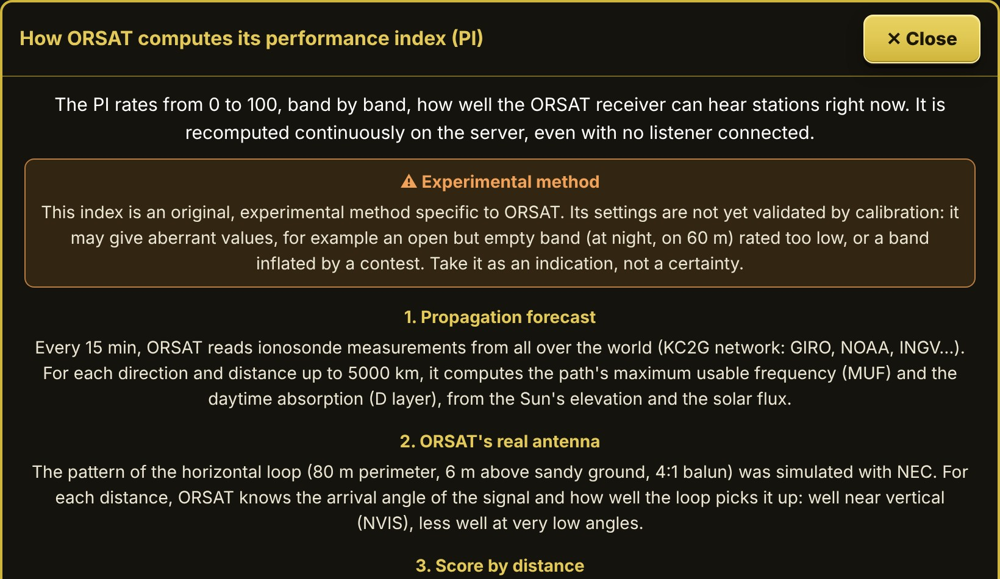{w=330}

The index combines two things:

- **a forecast**: every 15 minutes, the server reads the measurements of ionosondes worldwide (KC2G network), computes the maximum usable frequency and daytime absorption for every direction and distance, and weighs them with the real pattern of ORSAT's loop antenna;
- **a real measurement**: every 5 minutes, ORSAT itself listens to each band for a few seconds on its waterfall, counts the signals and notes the best signal-to-noise ratio.

When the measurement is less than 15 minutes old, the index is 40 % forecast and 60 % measurement; otherwise, the forecast alone.

> [Warning] This method is **original and experimental**, specific to ORSAT. It can give aberrant values, for instance an open but empty band scored too low, or a band inflated by a contest. Take it as an indication, not a certainty.

# 4. Dial, bands, modes and filters

The middle column gathers everything related to tuning the receiver.

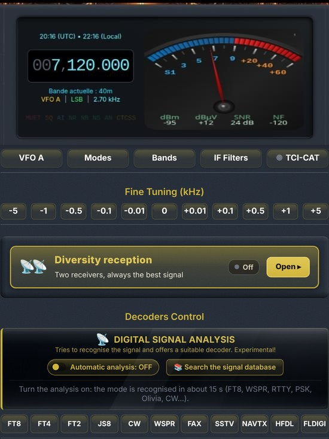{w=275}

## 4.0 Frequency dial, S-meter and indicators

{w=410}

The dial shows UTC and local time, the tuned frequency (e.g. 007,120.000 kHz), then the current band, the active VFO, the mode and the filter width (Current Band: 40m — VFO A | LSB | 2.70 kHz).

- **Direct tuning on the digits** — hover a digit of the frequency and turn the wheel to change it; a **right-click** on the dial lets you type a frequency directly.
- **Status indicators** — **MUTED**, **SQ** (squelch), **AI** (AI filter), **NR**, **NB**, **NS**, **AN** and **CTCSS** light up when the function is active: one glance tells you which processing is running.
- **Analogue S-meter** — scaled from S1 to +60 dB, with four readings under the needle: **dBm** and **dBµV** (received level), **SNR** (signal-to-noise ratio) and **NF** (noise floor).
A **click on the S-meter** cycles through its three styles: **dark**, **light** and **vintage**.

{w=236}

## 4.1 Band selector

The **Bands** button opens the list of amateur bands (2200 m to 10 m, CB, 11 m SSB) and broadcast bands (VLF, LF, LW, MW, 180 m to 13 m AM). One click tunes the receiver to a representative frequency of the band, in the usual mode; the current band is highlighted.

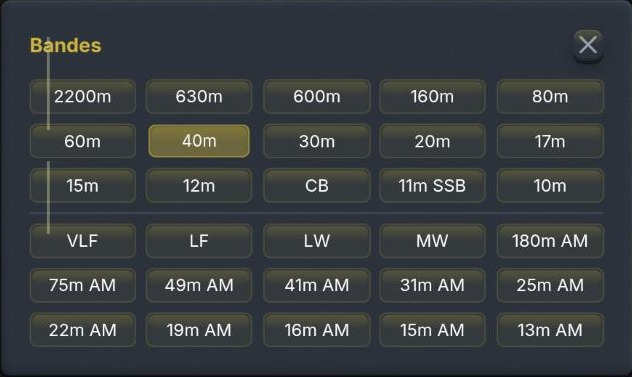{w=386}

## 4.2 Demodulation modes

{w=386}

- **USB / LSB** — single sideband (by convention LSB below 10 MHz, USB above).
- **CW** — telegraphy, with a narrow filter suited to Morse.
- **AM** — classic amplitude modulation; **QUAM** — quadrature AM demodulation.
- **FM** — frequency modulation.
- **RADEL / RADEU** — decoding of **FreeDV** digital voice (RADE mode) on the lower / upper sideband.

## 4.3 IF filters

The **IF Filters** button opens the “Static IF Filters” window: twelve preset widths from 500 Hz to 10 kHz, and a **Bandwidth (centre → edge)** slider for continuous adjustment, with the value in Hz. The **Reset** button returns to the mode’s default width.

{w=386}

> [Tip] A narrow filter cuts noise and adjacent interference but may clip part of the wanted signal. In CW, a few hundred hertz greatly improves copy of weak signals.

## 4.4 VFO A / B

The **VFO A** button switches between two VFOs: keep one frequency on one VFO and explore the band with the other, then return to the first with one click.

## 4.5 TCI-CAT

The **TCI-CAT** button opens the “CAT control via TCI” window, which synchronises the web interface with software running on your computer (**ExpertSDR**, **AetherSDR**, **Thetis**): the usual TCI ports 50001 and 40001 are probed automatically.

{w=386}

- **Status** — Inactive, Wait or connected; the dot in front of **TCI-CAT** on the button reflects it.
- **CAT Sync** — enables frequency synchronisation: a change on one side is mirrored on the other.
- **Host** — machine running the TCI software (localhost by default, or its IP address on the local network).
> [Tip] This link connects the software on your computer to the tuning done in the browser; it does not key the site’s transmitter and does not replace a direct CAT link to a transceiver.

## 4.6 Fine tuning

The **Fine Tuning (kHz)** row shifts the frequency by fixed steps: **-5, -1, -0.5, -0.1, -0.01, 0, +0.01, +0.1, +0.5, +1, +5** kHz. Small steps centre a CW or digital signal, large ones jump from one signal to the next.

# 5. Audio control column (left)

The left column gathers the sound output and processing settings.

## 5.1 Audio & Buffer

{w=200,side}
- **MUTE AUDIO** — large button to the left of the volume: one click cuts the sound, the button turns **red** and reads **AUDIO MUTED**; another click restores listening. Designed for listeners who go to transmit without an automatic link between their transceiver and the computer: it prevents **audio feedback**.
- **Volume** — listening level slider, to the right of the button.
- **SQ** (squelch) — the slider sets the threshold in dB. The **SQ** button offers an **automatic squelch**: go to a quiet frequency, click to measure the noise and the threshold sets itself; click again to disable it.
- **Buffer** (globe icon) — audio buffer multiplier (×1 by default). Increase it on a slow or unstable Internet connection, at the cost of a little latency.

## 5.2 AGC

Automatic gain control keeps a steady listening level. Each button's tooltip shows its recommended use by mode:

- **Auto** — the receiver's own AGC, all-purpose: a good default for general listening.
- **Fast** (recovers in about 0.3 s) — best for **CW** and **digital modes** (RTTY, PSK…), and on noisy bands (QRN, static).
- **Medium** (0.25 s hold, 1.2 s recovery) — best for **SSB** QSOs, and for **AM with fading**.
{w=187,side}
- **Slow** (1 s hold, 3 s recovery) — best for **AM** broadcast and steady SSB signals. All four give the same volume; they differ only in how the gain behaves between words and after a strong signal. While a decoder is open, the AGC is held on **Slow** for it, as a note beside the title shows.

## 5.3 Noise filters and AI audio filter

- **NR** — wideband noise reduction (continuous background noise).
- **NB** — impulse noise blanker (ignition noise, clicks).
- **NS** — background hiss suppression.
- **AN** — automatic notch: detects and attenuates steady carriers (heterodynes).
- **AI Audio Filter** — neural noise reducer, active in **SSB and AM/SAM only**. The slider sets its strength: up to 50 %, the original gentle setting; above, strong filtering (up to 40 dB of reduction, silences cleaned). Turn it down if QRP stations become inaudible.
> [Tip] Enable filters one at a time while listening: stacking several aggressive processes often hurts intelligibility instead of helping it.

## 5.4 Audio DSP: compressor, equalizer and gate

The **Compressor** and **Equalizer** buttons each open a settings window with its own enable switch and a **Reset** button.

{w=236}

- **Compressor** — **Threshold** (dB where compression starts), **Ratio** (e.g. 4:1), **Attack** and **Release** (ms), **Knee** (transition softness, dB) and **Makeup** gain; the **Auto makeup** box computes that gain from threshold and ratio.
- **Equalizer** — six bands adjustable in gain: 100 Hz, 350 Hz, 1 kHz, 2 kHz, 3 kHz and 5 kHz.
- **Gate: ON / OFF** — noise gate running **on the server**, engaged by default; it silences the noise between words or transmissions.
- Gate **Preset**: Balanced, Aggressive, Weak Signal, Smooth, Maximum, CW/Digital and AM/FM.
> [Tip] To lift a voice out of the noise, slightly cut 100–350 Hz and slightly boost 1–2 kHz, where speech intelligibility is concentrated.

# 6. QRSS

The **Show** button opens the QRSS settings and adds, below the waterfall, a very high resolution spectrogram for extremely slow, very low power signals (Morse at several seconds per dot, DFCW). The button becomes **Hide** to close it all.

{w=204,side}
- **Band** — list of known QRSS windows (10140.00 kHz on 30 m — the main one —, 7039.90 and 7000.85 kHz on 40 m, 14096.90 kHz on 20 m, 80 m, 160 m, 630 m, 2200 m, 60 m, 17 m…), then **Tune**.
- **Speed** — QRSS 3, 10, 30…: sets the fineness of the time-frequency analysis.
- **Centre** — observed audio centre frequency (Hz).
- **Span** — window shown around the centre; **Clear** resets the display.
- **Gain** — overlay contrast (dB).
- **Colour** — overlay palette (Rainbow…).
- **Save as .PNG** — saves an image of the overlay.

{w=482}

The indicator line under the overlay recalls the current analysis resolution. When the vertical resolution is flagged as the display limit, reduce the **Span** to gain definition. While QRSS is on, the AGC automatically switches to slow.

> [Tip] QRSS traces build up over several minutes: let the overlay run on the chosen window (for example 10 140 kHz on 30 m) before concluding there is no signal.

# 7. Recording

The **Recording Options** section offers three local captures, saved on your computer:

- **Audio** — records the demodulated audio only, as WAV.
- **Video** — records the waterfall together with the demodulated audio.
- **Area** — draw an area on the waterfall with the mouse to record only that part; with no area set, the whole panel is recorded.
A second click stops recording and offers the resulting file for download.

> [Tip] The recording captures exactly what you hear, filters and DSP included: check mode, frequency and settings before starting.

# 8. Receive diversity

**Diversity reception** pairs ORSAT with a **partner receiver** several hundred kilometres away. The two sites do not suffer the same fades (QSB): ORSAT lets you hear, at every moment, **the better of the two**. The panel is in the middle column, below fine tuning; click its gold bar (**Open ▸**) to unfold it.

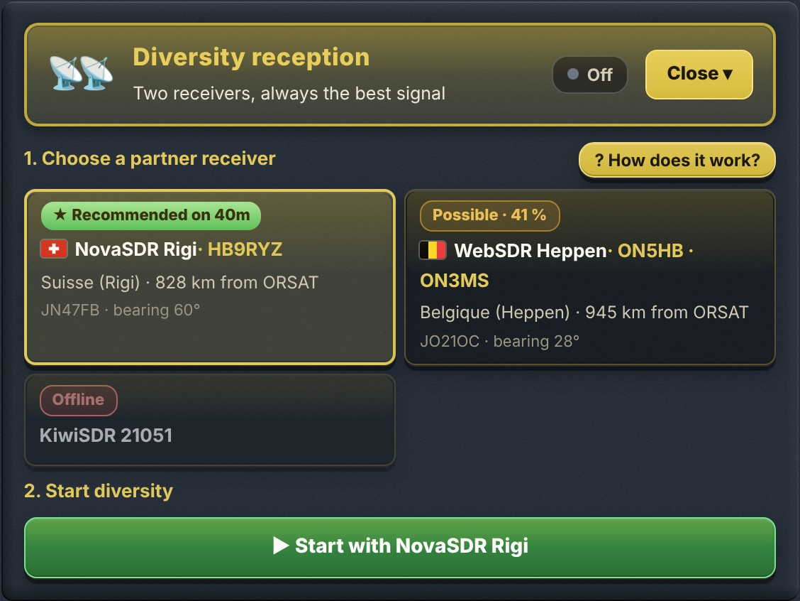{w=330}

1. **Choose a partner receiver** — the cards show the receivers selected by the ORSAT sysop: flag, name and callsign, place and distance, **locator** and **bearing** from ORSAT.
2. **Start diversity** — the large green **▶ Start with…** button; it becomes **■ Stop diversity** while listening.
3. **Listen** — “🎧 You are hearing: ORSAT” or the partner's name, the state in plain words (synchronising, then “Synchronised ✓”), two signal quality bars and the share of time spent on the partner.

On each card, a badge gives the current advice **for the band you are tuned to**; it follows the frequency when you change band:

| Badge | Meaning |
| ★ Recommended on 40m | The best partner right now: it hears the same area as ORSAT, along another path |
| Possible · 41 % | Partly useful: it hears about this percentage of the area ORSAT hears |
| Of little use on 40m | It does not hear the same stations as ORSAT on this band right now |
| Offline | The receiver does not answer (checked by the server every 10 minutes) |

Synchronising the two receivers takes **10 to 15 seconds** and needs a station to be transmitting. The partner is set automatically to the same frequency, mode and filter as ORSAT, and follows every tuning change.

Diversity only applies to **voice modes** (USB, LSB, AM, SAM, QUAM, FM, WBFM): it is disabled while you use a decoder, and stops as soon as a decoder starts or you switch to another mode.

> [Warning] **Using diversity reception noticeably increases the reception latency.** For a live QSO, stop it.

> [Tip] The detailed “Receive diversity” guide (Information menu) explains the principle, synchronisation, the indicators and troubleshooting.

# 9. Decoders

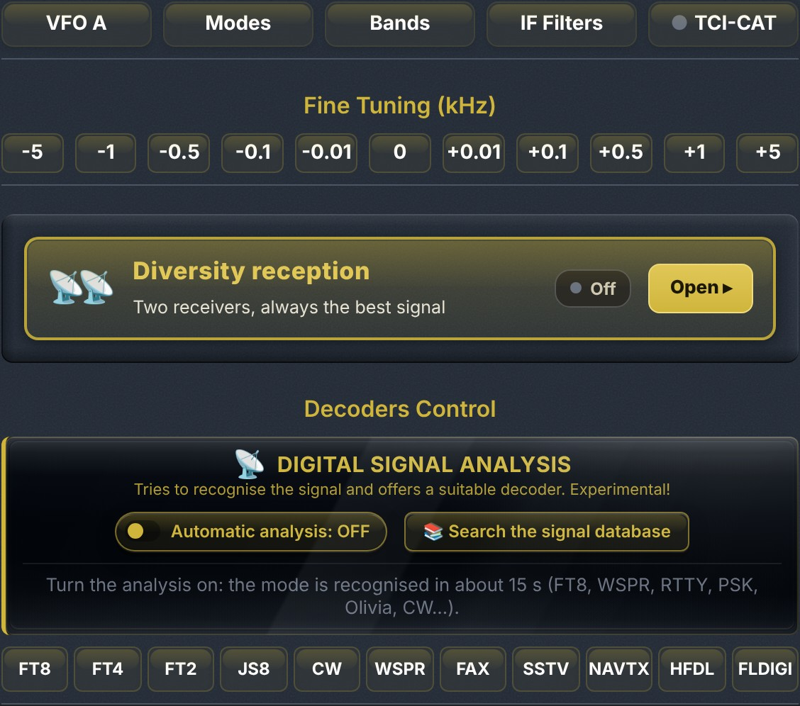{w=410}

## 9.1 Digital decoders

The **Decoders Control** row offers eleven decoders, each started with one click (a second click stops it):

| Button | Decoder | Use |
| FT8 / FT4 / FT2 | WSJT weak-signal digital modes | DX traffic, propagation |
| JS8 | JS8Call | Weak-signal keyboard messaging |
| CW | Morse telegraphy | Automatic Morse copy |
| WSPR | WSPR beacons | Propagation study |
| FAX | HF FAX / WEFAX | Radio-facsimile weather charts |
| SSTV | Slow-scan television | Amateur pictures |
| NAVTX | NAVTEX | Navigational warnings (518 / 490 kHz) |
| HFDL | HF Data Link | Aircraft ACARS messages on shortwave |
| FLDIGI | fldigi family | RTTY, SITOR, PSK31, Olivia, MFSK, DominoEX, THOR, THROB, Hellschreiber, MT63, Packet, APRS |

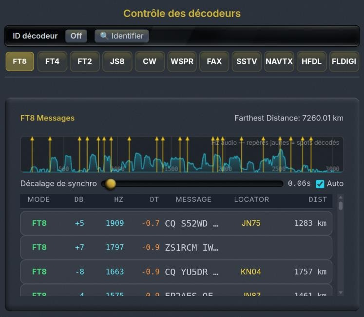{w=375}

- **Audio waveform** — yellow markers flag each decoded signal in the passband.
- **Farthest Distance** — distance of the farthest contact since the session started.
- **Sync offset** — timing correction, adjusted automatically when **Auto** is ticked.
- **Table** — one row per decode: MODE, DB (level), HZ (audio frequency), DT (timing offset), MESSAGE, LOCATOR (Maidenhead grid) and DIST (estimated distance).
> [Tip] The FT8/FT4/WSPR decoders require tuning to the mode’s frequency (e.g. 7074 kHz USB for FT8 on 40 m).

**Known frequencies.** The FT8 / FT4 / FT2, JS8, WSPR and SSTV panels have a **Known frequencies** menu: picking a band tunes the receiver straight to the mode's usual frequency, in USB.

**Station map.** The FT8 / FT4 / FT2, WSPR and JS8 panels have a **🗺 Map (n)** button: every station heard whose message carries a locator is placed on it (CQ calls almost always do). **⤢ Large view** opens the map in a floating window that can be moved and resized; hovering a dot shows the callsign and message, a click opens its QRZ page.

## 9.2 Digital signal analysis

The **Digital signal analysis** module, just above the decoder row, **tries to recognise the mode** of the signal you are hearing (FT8, WSPR, RTTY, PSK, Olivia, CW…) and **offers the right decoder**. This feature is **experimental**.

{w=380}

- **Automatic analysis: OFF / ON** — continuously analyses the signal in the passband. The mode is usually recognised within about fifteen seconds.
- **Current measurement** — the recognised mode and what was measured: width, tone spacing (shift), baud rate, timing, signal-to-noise ratio.
- **Recognised modes, by relevance** — modes already seen stay listed with their score, number of detections and age; the **▶ Launch** button opens the matching decoder and the **i** icon shows the mode's reference entry.
- **Recentre & retry** — appears when the signal sits too close to the edge of the filter, where the measurement is unreliable.
- **📚 Search the signal database** — opens the “Identify a signal” window (section 9.3).

> [Tip] Automatic analysis is off by default: it only uses CPU while it is on. It never switches decoder by itself: it only makes suggestions.

## 9.3 Identify a signal (Artemis database)

The **📚 Search the signal database** button opens a window that searches **583 reference signals** (Artemis database, from the Signal Identification Wiki) for matches to the current frequency, filter width and demodulation. Signals are ranked by match percentage.

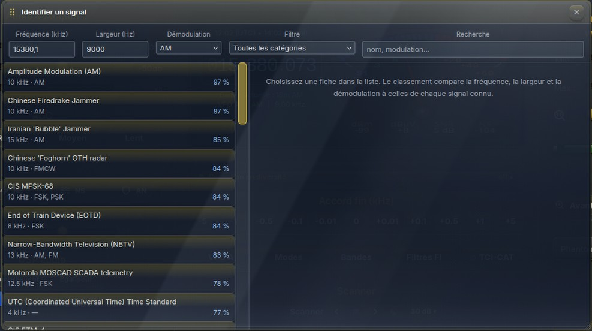{w=440}

- **Floating window** — it opens at the bottom of the screen without hiding the waterfall; **move** it by dragging its title bar (⠿) and **resize** it from its bottom-right corner. Esc or ✕ closes it.
- **Frequency**, **Width**, **Demodulation** — ranking criteria, editable.
- **Filter** — drop-down list of categories: amateur radio, military, marine, aviation, analogue broadcast, digital, time signals, radar, satellites, interference, numbers stations… A category shows all its entries, even away from the current frequency.
- **Search** — free text: name or modulation.
- **Wide gold scroll bars** — drag them, or click the track to move by one page.

Clicking an entry shows its **reference sheet**: reference spectrogram, **audio sample** to compare by ear (the receiver audio is muted while it plays), width, modulation, receive mode, frequency range, category, area, description and a link to the full Signal Identification Wiki page.

## 9.4 FLDIGI decoder (FSK / RTTY and other modes)

{w=204,side}
- **Variant** — maritime FSK / SITOR, weather RTTY, amateur RTTY, PSK31, Olivia, MFSK16·32·64, DominoEX, THOR, THROB, Hellschreiber, MT63, Packet (AX.25), APRS.
- **Known frequency** — list of reference frequencies (NAVTEX 518 / 490 kHz, HF SITOR MSI, NBDP…), then **Tune**.
- **Upcoming broadcasts · UTC** — schedule of NAVTEX stations on air and coming up.
- **Audio centre**, **Shift**, **Baud**, **Framing** and **Encoding** (CCIR-476, ITA2/Baudot, ASCII).
- **Invert mark / space** — tick it for weather RTTY, leave it unticked for maritime FSK and amateur RTTY; **Auto shift detection**.
- **Set IF passband** and **Auto centre**; Mark / Space, SNR, Lock and Timing indicators.
- Decoded text area, **Clear** and **Save text**.

> [Tip] While running, this decoder takes control of the mode and IF filter: pick a known frequency, then fine-tune until the text stabilises.

## 9.5 HFDL decoder

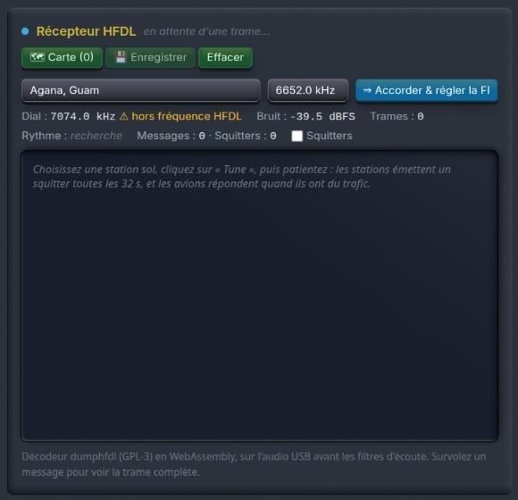{w=204,side}
- **Ground station** — choose an HFDL station (Shannon, Reykjavik, Canarias, Riverhead, Johannesburg…) and one of its frequencies, then **Tune & set IF**.
- The **Dial** indicator shows whether you are off an HFDL frequency; **Noise**, **Frames**, **Rate**, and the **Messages** and **Squitters** counters follow the decoding.
- Tick **Squitters** to show the ground stations' beacons too.
- Hover over a message to see the full frame; **Save** and **Clear** manage the log.

**Clickable identifiers.** In the message list, the aircraft's **flight number**, **registration** and **ICAO code** (transponder address) are links: a click opens its **FlightAware** page in a new tab. The ICAO link often finds the aircraft even when the flight has no page.

**Aircraft map.** The **🗺 Map** button shows, below the controls, the aircraft whose position has been received; **⤢ Large view** opens the same map in a **large floating window**, movable by its title bar and resizable from its corner; **⌖ Show all** zooms to all aircraft, Esc or ✕ closes it.

- Each aircraft is a **small gold plane pointing along its heading**, worked out from its last two positions.
- Its **track** is drawn in **red**.
- **Clicking the plane** opens its FlightAware page (flight, otherwise registration, otherwise ICAO code).

> [Tip] Ground stations send a squitter every 32 s and aircraft answer when they have traffic: wait a few minutes and choose a frequency where propagation is open towards the selected station. Only some messages (position reports) carry a position, so the map fills up gradually.

# 10. Waterfall controls

These controls, at the top of the right column, only change the display of the spectrum and waterfall, never the audio.

## 10.1 Automatic and manual adjustment

- **Automatic adjustment** — large gold button, **on as soon as the page opens**: this is the normal, recommended setting. It continuously measures the noise floor across the displayed width, turns it into an even dark background and brings out weak signals, whatever the palette. A click turns it off; the button then reads “Back to automatic adjustment”.
- **Manual adjustment** — a frame with two sliders, usable only when automatic adjustment is off (in automatic mode they are greyed out and show the values it chose):
- **Background (noise)** — level shown as black: raise it to darken the noise floor.
- **Strong signals** — level shown at full colour: lower it to bring out weak signals.

## 10.2 Colours

The **Colours** drop-down chooses the waterfall palette; a thin strip previews each one: Turbo, Gqrx, Twente, Twente v2, SpectraVU, Jet, Custom and PhantomSDR. The choice is remembered by the browser.

## 10.3 3D spectrum

The small **3D** button (pyramid), to the right of **Automatic adjustment**, shows the spectrum **in relief**: the latest traces stack up in perspective above the waterfall, the newest at the front. Frequency runs across, time runs into the distance, and strength is shown by height and colour.

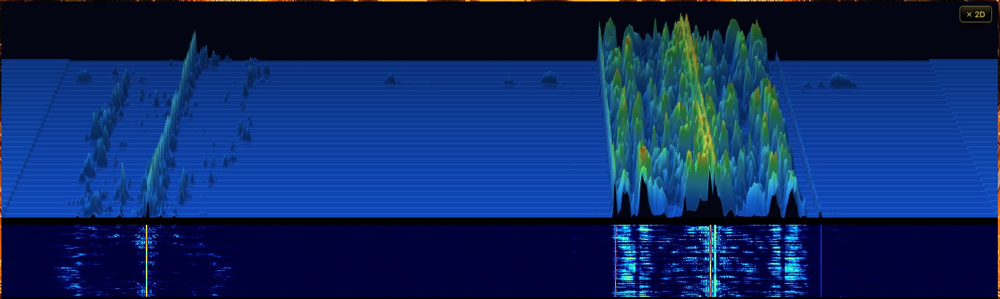{w=482}

- The view follows the waterfall's **zoom** and **panning**; you still tune by clicking the waterfall or the frequency scale.
- **dB scale** on the right: height of the peaks above the noise floor (+10, +20, +30 dB…).
- **Time markers** in depth: −5 s, −10 s… depending on the scrolling speed.
- Colours follow the **palette chosen for the waterfall** (**Colours** menu).
- **✕ 2D** or another click on **3D** brings back the classic spectrum.

> [Note] The 3D spectrum is computed by your computer's graphics card (WebGL2) and puts no load on the server. It is off by default; the button does not appear if the browser lacks WebGL2.

## 10.4 Magic eye, zoom and connection

- **Magic eye** — glowing green bar that responds to the received signal strength, as on old valve receivers.
- **Zoom** — **To band** frames the waterfall on the band of the tuned frequency; **In**, **Out**, **Max**, **Min**. The mouse wheel also zooms directly on the waterfall.
- **Connection indicator** — number of connected users and data rate (kbit/s) received by your browser.

> [Tip] Keep automatic adjustment on: it gives a readable waterfall straight away. Manual adjustment is only for special needs, such as bringing out a very faint signal.

# 11. Audio analyser

The **📊 Show / Hide** button of the **Audio analyser**, in the right-hand column, opens above the panels an analyser of the station you are hearing. It works on the receiver's **raw audio**: before mute, squelch, AGC, noise reduction, notch and equaliser. It therefore judges the station's modulation, not your listening settings, and **keeps working when the sound is muted**. The **Gain** control only affects the display.

The display adapts to the mode by itself: audio spectrum in USB, LSB and CW; **RF view** in AM and FM.

> [Tip] A detailed, illustrated guide to the audio analyser is available in the “Information” menu, under **Audio analyser guide**.

## 11.1 Base frequency and hover readout

- A banner shows the **base frequency** (the dial frequency) and the mode in plain text; on the right, the **Mute** button mutes the receiver without stopping the analysis.
- A **gold line** marks it in the spectrum: at 0 Hz audio in SSB (the suppressed carrier), on the 750 Hz note in CW.
- **Hovering with the mouse** shows the **exact RF frequency** of the point and its audio frequency.
- In **LSB** the axis is **reversed** (treble on the left) to follow the RF spectrum; the note “LSB: axis reversed” recalls it.

## 11.2 Bandwidth markers and filter

- Permanent **markers** show the recommended width for the mode: **standard SSB 300–2700 Hz** and **ESSB 50–4000 Hz**; **CW 500 Hz** and **250 Hz**; in AM, **±4.5 kHz** (broadcast) and **±3 kHz** (amateur); in narrow FM, **±5.5 kHz** (Carson bandwidth).
- A white dotted box shows the receiver's **current filter**.

## 11.3 Occupied bandwidth and splatter

The analyser measures on the waterfall the **occupied bandwidth** of the tuned station (“−26 dB” method, over 6 s, static crashes ignored) and compares it with the norms for the mode. A line under the spectrum gives the verdict: compliant, a little wide, or **probable splatter**; the overflow is coloured amber or red on the spectrum.

> [Tip] The measurement needs a fine enough waterfall: zoom in on the station. Otherwise the analyser says “Zoom in on the station in the waterfall…”.

## 11.4 RF view in AM and FM

In AM and FM the demodulated audio no longer contains the carrier (it moves to 0 Hz and both sidebands overlap). The analyser therefore automatically shows the station **as it is on RF**: **carrier in the centre** (gold line), sidebands on either side, an axis graduated in offset from the carrier and the level in dB above the noise. Sideband symmetry and carrier level can be read at a glance. Displayed width: ±6 kHz in AM, ±8 kHz in FM, ±120 kHz in wide FM.

## 11.5 SSB audio report

In **USB** and **LSB**, an **SSB audio report** box analyses the modulation over a sliding 20 s, only while the station is talking. Verdicts appear after 3 s of voice; each line has a green, amber or red light (grey: cannot be measured, with the reason).

| Criterion | What is measured |
| Bass 100–300 Hz | Bass energy relative to the midrange, compared with the chosen reference |
| Presence 1.5–2.7 kHz | Presence energy relative to the midrange: muffled or harsh voice |
| Compression | Peak-to-average ratio of the voice: little, correct or excessive compression |
| Mains hum | Stable lines at 50/100/150 Hz (or 60/120/180 Hz) |
| Residual carrier | Carrier level below the voice peaks, measured on the waterfall |
| Opposite sideband | Energy in the other sideband; another station there is reported (QRM) |
| Occupied bandwidth | The splatter measurement |

- **Judge the voice against:** — **standard SSB**, **DX / punch** (boosted presence) or **ESSB / hi-fi** (bass kept): the balance is judged against this choice.
- **Blue “average voice” curve** — the average shape of the voice, drawn on the spectrum.
- **Store A** — freezes this curve as a white dotted line: the other station changes its settings and you compare before and after (bass and presence differences shown). **Clear A** removes it.
- **↺ Restart** — starts again from scratch (also done automatically when frequency or mode changes).
- **🎧 Generate a listening report** — downloads an HTML file to send to the other station: frequency, mode, verdicts, spectrum image and the last 20 seconds of audio (WAV).
- **Static crashes** (short, flat-spectrum clicks) are discarded; their share is shown when it exceeds 10 %.

> [Tip] An operator can analyse their own transmission: listen to yourself on ORSAT with the sound cut (**MUTE AUDIO** button), so as not to feed the audio back into the microphone, and read the report.

> [Note] Indicative measurement: fading, the receiver filter and weak signals affect it. To judge the bass, the filter must reach down to about 120 Hz; for presence, up to about 2.6 kHz.

# 12. Bookmarks

{w=198,side}
- **Add a bookmark** — enter a Name and a short Label, then **Add**: the current frequency and tuning settings are stored.
- **Current link** — URL of the current frequency and mode, to share with **Copy**.
- **Import / Export bookmarks** — save or restore the list to or from a file. Reload the page (F5) if imported bookmarks do not appear.
- **Saved bookmarks** — click an entry to tune the receiver.

> [Tip] Bookmarks are stored in your browser, on your computer: export them to find them again on another machine.

# 13. “Information” menu

The central banner button unfolds this menu, which gathers the companion tools: hamdash, DX cluster synchronisation, station configuration, links and manuals.

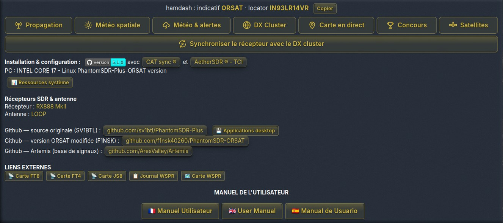{w=482}

## 13.1 hamdash tools

The **hamdash** line recalls the station callsign (ORSAT) and locator; **Copy** puts them on the clipboard to paste into hamdash. The seven buttons open the matching dashboards:

| Button | Content |
| Propagation | HF propagation forecasts |
| Space weather | Solar wind, K and A indices, flares |
| Weather &amp; alerts | Local weather and thunderstorm alerts |
| DX Cluster | Live DX cluster spots |
| Live map | Map of active bands and stations |
| Contests | Contest calendar |
| Satellites | Amateur satellite passes |

The large **Sync the receiver with the DX cluster** button opens the window described in section 14.

## 13.2 Setup & configuration

- **ORSAT 1.0** and **base 5.1.0** — ORSAT version and the PhantomSDR-Plus version it is built on.
- **CAT sync** and **AetherSDR - TCI** — synchronisation features available on this receiver (section 4.5).
- **PC** — server hardware and operating system.
- **System resources** — server load window (below).

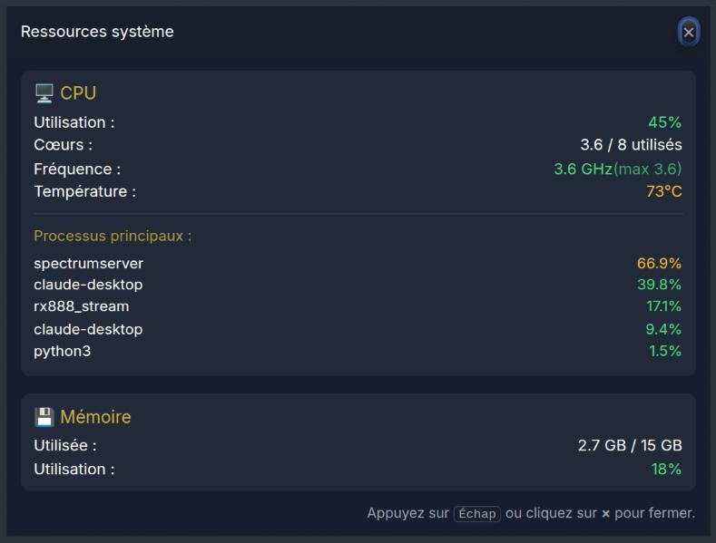{w=299}

It shows processor usage and frequency, the number of cores in use, its temperature, the most demanding processes and memory use — useful to understand a slowdown. Close with Esc or the cross.

## 13.3 Receiver, antenna and links

- **Receiver**: RX888 MkII — **Antenna**: LOOP.
- **Github — original source (SV1BTL)**, **ORSAT modified version (F1NSK)** and **Artemis** (signal identification database).
- **Desktop applications** — download PhantomSDR+ Desktop for Linux and Windows, to listen from a native application.
- **External links** — quick links to the PSK Reporter **FT8**, **FT4**, **JS8** maps, the **WSPR log** and the **WSPR map**.

## 13.4 User manuals

The **User manual** section gathers the three versions of this document: **Manuel Utilisateur** (French), **User Manual** (English) and **Manual de Usuario** (Spanish). Each opens in its own window, closed with the cross or the Esc key.

# 14. DX Cluster

The **DX Cluster · DX Summit** window shows, in real time, the spots posted by the worldwide amateur radio community: UTC time, frequency (kHz), DX callsign, spotter and comment.

{w=344}

- **Click a blue frequency** — immediately tunes the receiver to the spot.
- Greyed spots are on frequencies the receiver does not cover (VHF/UHF, for example).
- **Band filter** — All bands, or one band from 160 m to 6 m.
- **↻** — immediate refresh; the list also updates itself every 30 s. **×** closes the window.
> [Tip] The DX cluster and the Users window (TUNE button) are the two quickest ways to “follow the DX” spotted by other operators or heard by other listeners.

# 15. Tips, troubleshooting and good practice

## 15.1 Listening quality

- First choose an IF filter suited to the mode (wide for AM/FM, narrow for CW), then enable noise filters one at a time.
- In SSB or AM, try the **AI Audio Filter** at 50 % before pushing its strength.
- Keep the waterfall's **automatic adjustment** on to clearly separate weak signals from the noise floor.

## 15.2 Audio dropouts or latency

- Increase the audio **buffer** (section 5.1) on a slow or unstable connection.
- Check **System resources** (section 13.2): a high server load can explain a slowdown.
- Watch the **data rate** shown at the bottom of the right column.

## 15.3 Decoders

- When unsure about a signal, start the **automatic analysis** or look it up in the **signal database** before choosing a decoder.
- Run only one decoder at a time and tune to the mode’s own frequency.

## 15.4 Shared use

- Several listeners share the same receiver, each with their own tuning and audio settings, without affecting the others.
- The labels below the waterfall and the Users window show where the others are listening; the ★ ADMIN message keeps you informed about the site.
