# 1. Introducción general

PhantomSDR-Plus es un receptor de radio definido por software (SDR) que se utiliza desde un simple navegador web, sin instalar nada. La interfaz muestra en tiempo real el espectro de RF y la cascada (waterfall) del receptor, y permite escuchar, sintonizar y decodificar las señales recibidas directamente desde el navegador. PhantomSDR pretende ser una alternativa moderna al WebSDR de PA3FWM.

La estación **ORSAT** utiliza la versión 5.1.0 de PhantomSDR-Plus (proyecto original de SV1BTL), modificada por F1NSK con el nombre **ORSAT 1.0**: tema «oro viejo», interfaz totalmente traducida al francés, inglés y español, sincronización con el DX cluster, decodificadores adicionales (HFDL con mapa de aviones, familia FLDIGI), análisis e identificación de señales, espectro 3D, analizador de audio e informe de modulación SSB, recepción en diversidad y herramientas hamdash integradas.

Este manual describe, zona por zona, todos los controles visibles en pantalla: dónde están, para qué sirven y cómo usarlos. Cada función compleja va acompañada de una captura de la ventana o del panel tal como aparece realmente en la interfaz.

> [Nota] La interfaz ORSAT está pensada para un **ordenador** o una **tableta**, sea cual sea el tamaño de la pantalla. Un teléfono se dirige automáticamente a la página ligera **/mobile**.

## 1.1 Organización de la pantalla

- **Banda superior** — identificación de la estación, enlaces, reloj, idioma y menú «Información» (sección 2).
- **Zona central** — banda «Índice de rendimiento», espectro, cascada, regla de frecuencias y marcas de bandas (sección 3).
- **Columna izquierda** — audio, AGC, filtros de ruido, DSP, QRSS y grabación (secciones 5 a 7).
- **Columna  central** — dial de frecuencia, S-meter, bandas/modos/filtros, sintonía fina, diversidad y decodificadores (secciones 4, 8 y 9).
- **Columna derecha** — controles de la cascada (ajuste automático, colores, espectro 3D), analizador de audio, marcadores e indicador de conexión (secciones 10 a 12).

## 1.2 Elección del idioma

Los botones con bandera **FR**, **EN** y **ES**, a la derecha de la banda superior (icono de globo), cambian al instante toda la interfaz — etiquetas e información sobre herramientas — a francés, inglés o español. El navegador recuerda la elección para las próximas visitas.

## 1.3 Información sobre herramientas

Casi todos los botones, cursores y zonas muestran un **texto de ayuda** cuando se deja el ratón inmóvil sobre ellos un instante. Es la forma más rápida de descubrir un control sin salir de la pantalla de recepción.

> [Consejo] La interfaz es totalmente reactiva: la mayoría de los ajustes (banda, modo, filtros, ganancia) se aplican al instante, sin validación. Cada usuario tiene su propia sintonía y sus propios ajustes, que no afectan a los demás usuarios conectados al mismo receptor.

> [Nota] Al abrir la página, los navegadores bloquean el sonido hasta que el usuario interactúa: aparece un velo «Toque para activar el audio» — basta un clic para empezar a escuchar.

# 2. Banda superior

La banda situada en lo alto de la pantalla identifica la estación que aloja el receptor y reúne los enlaces y herramientas complementarias, el reloj, el selector de idioma y el botón que abre el menú «Información».

{w=482}

## 2.1 Línea de identificación de la estación

La primera línea muestra el nombre de la estación, su ubicación y su locator Maidenhead (Christus Lake - SW France, IN93LR14VR). Contiene dos botones:

- **ORSAT** — abre la página QRZ.com del sysop de la estación.
- **Christus Lake - SW France, IN93LR14VR** — abre un mapa satelital centrado en el QTH del receptor.

## 2.2 Segunda línea: contacto, usuarios y estadísticas

- **e-mail** — abre un mensaje dirigido al sysop (pregunta, aviso de un problema…).
- **Usuarios** — ventana de los usuarios conectados en tiempo real (ver abajo).
- **Estadísticas** — panel de estadísticas de conexión (ver abajo).
- **Otros servidores: 1, 2, 3** — directorios de otros WebSDR: 1 = sdr-list.xyz, 2 = sdr.shbrg.nl, 3 = websdr.org.

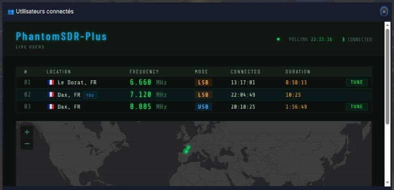{w=482}

La ventana **Usuarios conectados** muestra cada oyente (ubicación aproximada, frecuencia y modo, hora de conexión y duración). Su propia línea lleva la marca **YOU**. El botón **TUNE** de una línea sintoniza su receptor en la misma frecuencia y el mismo modo que ese usuario. Un mapa sitúa a los oyentes; el indicador Polling confirma la actualización automática.

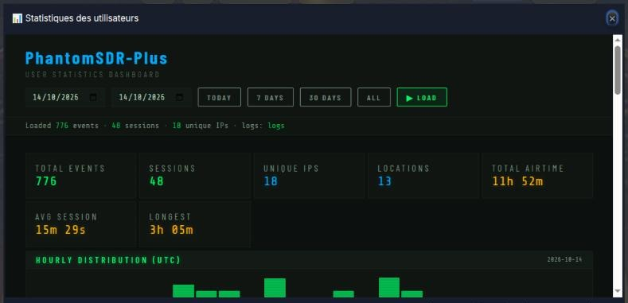{w=482}

La ventana **Estadísticas** presenta la actividad del receptor en un periodo elegido (fechas de inicio y fin, o botones **Today**, **7 days**, **30 days**, **All**, y luego **Load**): número de eventos y de sesiones, direcciones únicas, número de ubicaciones, tiempo total de escucha, duración media y sesión más larga, e histograma de la distribución horaria (UTC). Ambas ventanas se cierran con la cruz o la tecla Esc.

## 2.3 Tercera línea: búsqueda de frecuencia y de indicativo

- **MW** / **SW** — bases de datos para identificar la emisora de radiodifusión escuchada en onda media o corta.
- **PSK Reporter** — mapa comunitario de informes de recepción de modos digitales.
- **WSPRnet** — base de informes del modo baliza WSPR.
- **Búsqueda de indicativo** — escriba un indicativo en el campo y pulse **Buscar**.

## 2.4 Reloj UTC / Local

A la izquierda, un reloj digital muestra la hora y la fecha. El botón **UTC** la muestra en tiempo universal coordinado — la referencia para los modos digitales, los horarios de emisión y el DX cluster — y el botón **LOCAL** en la hora local de su ordenador.

## 2.5 Idioma y menú «Información»

A la derecha están los botones de idioma descritos en la sección 1.2. En el centro, el botón **Abrir Meteo - Alertas - Info - Propagación - DXcluster y Manuales de usuario** despliega el menú «Información» detallado en la sección 13; entonces pasa a **Cerrar las ventanas** para plegarlo.

# 3. Pantalla principal: espectro y cascada

La zona central muestra dos representaciones complementarias de la señal recibida:

- **El espectro** (parte superior) — amplitud de la señal en función de la frecuencia, en el instante presente.
- **La cascada / waterfall** (parte que se desplaza) — historial del espectro en el tiempo; el color indica la intensidad recibida.
- **La regla de frecuencias** y, debajo, las **marcas de bandas y servicios** (MW, 120m, Maritime, Aeronautical, CB, 10m…).
- **El espectro 3D** (opcional) — el espectro también puede mostrarse en relieve: véase la sección 10.3.

{w=482}

## 3.1 Sintonía con el ratón y la rueda

- **Clic** en el espectro o la cascada — sintoniza el receptor en la frecuencia pulsada; arrastrar desplaza el filtro.
- **Arrastre horizontal** — desplaza la porción visible de la banda sin cambiar la frecuencia de escucha.
- **Rueda** — acercar / alejar.
- **Mayús + rueda** — sintonía en pasos de 0,1 kHz; **Ctrl + rueda** — pasos de 0,01 kHz.
- **Mayús + Ctrl + rueda** — ajusta la frecuencia al kilohercio redondo (.00 kHz).

## 3.2 Etiquetas de los oyentes y mensaje del administrador

Bajo la regla, pequeñas etiquetas con bandera (p. ej. Le Dorat, Dax) indican la frecuencia que escucha cada uno de los demás usuarios conectados; su propia posición está marcada con una estrella. El pequeño botón redondo **●** a la derecha de la zona permite **ocultar o mostrar** estas etiquetas.

Cuando una banda **★ ADMIN** atraviesa la cascada, se trata de un mensaje difundido por el sysop a todos los oyentes (mantenimiento, nueva versión, interrupción prevista…).

> [Consejo] Los colores, el brillo y el contraste de la cascada se ajustan en la columna derecha (sección 10).

## 3.3 Banda «Índice de rendimiento»

Justo encima de la cascada, una banda fina indica, **banda por banda**, la capacidad de ORSAT para oír estaciones **en este momento**. El servidor la recalcula continuamente, incluso cuando nadie escucha.

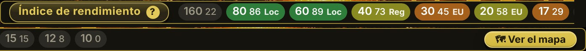{w=440}

- **Pastillas** — una por banda, con una nota de **0 a 100** y su color: **verde** excelente (75 o más), **oliva** bueno (50 a 74), **naranja** regular (25 a 49), **gris** débil (menos de 25). La banda que escucha aparece resaltada.
- **Zona** — **Loc** (hasta 300 km), **Reg** (300 a 900 km), **EU** (900 a 2500 km) o **DX** (más allá): la distancia a la que ORSAT escucha mejor en esa banda.
- **Al pasar sobre una pastilla** — el detalle: nota prevista, medida real y lo que la calibración ha constatado los días anteriores.
- **🗺 Ver el mapa** (o un clic en cualquier parte de la banda) — abre el mapa detallado de las zonas donde ORSAT escucha bien, banda por banda; el botón **✕ Cerrar** lo cierra.
- **Índice de rendimiento ?** — el título es un botón: abre la explicación completa del cálculo.

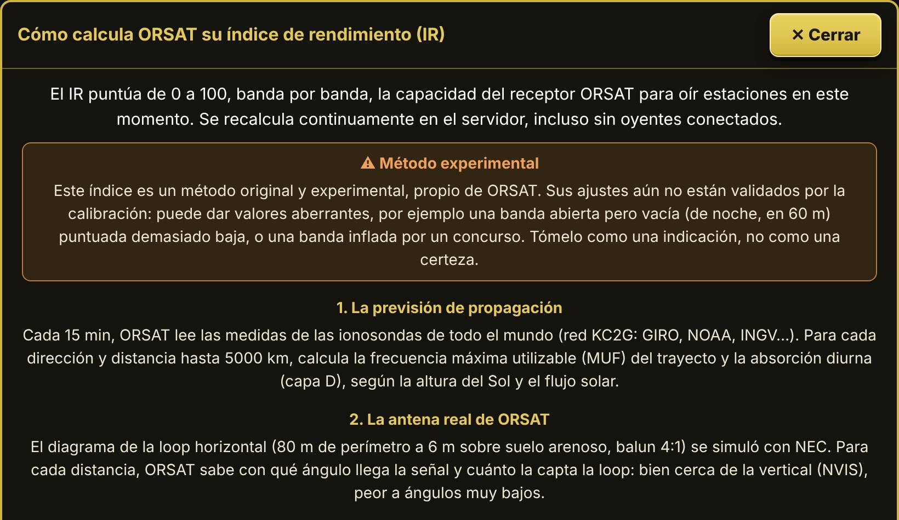{w=330}

El índice combina dos cosas:

- **una previsión**: cada 15 minutos, el servidor lee las medidas de las ionosondas de todo el mundo (red KC2G), calcula la frecuencia máxima utilizable y la absorción diurna para cada dirección y distancia, y las pondera con el diagrama real de la antena loop de ORSAT;
- **una medida real**: cada 5 minutos, ORSAT escucha él mismo cada banda unos segundos en su cascada, cuenta las señales y anota la mejor relación señal/ruido.

Cuando la medida tiene menos de 15 minutos, el índice vale 40 % de previsión y 60 % de medida; si no, solo la previsión.

# 4. Dial, bandas, modos y filtros

La columna central reúne todo lo relativo a la sintonía del receptor.

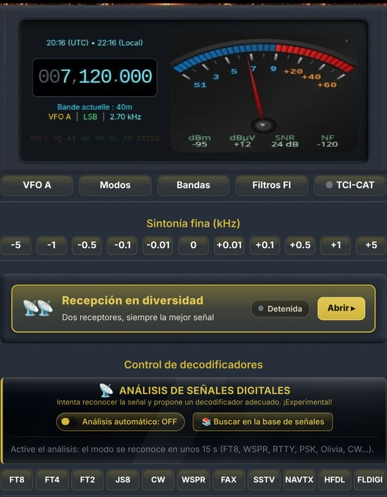{w=275}

## 4.0 Dial de frecuencia, S-meter e indicadores

{w=410}

El dial muestra la hora UTC y local, la frecuencia sintonizada (p. ej. 007,120.000 kHz), y luego la banda actual, el VFO activo, el modo y el ancho del filtro (Banda actual: 40m — VFO A | LSB | 2.70 kHz).

- **Sintonía directa en las cifras** — pase el ratón sobre una cifra de la frecuencia y gire la rueda para cambiarla; un **clic derecho** en el dial permite escribir directamente una frecuencia.
- **Indicadores de estado** — **SILENCIO**, **SQ** (silenciador), **AI** (filtro IA), **NR**, **NB**, **NS**, **AN** y **CTCSS** se iluminan cuando la función está activa: de un vistazo se ve qué procesos están en marcha.
- **S-meter analógico** — graduado de S1 a +60 dB, con cuatro medidas bajo la aguja: **dBm** y **dBµV** (nivel recibido), **SNR** (relación señal/ruido) y **NF** (ruido de fondo).
Un **clic en el S-meter** recorre sus tres estilos: **oscuro**, **claro** y **vintage**.

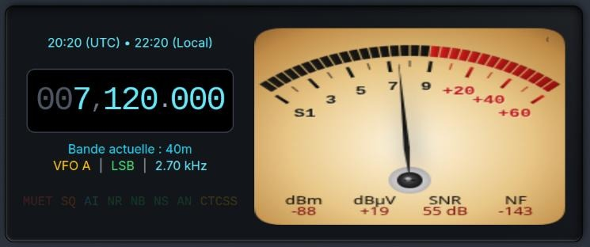{w=236}

## 4.1 Selector de bandas

El botón **Bandas** abre la lista de bandas de radioaficionado (2200 m a 10 m, CB, 11 m SSB) y de radiodifusión (VLF, LF, LW, MW, 180 m a 13 m AM). Un clic sintoniza el receptor en una frecuencia representativa de la banda, en el modo habitual; la banda actual aparece resaltada.

{w=386}

## 4.2 Modos de demodulación

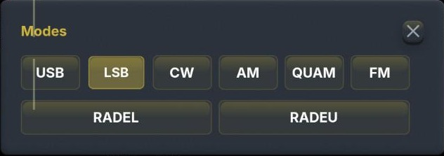{w=386}

- **USB / LSB** — banda lateral única (por convención LSB por debajo de 10 MHz, USB por encima).
- **CW** — telegrafía, con un filtro estrecho adaptado al Morse.
- **AM** — modulación de amplitud clásica; **QUAM** — demodulación AM en cuadratura.
- **FM** — modulación de frecuencia.
- **RADEL / RADEU** — decodificación de la voz digital **FreeDV** (modo RADE) en banda lateral inferior / superior.

## 4.3 Filtros FI

El botón **Filtros FI** abre la ventana «Filtros FI fijos»: doce anchos predefinidos de 500 Hz a 10 kHz, y un cursor **Ancho de banda (centro → borde)** para un ajuste continuo, con el valor en Hz. El botón **Restablecer** vuelve al ancho por defecto del modo.

{w=386}

> [Consejo] Un filtro estrecho reduce el ruido y las interferencias cercanas, pero puede recortar parte de la señal útil. En CW, unos cientos de hercios mejoran mucho la lectura de las señales débiles.

## 4.4 VFO A / B

El botón **VFO A** alterna entre dos VFO: guarde una frecuencia en uno y explore la banda con el otro, y vuelva a la primera con un clic.

## 4.5 TCI-CAT

El botón **TCI-CAT** abre la ventana «Control CAT vía TCI», que sincroniza la interfaz web con un programa instalado en su ordenador (**ExpertSDR**, **AetherSDR**, **Thetis**): los puertos TCI habituales 50001 y 40001 se buscan automáticamente.

{w=386}

- **Estado** — Inactivo, Espere o conectado; el punto delante de **TCI-CAT** en el botón lo refleja.
- **Sincro CAT** — activa la sincronización de frecuencia: un cambio en un lado se repite en el otro.
- **Host** — máquina donde se ejecuta el programa TCI (localhost por defecto, o su dirección IP en la red local).
> [Consejo] Este enlace une el programa de su ordenador con la sintonía hecha en el navegador; no acciona el transmisor del sitio y no sustituye una conexión CAT directa con un transceptor.

## 4.6 Sintonía fina

La fila **Sintonía fina (kHz)** desplaza la frecuencia por pasos fijos: **-5, -1, -0.5, -0.1, -0.01, 0, +0.01, +0.1, +0.5, +1, +5** kHz. Los pasos pequeños sirven para centrar una señal CW o digital, los grandes para saltar de una señal a otra.

# 5. Columna de control de audio (izquierda)

La columna izquierda reúne los ajustes de reproducción y procesado del sonido.

## 5.1 Audio y búfer

{w=200,side}
- **SILENCIAR** — botón grande a la izquierda del volumen: un clic corta el sonido, el botón se vuelve **rojo** y muestra **SILENCIADO**; otro clic restablece la escucha. Pensado para el oyente que pasa a transmisión sin enlace automático entre su transceptor y el ordenador: evita el **acoplamiento (larsen)**.
- **Volumen** — cursor del nivel de escucha, a la derecha del botón.
- **SQ** (silenciador) — el cursor fija el umbral en dB. El botón **SQ** ofrece un **silenciador automático**: sitúese en una frecuencia silenciosa, haga clic para medir el ruido y el umbral se ajusta solo; un nuevo clic lo desactiva.
- **Búfer** (icono de globo) — multiplicador del búfer de audio (×1 por defecto). Auméntelo si su conexión a Internet es lenta o inestable, a costa de algo de latencia.

## 5.2 AGC

El control automático de ganancia mantiene un nivel de escucha uniforme. La información emergente de cada botón indica su uso recomendado según el modo:

- **Auto** — el CAG del receptor, polivalente: buena opción por defecto para la escucha general.
- **Rápido** (recupera en unos 0,3 s) — ideal en **CW** y **modos digitales** (RTTY, PSK…), y en bandas ruidosas (QRN, parásitos).
- **Medio** (retención 0,25 s, recuperación 1,2 s) — ideal en **SSB** para los QSO, y en **AM con desvanecimiento**.
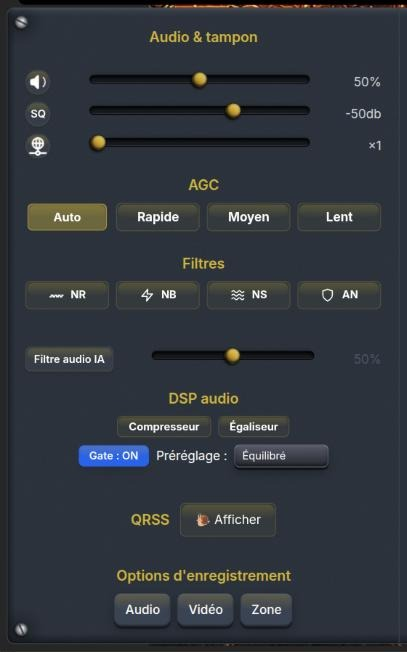{w=187,side}
- **Lento** (retención 1 s, recuperación 3 s) — ideal en **AM** de radiodifusión y para señales SSB estables. Los cuatro dan el mismo volumen; solo difieren en cómo reacciona la ganancia entre palabras y tras una señal fuerte. Mientras hay un decodificador abierto, el CAG se mantiene en **Lento** para él, como indica una mención junto al título.

## 5.3 Filtros de ruido y filtro de audio IA

- **NR** — reducción de ruido de banda ancha (ruido de fondo continuo).
- **NB** — supresor de ruido impulsivo (parásitos de encendido, chasquidos).
- **NS** — supresión del soplido.
- **AN** — notch automático: detecta y atenúa las portadoras fijas (heterodinos).
- **Filtro de audio IA** — reductor de ruido neuronal, activo solo en **SSB y AM/SAM**. El cursor dosifica su acción: hasta el 50 %, ajuste suave original; por encima, filtrado enérgico (hasta 40 dB de reducción, silencios limpios). Redúzcalo si las estaciones QRP dejan de oírse.
> [Consejo] Active los filtros de uno en uno escuchando el efecto: acumular varios procesos agresivos suele empeorar la inteligibilidad en lugar de mejorarla.

## 5.4 DSP de audio: compresor, ecualizador y gate

Los botones **Compresor** y **Ecualizador** abren cada uno una ventana de ajuste con su propio interruptor de activación y un botón **Restablecer**.

{w=236}

- **Compresor** — **Umbral** (dB donde empieza la compresión), **Relación** (p. ej. 4:1), **Ataque** y **Liberación** (ms), **Codo** (suavidad de la transición, dB) y **Compensación** de ganancia; la casilla **Compensación auto** calcula esa ganancia a partir del umbral y la relación.
- **Ecualizador** — seis bandas ajustables en ganancia: 100 Hz, 350 Hz, 1 kHz, 2 kHz, 3 kHz y 5 kHz.
- **Gate: ON / OFF** — reductor de ruido (noise gate) que funciona **en el servidor**, activado por defecto; corta el ruido entre palabras o transmisiones.
- **Preajuste** del gate: Equilibrado, Agresivo, Señal débil, Suave, Máximo, CW/Digital y AM/FM.
> [Consejo] Para destacar una voz en el ruido, atenúe ligeramente 100–350 Hz y refuerce un poco la zona de 1–2 kHz, donde se concentra la inteligibilidad de la palabra.

# 6. QRSS

El botón **Mostrar** abre los ajustes QRSS y añade bajo la cascada un espectrograma de muy alta resolución, destinado a las señales extremadamente lentas y de muy baja potencia (Morse a varios segundos por punto, DFCW). El botón pasa a **Ocultar** para cerrarlo todo.

{w=204,side}
- **Banda** — lista de ventanas QRSS conocidas (10140,00 kHz en 30 m — la principal —, 7039,90 y 7000,85 kHz en 40 m, 14096,90 kHz en 20 m, 80 m, 160 m, 630 m, 2200 m, 60 m, 17 m…), y luego **Sintonizar**.
- **Velocidad** — QRSS 3, 10, 30…: determina la finura del análisis tiempo-frecuencia.
- **Centro** — frecuencia de audio central observada (Hz).
- **Ancho** — ventana mostrada alrededor del centro; **Borrar** reinicia la visualización.
- **Ganancia** — contraste del overlay (dB).
- **Color** — paleta propia del overlay (Arco iris…).
- **Guardar en .PNG** — guarda una imagen del overlay.

{w=482}

La línea de indicadores bajo el overlay recuerda la resolución de análisis actual. Cuando la resolución vertical se señala como límite de visualización, reduzca el **Ancho** para ganar definición. Durante el QRSS, el AGC pasa automáticamente a lento.

> [Consejo] Las trazas QRSS se forman en varios minutos: deje funcionar el overlay en la ventana elegida (por ejemplo 10 140 kHz en 30 m) antes de concluir que no hay señal.

# 7. Grabación

La sección **Opciones de grabación** ofrece tres capturas locales, guardadas en su ordenador:

- **Audio** — graba solo el audio demodulado, en formato WAV.
- **Vídeo** — graba la cascada junto con el audio demodulado.
- **Zona** — trace con el ratón una zona en la cascada para grabar solo esa parte; si no se define ninguna, se graba el panel completo.
Un nuevo clic detiene la grabación y ofrece la descarga del archivo producido.

> [Consejo] La grabación captura exactamente lo que oye, filtros y DSP incluidos: compruebe modo, frecuencia y ajustes antes de empezar.

# 8. Recepción en diversidad

La **recepción en diversidad** asocia ORSAT a un **receptor asociado** situado a varios cientos de kilómetros. Los dos sitios no sufren los mismos desvanecimientos (QSB): ORSAT le hace oír en cada momento **el mejor de los dos**. El panel está en la columna central, bajo la sintonía fina; haga clic en su barra dorada (**Abrir ▸**) para desplegarlo.

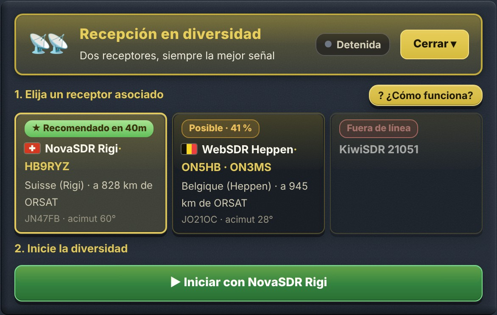{w=330}

1. **Elija un receptor asociado** — las tarjetas presentan los receptores elegidos por el sysop de ORSAT: bandera, nombre e indicativo, lugar y distancia, **locator** y **acimut** desde ORSAT.
2. **Inicie la diversidad** — el gran botón verde **▶ Iniciar con…**; se convierte en **■ Detener la diversidad** durante la escucha.
3. **Escuche** — «🎧 Está escuchando: ORSAT» o el nombre del asociado, el estado en claro (sincronizando, luego «Sincronizado ✓»), dos barras de calidad de señal y la parte del tiempo pasada en el asociado.

En cada tarjeta, una insignia da el consejo del momento **para la banda escuchada**; sigue la frecuencia cuando cambia de banda:

| Insignia | Significado |
| ★ Recomendado en 40m | El mejor asociado ahora: oye la misma zona que ORSAT, por otro camino |
| Posible · 41 % | Útil en parte: oye aproximadamente ese porcentaje de la zona que oye ORSAT |
| Poco útil en 40m | No oye las mismas estaciones que ORSAT en esta banda ahora |
| Fuera de línea | El receptor no responde (comprobado por el servidor cada 10 minutos) |

La sincronización de los dos receptores tarda **10 a 15 segundos** y necesita que una estación transmita. El asociado se ajusta automáticamente a la misma frecuencia, modo y filtro que ORSAT, y sigue cada cambio de sintonía.

La diversidad solo se aplica a los **modos de fonía** (USB, LSB, AM, SAM, QUAM, FM, WBFM): se desactiva si usa un decodificador, y se detiene en cuanto arranca un decodificador o cambia a otro modo.

> [Atención] **El uso de la recepción en diversidad aumenta notablemente la latencia de la recepción.** Para un QSO en directo, deténgala.

> [Consejo] La guía detallada «Recepción en diversidad» (menú Información) explica el principio, la sincronización, los indicadores y la resolución de problemas.

# 9. Decodificadores

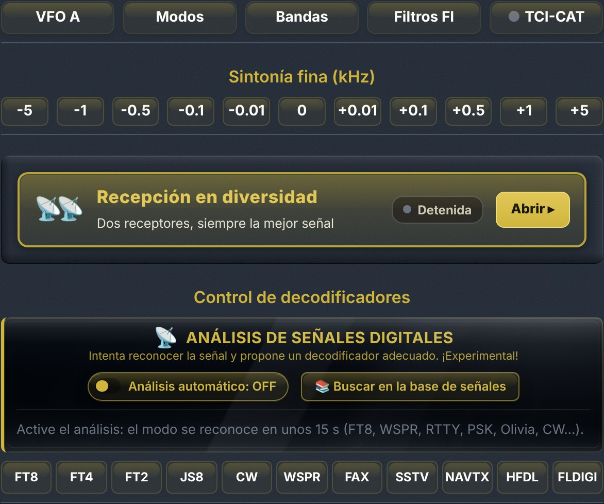{w=410}

## 9.1 Decodificadores digitales

La fila **Control de decodificadores** ofrece once decodificadores que se activan con un clic (un segundo clic los detiene):

| Botón | Decodificador | Uso |
| FT8 / FT4 / FT2 | Modos digitales de señal débil WSJT | Tráfico DX, propagación |
| JS8 | JS8Call | Mensajería de teclado de señal débil |
| CW | Telegrafía Morse | Lectura automática del Morse |
| WSPR | Balizas WSPR | Estudio de propagación |
| FAX | HF FAX / WEFAX | Mapas meteorológicos por radiofacsímil |
| SSTV | Televisión de barrido lento | Imágenes de radioaficionados |
| NAVTX | NAVTEX | Avisos a los navegantes (518 / 490 kHz) |
| HFDL | HF Data Link | Mensajes ACARS de aviones en onda corta |
| FLDIGI | Familia fldigi | RTTY, SITOR, PSK31, Olivia, MFSK, DominoEX, THOR, THROB, Hellschreiber, MT63, Packet, APRS |

{w=375}

- **Forma de onda de audio** — las marcas amarillas señalan cada señal decodificada en la banda de paso.
- **Farthest Distance** — distancia del contacto más lejano desde el inicio de la sesión.
- **Desfase de sincronización** — corrección del desfase temporal, ajustada sola cuando **Auto** está marcada.
- **Tabla** — una línea por decodificación: MODE, DB (nivel), HZ (frecuencia de audio), DT (desfase), MESSAGE, LOCATOR (cuadrícula Maidenhead) y DIST (distancia estimada).
> [Consejo] Los decodificadores FT8/FT4/WSPR exigen estar sintonizado en la frecuencia del modo (p. ej. 7074 kHz USB para FT8 en 40 m).

**Frecuencias conocidas.** Los paneles FT8 / FT4 / FT2, JS8, WSPR y SSTV tienen un menú **Frecuencias conocidas**: elegir una banda sintoniza el receptor directamente en la frecuencia habitual del modo, en USB.

**Mapa de estaciones.** Los paneles FT8 / FT4 / FT2, WSPR y JS8 tienen un botón **🗺 Mapa (n)**: cada estación oída cuyo mensaje contiene un locator se sitúa en él (las llamadas CQ casi siempre lo incluyen). **⤢ Gran formato** abre el mapa en una ventana flotante, desplazable y redimensionable; al pasar el ratón sobre un punto se ven el indicativo y el mensaje, un clic abre su ficha QRZ.

## 9.2 Análisis de señales digitales

El módulo **Análisis de señales digitales**, justo encima de la fila de decodificadores, **intenta reconocer el modo** de la señal que escucha (FT8, WSPR, RTTY, PSK, Olivia, CW…) y **propone el decodificador adecuado**. Esta función es **experimental**.

{w=380}

- **Análisis automático: OFF / ON** — analiza continuamente la señal de la banda de paso. El modo suele reconocerse en unos quince segundos.
- **Medida actual** — el modo reconocido y lo medido: ancho, separación entre tonos (shift), velocidad en baudios, cadencia, relación señal/ruido.
- **Modos reconocidos, por relevancia** — los modos ya vistos siguen en la lista con su puntuación, el número de detecciones y su antigüedad; el botón **▶ Lanzar** abre el decodificador correspondiente y el icono **i** muestra la ficha de referencia del modo.
- **Recentrar y reintentar** — aparece cuando la señal está demasiado cerca del borde del filtro, donde la medida no es fiable.
- **📚 Buscar en la base de señales** — abre la ventana «Identificar una señal» (sección 9.3).

> [Consejo] El análisis automático está desactivado por defecto: solo consume CPU mientras está activo. Nunca cambia de decodificador por sí solo: solo propone.

## 9.3 Identificar una señal (base Artemis)

El botón **📚 Buscar en la base de señales** abre una ventana que busca, entre **583 señales de referencia** (base Artemis, procedente del Signal Identification Wiki), lo que corresponde a la frecuencia, al ancho del filtro y a la demodulación actuales. Las señales se clasifican por porcentaje de coincidencia.

{w=440}

- **Ventana flotante** — se abre en la parte inferior de la pantalla sin tapar la cascada; se **mueve** arrastrando su barra de título (⠿) y se **redimensiona** desde su esquina inferior derecha. Esc o ✕ la cierra.
- **Frecuencia**, **Ancho**, **Demodulación** — criterios de clasificación, modificables.
- **Filtro** — menú desplegable de categorías: radioaficionado, militar, marítimo, aviación, radiodifusión analógica, digital, señales horarias, radar, satélites, interferencias, estaciones de números… Una categoría muestra todas sus fichas, incluso fuera de la frecuencia actual.
- **Búsqueda** — texto libre: nombre o modulación.
- **Barras de desplazamiento anchas y doradas** — se arrastran con el ratón, o se hace clic en la guía para avanzar una página.

Un clic en una entrada muestra su **ficha**: espectrograma de referencia, **muestra de audio** para comparar de oído (el audio del receptor se silencia durante la escucha), ancho, modulación, modo de recepción, rango de frecuencias, categoría, zona, descripción y enlace a la ficha completa del Signal Identification Wiki.

## 9.4 Decodificador FLDIGI (FSK / RTTY y otros modos)

{w=204,side}
- **Variante** — FSK marítimo / SITOR, RTTY meteorológico, RTTY de aficionado, PSK31, Olivia, MFSK16·32·64, DominoEX, THOR, THROB, Hellschreiber, MT63, Packet (AX.25), APRS.
- **Frecuencia conocida** — lista de frecuencias de referencia (NAVTEX 518 / 490 kHz, SITOR MSI HF, NBDP…), y luego **Sintonizar**.
- **Próximas emisiones · UTC** — horarios de las estaciones NAVTEX en curso y próximas.
- **Centro de audio**, **Desplazamiento** (shift), **Baudios**, **Trama** y **Codificación** (CCIR-476, ITA2/Baudot, ASCII).
- **Invertir mark / space** — márquela para el RTTY meteorológico, déjela sin marcar para el FSK marítimo y el RTTY de aficionado; **Detección auto del desplazamiento**.
- **Ajustar la banda de paso FI** y **Centrado auto**; indicadores Mark / Space, SNR, Bloqueo y Timing.
- Zona de texto decodificado, **Borrar** y **Guardar el texto**.

> [Consejo] Mientras funciona, este decodificador toma el control del modo y del filtro FI: elija una frecuencia conocida y afine la sintonía hasta que el texto se estabilice.

## 9.5 Decodificador HFDL

{w=204,side}
- **Estación terrestre** — elija una estación HFDL (Shannon, Reykjavik, Canarias, Riverhead, Johannesburg…) y una de sus frecuencias, y luego **Sintonizar y ajustar FI**.
- El indicador **Dial** señala si está fuera de una frecuencia HFDL; **Ruido**, **Tramas**, **Ritmo** y los contadores de **Mensajes** y **Squitters** siguen la decodificación.
- Marque **Squitters** para mostrar también las balizas de las estaciones terrestres.
- Pase el ratón sobre un mensaje para ver la trama completa; **Guardar** y **Borrar** gestionan el registro.

**Identificadores con enlace.** En la lista de mensajes, el **número de vuelo**, la **matrícula** y el **código ICAO** (dirección del transpondedor) del avión son enlaces: un clic abre su ficha de **FlightAware** en una pestaña nueva. El enlace por código ICAO suele encontrar el avión incluso cuando el vuelo no tiene ficha.

**Mapa de aviones.** El botón **🗺 Mapa** muestra, bajo los controles, los aviones cuya posición se ha recibido; **⤢ Gran formato** abre el mismo mapa en una **gran ventana flotante**, que se mueve por su barra de título y se redimensiona desde su esquina; **⌖ Ver todo** encuadra todos los aviones, Esc o ✕ la cierra.

- Cada avión es un **pequeño avión dorado orientado según su rumbo**, calculado a partir de sus dos últimas posiciones.
- Su **traza** se dibuja en **rojo**.
- **Un clic en el avión** abre su ficha de FlightAware (vuelo; si no, matrícula; si no, código ICAO).

> [Consejo] Las estaciones terrestres emiten un squitter cada 32 s y los aviones responden cuando tienen tráfico: espere unos minutos y elija una frecuencia con propagación abierta hacia la estación elegida. Solo algunos mensajes (informes de posición) incluyen una posición, así que el mapa se va llenando poco a poco.

# 10. Controles de la cascada

Estos controles, en la parte superior de la columna derecha, solo modifican la visualización del espectro y de la cascada, nunca el audio.

## 10.1 Ajuste automático y ajuste manual

- **Ajuste automático** — gran botón dorado, **activo desde que se abre la página**: es el ajuste normal y recomendado. Mide continuamente el ruido de fondo en todo el ancho mostrado, lo convierte en un fondo oscuro y uniforme y resalta las señales débiles, sea cual sea la paleta. Un clic lo desactiva; el botón indica entonces «Volver al ajuste automático».
- **Ajuste manual** — un marco con dos cursores, utilizables solo cuando el ajuste automático está desactivado (en automático aparecen en gris y muestran los valores elegidos):
- **Fondo (ruido)** — nivel mostrado en negro: súbalo para oscurecer el ruido de fondo.
- **Señales fuertes** — nivel mostrado a pleno color: bájelo para resaltar las señales débiles.

## 10.2 Colores

El menú desplegable **Colores** elige la paleta de la cascada; una fina franja muestra el degradado de cada una: Turbo, Gqrx, Twente, Twente v2, SpectraVU, Jet, Personal y PhantomSDR. El navegador recuerda la elección.

## 10.3 Espectro 3D

El pequeño botón **3D** (pirámide), a la derecha de **Ajuste automático**, muestra el espectro **en relieve**: las últimas trazas se apilan en perspectiva sobre la cascada, la más reciente delante. La frecuencia va a lo ancho, el tiempo en profundidad y la intensidad en altura y color.

{w=482}

- La vista sigue el **zoom** y el **desplazamiento** de la cascada; se sigue sintonizando con un clic en la cascada o en la regla de frecuencias.
- **Escala en dB** a la derecha: altura de los picos sobre el ruido de fondo (+10, +20, +30 dB…).
- **Marcas de tiempo** en profundidad: −5 s, −10 s… según la velocidad de desplazamiento.
- Los colores siguen la **paleta elegida para la cascada** (menú **Colores**).
- **✕ 2D** o un nuevo clic en **3D** vuelve al espectro clásico.

> [Nota] El espectro 3D lo calcula la tarjeta gráfica de su ordenador (WebGL2) y no carga el servidor. Está desactivado por defecto; el botón no aparece si el navegador no admite WebGL2.

## 10.4 Ojo mágico, zoom y conexión

- **Ojo mágico** — barra verde luminosa sensible a la potencia de la señal recibida, como en los antiguos receptores de válvulas.
- **Zoom** — **A la banda** encuadra la cascada en la banda de la frecuencia sintonizada; **Acercar**, **Alejar**, **Máx**, **Mín**. La rueda del ratón también hace zoom directamente sobre la cascada.
- **Indicador de conexión** — número de usuarios conectados y caudal (kbit/s) recibido por su navegador.

> [Consejo] Deje activo el ajuste automático: da una cascada legible desde el primer momento. El ajuste manual solo sirve para necesidades particulares, como resaltar una señal muy débil.

# 11. Analizador de audio

El botón **📊 Show / Hide** del **Analizador de audio**, en la columna derecha, abre encima de los paneles un analizador de la señal de su corresponsal. Trabaja sobre el **audio bruto** del receptor: antes del silencio, el squelch, el AGC, la reducción de ruido, el notch y el ecualizador. Juzga, por tanto, la modulación de la estación y no sus ajustes de escucha, y **sigue funcionando con el sonido silenciado**. El ajuste **Ganancia** solo actúa sobre la visualización.

La visualización se adapta sola al modo: espectro de audio en USB, LSB y CW; **vista RF** en AM y FM.

> [Consejo] En el menú «Información», apartado **Guía del analizador de audio**, hay una guía detallada e ilustrada del analizador.

## 11.1 Frecuencia base y lectura al pasar el ratón

- Una franja recuerda claramente la **frecuencia base** (la del dial) y el modo; a la derecha, el botón **Silenciar** corta el sonido del receptor sin detener el análisis.
- Una **línea dorada** la sitúa en el espectro: en 0 Hz de audio en SSB (la portadora suprimida), sobre la nota de 750 Hz en CW.
- Al **pasar el ratón**, una burbuja da la **frecuencia RF exacta** del punto y su frecuencia de audio.
- En **LSB** el eje está **invertido** (agudos a la izquierda) para seguir el sentido del espectro RF; la mención «LSB: eje invertido» lo recuerda.

## 11.2 Marcas de ancho de banda y filtro

- Unas **marcas** permanentes muestran el ancho recomendado para el modo: **SSB estándar 300–2700 Hz** y **ESSB 50–4000 Hz**; **CW 500 Hz** y **250 Hz**; en AM, **±4,5 kHz** (radiodifusión) y **±3 kHz** (radioaficionado); en FM estrecha, **±5,5 kHz** (ancho de Carson).
- Un recuadro de puntos blancos muestra el **filtro actual** del receptor.

## 11.3 Ancho ocupado y splatter

El analizador mide en la cascada el **ancho ocupado** por la estación sintonizada (método «−26 dB», sobre 6 s, parásitos estáticos ignorados) y lo compara con las normas del modo. Una línea bajo el espectro da el veredicto: conforme, algo ancho o **splatter probable**; el desbordamiento se colorea en ámbar o en rojo sobre el espectro.

> [Consejo] La medida necesita una cascada suficientemente fina: haga zoom sobre la estación. Si no, el analizador indica «Haga zoom sobre la estación en la cascada…».

## 11.4 Vista RF en AM y FM

En AM y FM el audio demodulado ya no contiene la portadora (pasa a 0 Hz y las dos bandas laterales se superponen). El analizador muestra entonces automáticamente la estación **tal como es en RF**: **portadora en el centro** (línea dorada), bandas laterales a cada lado, eje graduado en desplazamiento respecto a la portadora y nivel en dB sobre el ruido. La simetría de las bandas laterales y el nivel de portadora se leen de un vistazo. Ancho mostrado: ±6 kHz en AM, ±8 kHz en FM, ±120 kHz en FM ancha.

## 11.5 Informe de audio SSB

En **USB** y **LSB**, un recuadro **Informe de audio SSB** analiza la modulación sobre 20 s deslizantes, solo mientras la estación habla. Los veredictos aparecen tras 3 s de voz; cada línea tiene un piloto verde, ámbar o rojo (gris: no medible, con el motivo).

| Criterio | Qué se mide |
| Graves 100–300 Hz | Energía de los graves respecto a los medios, comparada con la referencia elegida |
| Presencia 1,5–2,7 kHz | Energía de la presencia respecto a los medios: voz apagada o chillona |
| Compresión | Relación pico / media de la voz: poca, correcta o excesiva compresión |
| Zumbido de red | Rayas estables en 50/100/150 Hz (o 60/120/180 Hz) |
| Portadora residual | Nivel de la portadora bajo los picos de voz, medido en la cascada |
| Banda opuesta | Energía de la otra banda lateral; se indica si la ocupa otra estación (QRM) |
| Ancho ocupado | La medida de splatter |

- **Juzgar la voz respecto a:** — **SSB estándar**, **DX / punch** (presencia reforzada) o **ESSB / hi-fi** (graves conservados): el equilibrio se juzga respecto a esta elección.
- **Curva azul «voz media»** — forma media de la voz, trazada sobre el espectro.
- **Memorizar A** — fija esta curva en puntos blancos: el corresponsal modifica su ajuste y se compara el antes y el después (diferencias de graves y presencia mostradas). **Borrar A** la quita.
- **↺ Reiniciar** — vuelve a empezar (también automáticamente al cambiar de frecuencia o de modo).
- **🎧 Generar un informe de escucha** — descarga un archivo HTML para enviar al corresponsal: frecuencia, modo, veredictos, imagen del espectro y los últimos 20 segundos de audio (WAV).
- Los **parásitos estáticos** (chasquidos breves de espectro plano) se descartan; su proporción se indica cuando supera el 10 %.

> [Consejo] Un operador puede analizar su propia emisión: se escucha en ORSAT con el sonido cortado (botón **SILENCIAR**), para no devolver el audio al micrófono, y lee su informe.

> [Nota] Medida indicativa: el fading, el filtro del receptor y las señales débiles influyen. Para juzgar los graves, el filtro debe bajar hasta unos 120 Hz; para la presencia, subir hasta unos 2,6 kHz.

# 12. Marcadores

{w=198,side}
- **Añadir un marcador** — escriba un Nombre y una Etiqueta corta, y luego **Añadir**: se guardan la frecuencia y los ajustes de sintonía actuales.
- **Enlace actual** — URL de la frecuencia y el modo actuales, para compartir con **Copiar**.
- **Importar / Exportar marcadores** — guarda o restaura la lista en un archivo. Recargue la página (F5) si los marcadores importados no aparecen.
- **Marcadores guardados** — un clic en una entrada sintoniza el receptor.

> [Consejo] Los marcadores se guardan en su navegador, en su ordenador: expórtelos para recuperarlos en otro equipo.

# 13. Menú «Información»

El botón central de la banda despliega este menú, que reúne las herramientas complementarias: hamdash, sincronización con el DX cluster, configuración de la estación, enlaces y manuales.

{w=482}

## 13.1 Herramientas hamdash

La línea **hamdash** recuerda el indicativo (ORSAT) y el locator de la estación; **Copiar** los coloca en el portapapeles para pegarlos en hamdash. Los siete botones abren los paneles correspondientes:

| Botón | Contenido |
| Propagación | Previsiones de propagación HF |
| Meteorología espacial | Viento solar, índices K y A, erupciones |
| Meteo y alertas | Meteorología local y alertas de tormenta |
| DX Cluster | Spots del DX cluster en directo |
| Mapa en directo | Mapa de bandas y estaciones activas |
| Concursos | Calendario de concursos |
| Satélites | Pasos de los satélites de radioaficionado |

El gran botón **Sincronizar el receptor con el DX cluster** abre la ventana descrita en la sección 14.

## 13.2 Instalación y configuración

- **ORSAT 1.0** y **base 5.1.0** — versión de ORSAT y versión de PhantomSDR-Plus en la que se basa.
- **CAT sync** y **AetherSDR - TCI** — funciones de sincronización disponibles en este receptor (sección 4.5).
- **PC** — hardware y sistema del servidor.
- **Recursos del sistema** — ventana de carga del servidor (abajo).

{w=299}

Muestra el uso y la frecuencia del procesador, el número de núcleos utilizados, su temperatura, los procesos que más consumen y la ocupación de memoria — útil para entender una posible ralentización. Se cierra con Esc o con la cruz.

## 13.3 Receptor, antena y enlaces

- **Receptor**: RX888 MkII — **Antena**: LOOP.
- **Github — fuente original (SV1BTL)**, **versión ORSAT modificada (F1NSK)** y **Artemis** (base de identificación de señales).
- **Aplicaciones de escritorio** — descarga de PhantomSDR+ Desktop para Linux y Windows, para escuchar desde una aplicación nativa.
- **Enlaces externos** — accesos rápidos a los mapas PSK Reporter **FT8**, **FT4**, **JS8**, al **Registro WSPR** y al **Mapa WSPR**.

## 13.4 Manuales de usuario

La sección **Manual del usuario** reúne las tres versiones de este documento: **Manuel Utilisateur** (francés), **User Manual** (inglés) y **Manual de Usuario** (español). Cada una se abre en su propia ventana, que se cierra con la cruz o la tecla Esc.

# 14. DX Cluster

La ventana **DX Cluster · DX Summit** muestra en tiempo real los spots publicados por la comunidad mundial de radioaficionados: hora UTC, frecuencia (kHz), indicativo DX, autor del spot (spotter) y comentario.

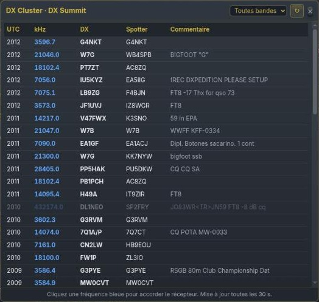{w=344}

- **Clic en una frecuencia azul** — sintoniza inmediatamente el receptor en el spot.
- Los spots en gris corresponden a frecuencias que el receptor no cubre (VHF/UHF, por ejemplo).
- **Filtro de banda** — Todas las bandas, o una banda de 160 m a 6 m.
- **↻** — actualización inmediata; la lista se actualiza sola cada 30 s. **×** cierra la ventana.
> [Consejo] El DX cluster y la ventana Usuarios (botón TUNE) son las dos formas más rápidas de «seguir el DX» anunciado por otros operadores o escuchado por otros oyentes.

# 15. Consejos, solución de problemas y buenas prácticas

## 15.1 Calidad de escucha

- Elija primero un filtro FI adaptado al modo (ancho en AM/FM, estrecho en CW) y luego active los filtros de ruido de uno en uno.
- En SSB o AM, pruebe el **Filtro de audio IA** al 50 % antes de aumentar su intensidad.
- Deje activo el **ajuste automático** de la cascada para distinguir bien las señales débiles del ruido de fondo.

## 15.2 Cortes o latencia de audio

- Aumente el **búfer** de audio (sección 5.1) en una conexión lenta o inestable.
- Consulte los **Recursos del sistema** (sección 13.2): una carga elevada del servidor puede explicar una ralentización.
- Vigile el **caudal** que se muestra al pie de la columna derecha.

## 15.3 Decodificadores

- Si duda sobre una señal, inicie el **análisis automático** o búsquela en la **base de señales** antes de elegir un decodificador.
- Active un solo decodificador a la vez y sintonice la frecuencia propia del modo.

## 15.4 Uso compartido

- Varios oyentes comparten el mismo receptor, cada uno con su propia sintonía y sus propios ajustes de audio, sin afectar a los demás.
- Las etiquetas bajo la cascada y la ventana Usuarios muestran dónde escuchan los demás; el mensaje ★ ADMIN informa de la vida del sitio.
