# 1. Introduction générale

PhantomSDR-Plus est un récepteur radio défini par logiciel (SDR) accessible depuis un simple navigateur web, sans aucune installation. L'interface affiche en temps réel le spectre radiofréquence et la cascade (waterfall) du récepteur, et permet d'écouter, de régler et de décoder les signaux reçus directement depuis le navigateur. PhantomSDR se veut une alternative moderne au WebSDR de PA3FWM.

La station **ORSAT** utilise la version 5.1.0 de PhantomSDR-Plus (projet original de SV1BTL), modifiée par F1NSK sous le nom **ORSAT 1.0** : thème « vieil or », interface entièrement traduite en français, anglais et espagnol, synchronisation avec le DX cluster, décodeurs supplémentaires (HFDL avec carte des avions, famille FLDIGI), analyse et identification des signaux, spectre 3D, analyseur audio et bilan de modulation SSB, réception en diversité et outils hamdash intégrés.

Ce manuel décrit, zone par zone, l'ensemble des commandes visibles à l'écran : leur emplacement, leur fonction et la manière de les utiliser. Chaque fonction complexe est accompagnée d'une vignette montrant la fenêtre ou le panneau tel qu'il apparaît réellement dans l'interface.

> [Remarque] L'interface ORSAT est conçue pour un **ordinateur** ou une **tablette**, quelle que soit la taille de l'écran. Un téléphone est dirigé automatiquement vers la page allégée **/mobile**.

## 1.1 Organisation de l'écran

- **Bandeau supérieur** — identification de la station, liens, horloge, langue et menu « Informations » (section 2).
- **Zone centrale** — bandeau « Indice de performance », spectre, cascade, règle de fréquences et repères de bandes (section 3).
- **Colonne de gauche** — audio, AGC, filtres de bruit, DSP, QRSS et enregistrement (sections 5 à 7).
- **Colonne  centrale** — cadran de fréquence, S-mètre, bandes/modes/filtres, accord fin, diversité et décodeurs (sections 4, 8 et 9).
- **Colonne de droite** — commandes du waterfall (réglage automatique, couleurs, spectre 3D), analyseur audio, favoris et indicateur de connexion (sections 10 à 12).

## 1.2 Choix de la langue

Les boutons à drapeaux **FR**, **EN** et **ES**, à droite du bandeau supérieur (icône globe), basculent instantanément toute l'interface — libellés et infobulles — en français, anglais ou espagnol. Le choix est conservé par le navigateur pour les visites suivantes.

## 1.3 Infobulles

Presque chaque bouton, curseur et zone affiche une **infobulle** explicative lorsqu'on laisse la souris immobile quelques instants dessus. C'est le moyen le plus rapide de découvrir une commande sans quitter l'écran de réception.

> [Astuce] L'interface est entièrement réactive : la plupart des réglages (bande, mode, filtres, gain) s'appliquent instantanément, sans validation. Chaque utilisateur dispose de son propre accord et de ses propres réglages, qui n'influent pas sur ceux des autres utilisateurs connectés au même récepteur.

> [Remarque] Lors de l'ouverture de la page, les navigateurs bloquent le son tant que l'utilisateur n'a pas interagi : un voile « Touchez pour activer l'audio » s'affiche alors — un simple clic suffit pour démarrer l'écoute.

# 2. Bandeau supérieur

Le bandeau situé tout en haut de l'écran identifie la station qui héberge le récepteur et regroupe les liens et outils annexes, l'horloge, le sélecteur de langue et le bouton d'ouverture du menu « Informations ».

{w=482}

## 2.1 Ligne d'identification de la station

La première ligne affiche « Page QRZ : ORSAT, SDR sur le Web situé à Christus Lake - SW France, IN93LR14VR ». Elle comporte deux boutons :

- **ORSAT** — ouvre la page QRZ.com du sysop de la station.
- **Christus Lake - SW France, IN93LR14VR** — ouvre une carte satellite centrée sur le QTH (locator Maidenhead) du récepteur.

## 2.2 Deuxième ligne : contact, utilisateurs et statistiques

- **e-mail** — ouvre un message pré-adressé au sysop (question, signalement d'un problème…).
- **Utilisateurs** — fenêtre des utilisateurs connectés en temps réel (voir ci-dessous).
- **Stats** — tableau de bord des statistiques de connexion (voir ci-dessous).
- **Autres serveurs : 1, 2, 3** — annuaires d'autres WebSDR : 1 = sdr-list.xyz, 2 = sdr.shbrg.nl, 3 = websdr.org.

{w=482}

La fenêtre **Utilisateurs connectés** liste chaque auditeur (localisation approximative, fréquence et mode écoutés, heure de connexion et durée). Votre propre ligne est repérée par la mention **YOU**. Le bouton **TUNE** d'une ligne accorde votre récepteur sur la même fréquence et le même mode que cet utilisateur. Une carte situe les auditeurs ; l'indicateur Polling confirme le rafraîchissement automatique.

{w=482}

La fenêtre **Statistiques** présente l'activité du récepteur sur une période choisie (dates de début et de fin, ou boutons **Today**, **7 days**, **30 days**, **All**, puis **Load**) : nombre d'événements et de sessions, adresses uniques, nombre de localisations, temps d'écoute total, durée moyenne et plus longue session, et histogramme de la répartition horaire (UTC). Ces deux fenêtres se ferment par la croix ou la touche Échap.

## 2.3 Troisième ligne : recherche de fréquence et d'indicatif

- **MW** / **SW** — bases de données pour identifier la station de radiodiffusion écoutée en ondes moyennes ou courtes.
- **PSK Reporter** — carte communautaire des rapports de réception des modes numériques.
- **WSPRnet** — base de rapports du mode balise WSPR.
- **Recherche d'indicatif** — saisissez un indicatif dans le champ puis cliquez sur **Rechercher**.

## 2.4 Horloge TU / Local

À gauche, une horloge numérique affiche l'heure et la date. Le bouton **TU** l'affiche en temps universel (UTC) — la référence pour les modes numériques, les horaires de diffusion et le DX cluster — et le bouton **LOCAL** à l'heure locale de votre ordinateur.

## 2.5 Langue et menu « Informations »

À droite figurent les boutons de langue décrits en section 1.2. Au centre, le bouton **Ouvrir Météo - Alertes - Infos - Propagation - DXcluster et Manuels utilisateur** déplie le menu « Informations » détaillé en section 13 ; il devient alors **Fermer les fenêtres** pour le replier.

# 3. Écran principal : spectre et cascade

La zone centrale affiche deux représentations complémentaires du signal reçu :

- **Le spectre** (partie supérieure) — amplitude du signal en fonction de la fréquence, à l'instant présent.
- **La cascade / waterfall** (partie défilante) — historique du spectre dans le temps ; la couleur traduit l'intensité reçue.
- **La règle de fréquences** et, dessous, les **repères de bandes et de services** (MW, 120m, Maritime, Aeronautical, CB, 10m…).
- **Le spectre 3D** (en option) — le spectre peut aussi s'afficher en relief : voir section 10.3.

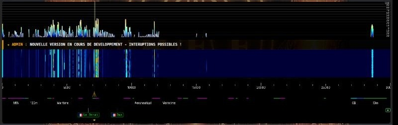{w=482}

## 3.1 Accord à la souris et à la molette

- **Clic** sur le spectre ou la cascade — accorde le récepteur sur la fréquence cliquée ; un glisser déplace le filtre.
- **Glisser horizontal** — fait défiler la portion de bande visible sans changer la fréquence d'écoute.
- **Molette** — zoom avant / arrière.
- **Maj + molette** — accord par pas de 0,1 kHz ; **Ctrl + molette** — pas de 0,01 kHz.
- **Maj + Ctrl + molette** — cale la fréquence sur le kilohertz rond (.00 kHz).

## 3.2 Étiquettes des auditeurs et message de l'administrateur

Sous la règle, de petites étiquettes à drapeau (par ex. Le Dorat, Dax) indiquent la fréquence écoutée par chacun des autres utilisateurs connectés ; votre propre position est marquée d'une étoile. Le petit bouton rond **●** à droite de la zone permet de **masquer ou réafficher** ces étiquettes.

Lorsqu'un bandeau **★ ADMIN** défile en travers de la cascade, il s'agit d'un message diffusé par le sysop à tous les auditeurs (maintenance, nouvelle version, interruption prévue…).

> [Astuce] Les couleurs, la luminosité et le contraste de la cascade se règlent dans la colonne de droite (section 10).

## 3.3 Bandeau « Indice de performance »

Juste au-dessus de la cascade, un bandeau fin indique, **bande par bande**, la capacité d'ORSAT à entendre des stations **en ce moment**. Il est recalculé en continu par le serveur, même quand personne n'écoute.

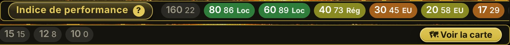{w=440}

- **Pastilles** — une par bande, avec une note de **0 à 100** et sa couleur : **vert** excellent (75 et plus), **olive** bon (50 à 74), **orange** moyen (25 à 49), **gris** faible (moins de 25). La bande que vous écoutez est mise en évidence.
- **Zone** — **Loc** (jusqu'à 300 km), **Rég** (300 à 900 km), **EU** (900 à 2500 km) ou **DX** (au-delà) : la distance à laquelle ORSAT entend le mieux sur cette bande.
- **Survol d'une pastille** — le détail : stations localisées du carnet entendues ces 3 dernières heures (nombre, tranches de distance, la plus lointaine), portée prévue par les ionosondes, activité de la chute d'eau (sans distance, son origine n'étant pas localisée) et, en cas de désaccord, un avertissement « prévision sous-estimée » ou « surestimée ».
- **🗺 Voir la carte** (ou un clic n'importe où sur le bandeau) — ouvre la carte détaillée des zones où ORSAT entend bien, bande par bande ; le bouton **✕ Fermer** la referme.
- **Indice de performance ?** — le titre est un bouton : il ouvre l'explication complète du calcul.

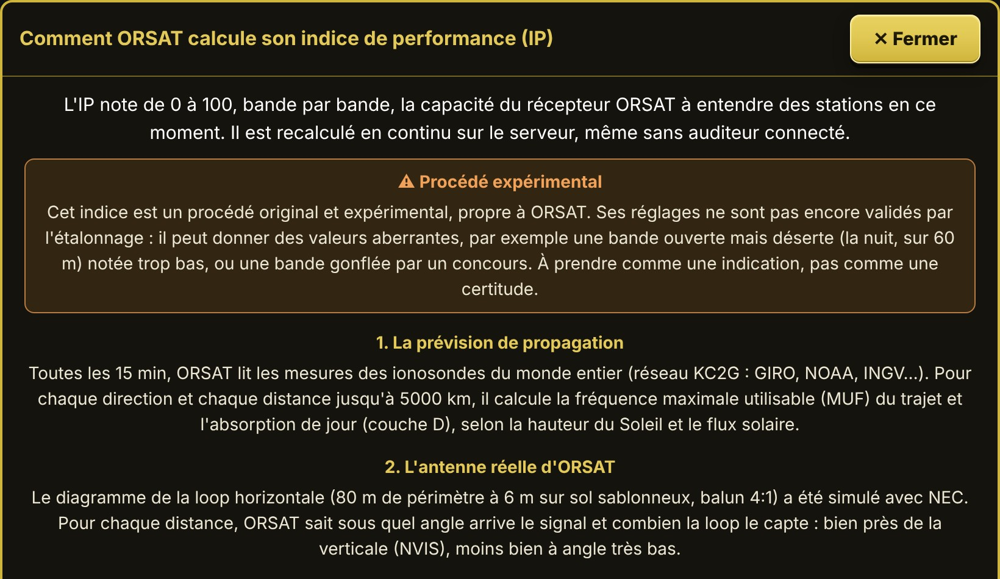{w=330}

L'indice combine deux choses :

- **une prévision** : toutes les 15 minutes, le serveur lit les mesures des ionosondes du monde entier (réseau KC2G), calcule la fréquence maximale utilisable et l'absorption de jour pour chaque direction et chaque distance, et en tient compte avec le diagramme réel de l'antenne loop d'ORSAT ;
- **une mesure réelle** : toutes les 5 minutes, ORSAT écoute lui-même chaque bande quelques secondes sur sa cascade, compte les signaux et relève le meilleur rapport signal/bruit.

Quand la mesure date de moins de 15 minutes, l'indice vaut 40 % de prévision et 60 % de mesure ; sinon, la prévision seule.

# 4. Cadran, bandes, modes et filtres

La colonne centrale regroupe tout ce qui concerne l'accord du récepteur.

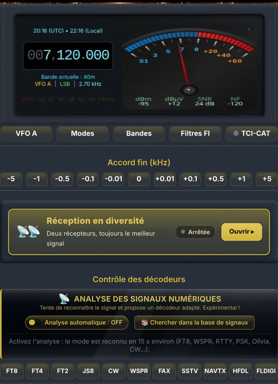{w=275}

## 4.0 Cadran de fréquence, S-mètre et voyants

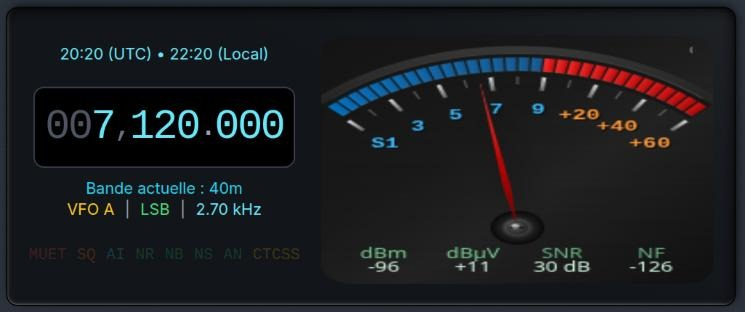{w=410}

Le cadran affiche l'heure UTC et locale, la fréquence accordée (par ex. 007,120.000 kHz), puis la bande en cours, le VFO actif, le mode et la largeur du filtre (Bande actuelle : 40m — VFO A | LSB | 2.70 kHz).

- **Accord direct sur les chiffres** — survolez un chiffre de la fréquence et faites tourner la molette pour le faire varier ; un **clic droit** sur le cadran ouvre la saisie directe d'une fréquence.
- **Voyants d'état** — **MUET**, **SQ** (silencieux), **AI** (filtre IA), **NR**, **NB**, **NS**, **AN** et **CTCSS** s'allument en couleur lorsque la fonction est active : un coup d'œil suffit pour vérifier les traitements en service.
- **S-mètre analogique** — gradué de S1 à +60 dB, avec sous l'aiguille quatre mesures : **dBm** et **dBµV** (niveau reçu), **SNR** (rapport signal/bruit) et **NF** (niveau de bruit de fond).
Un **clic sur le S-mètre** fait défiler ses trois styles : **sombre**, **clair** et **vintage**.

{w=236}

## 4.1 Sélecteur de bandes

Le bouton **Bandes** ouvre la liste des bandes radioamateurs (2200 m à 10 m, CB, 11 m SSB) et des bandes de radiodiffusion (VLF, LF, LW, MW, 180 m à 13 m AM). Un clic accorde directement le récepteur sur une fréquence représentative de la bande, dans le mode habituel ; la bande en cours est surlignée.

{w=386}

## 4.2 Modes de démodulation

{w=386}

- **USB / LSB** — bande latérale unique (par convention LSB sous 10 MHz, USB au-dessus).
- **CW** — télégraphie, filtre étroit adapté au Morse.
- **AM** — modulation d'amplitude classique ; **QUAM** — démodulation AM en quadrature.
- **FM** — modulation de fréquence.
- **RADEL / RADEU** — décodage de la voix numérique **FreeDV** (mode RADE) en bande latérale inférieure / supérieure.

## 4.3 Filtres FI

Le bouton **Filtres FI** ouvre la fenêtre « Filtres FI fixes » : douze largeurs prédéfinies de 500 Hz à 10 kHz, et un curseur **Largeur de bande (centre → bord)** pour un réglage continu, avec la valeur en Hz. Le bouton **Réinitialiser** revient à la largeur par défaut du mode.

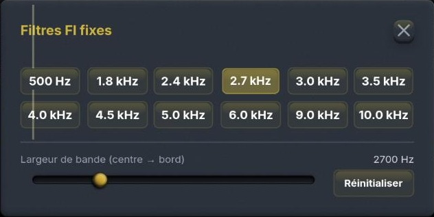{w=386}

> [Astuce] Un filtre étroit réduit le bruit et les interférences voisines, mais peut couper une partie du signal utile. En CW, quelques centaines de hertz améliorent nettement la lecture des signaux faibles.

## 4.4 VFO A / B

Le bouton **VFO A** bascule entre deux VFO : mémorisez une fréquence sur l'un et explorez la bande avec l'autre, puis revenez d'un clic à la première.

## 4.5 TCI-CAT

Le bouton **TCI-CAT** ouvre la fenêtre « Contrôle CAT via TCI », qui synchronise l'interface web avec un logiciel installé sur votre ordinateur (**ExpertSDR**, **AetherSDR**, **Thetis**) : les ports TCI usuels 50001 et 40001 sont recherchés automatiquement.

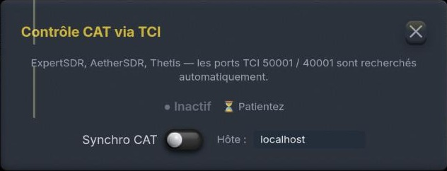{w=386}

- **Statut** — Inactif, Patientez ou connecté ; le point devant **TCI-CAT** sur le bouton reflète cet état.
- **Synchro CAT** — active la synchronisation de fréquence : un changement d'un côté est répercuté de l'autre.
- **Hôte** — machine où tourne le logiciel TCI (localhost par défaut, ou son adresse IP sur le réseau local).
> [Astuce] Cette liaison relie le logiciel de votre ordinateur à l'accord fait dans le navigateur ; elle ne pilote pas l'émetteur du site et ne remplace pas une liaison CAT directe vers un transceiver.

## 4.6 Accord fin

La rangée **Accord fin (kHz)** décale la fréquence par pas fixes : **-5, -1, -0.5, -0.1, -0.01, 0, +0.01, +0.1, +0.5, +1, +5** kHz. Les petits pas servent à centrer un signal CW ou numérique, les grands à sauter d'un signal à l'autre.

# 5. Colonne de contrôle audio (gauche)

La colonne de gauche regroupe les réglages de restitution et de traitement du son.

## 5.1 Audio & tampon

{w=200,side}
- **COUPER L'AUDIO** — grand bouton à gauche du volume : un clic coupe le son, le bouton devient **rouge** et affiche **SILENCIEUX** ; un nouveau clic rétablit l'écoute. Pensé pour l'auditeur qui passe en émission sans liaison automatique entre son transceiver et l'ordinateur : il évite le **larsen**.
- **Volume** — curseur du niveau d'écoute, à droite du bouton.
- **SQ** (silencieux) — le curseur fixe le seuil en dB. Le bouton **SQ** offre un **silencieux automatique** : placez-vous sur une fréquence silencieuse, cliquez pour mesurer le bruit, le seuil se règle seul ; un nouveau clic le désactive.
- **Tampon** (icône globe) — multiplicateur du tampon audio (×1 par défaut). Augmentez-le si votre connexion Internet est lente ou instable, au prix d'un peu de latence.

## 5.2 AGC

Le contrôle automatique de gain maintient un niveau d'écoute homogène. Chaque bouton affiche, dans son infobulle, l'usage conseillé selon le mode :

- **Auto** — la CAG du récepteur, polyvalente : bon choix par défaut pour l'écoute générale.
- **Rapide** (remontée en 0,3 s environ) — idéale en **CW** et en **modes numériques** (RTTY, PSK…), ainsi que sur bande bruyante (QRN, parasites).
- **Moyen** (maintien 0,25 s, remontée 1,2 s) — idéale en **SSB** pour les QSO, et en **AM avec fading**.
{w=187,side}
- **Lent** (maintien 1 s, remontée 3 s) — idéale en **AM** de radiodiffusion et pour les signaux SSB stables. Les quatre réglages donnent le même volume ; ils ne diffèrent que par la manière dont le gain réagit entre les mots et après un signal fort. Quand un décodeur est ouvert, la CAG est maintenue sur **Lent** pour lui, ce qu'indique une mention à côté du titre.

## 5.3 Filtres de bruit et filtre audio IA

- **NR** — réduction de bruit large bande (bruit de fond continu).
- **NB** — suppresseur de bruit impulsionnel (parasites d'allumage, claquements).
- **NS** — suppression du souffle.
- **AN** — anti-notch automatique : détecte et atténue les porteuses fixes (hétérodynes).
- **Filtre audio IA** — réducteur de bruit neuronal, actif uniquement en **SSB et AM/SAM**. Le curseur dose son action : jusqu'à 50 %, réglage doux d'origine ; au-delà, filtrage énergique (jusqu'à 40 dB de réduction, silences nettoyés). Réduisez-le si les stations QRP deviennent inaudibles.
> [Astuce] Activez les filtres un par un en écoutant l'effet : cumuler plusieurs traitements agressifs dégrade souvent l'intelligibilité au lieu de l'améliorer.

## 5.4 DSP audio : compresseur, égaliseur et gate

Les boutons **Compresseur** et **Égaliseur** ouvrent chacun une fenêtre de réglage avec son propre interrupteur d'activation et un bouton **Réinitialiser**.

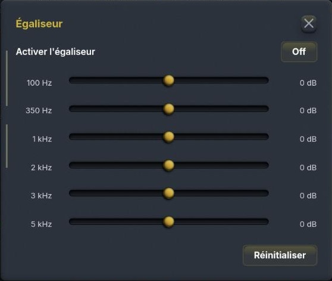{w=236}

- **Compresseur** — **Seuil** (dB où la compression commence), **Taux** (ex. 4:1), **Attaque** et **Relâchement** (ms), **Coude** (douceur de transition, dB) et **Compensation** du gain ; la case **Compensation auto** calcule ce gain d'après le seuil et le taux.
- **Égaliseur** — six bandes réglables en gain : 100 Hz, 350 Hz, 1 kHz, 2 kHz, 3 kHz et 5 kHz.
- **Gate : ON / OFF** — réducteur de bruit (noise gate) exécuté **côté serveur**, engagé par défaut ; il coupe le bruit entre les mots ou les transmissions.
- **Préréglage** du gate : Équilibré, Agressif, Signal faible, Doux, Maximum, CW/Numérique et AM/FM.
> [Astuce] Pour dégager une voix dans le bruit, atténuez légèrement 100–350 Hz et renforcez un peu la zone 1–2 kHz, où se concentre l'intelligibilité de la parole.

# 6. QRSS

Le bouton **Afficher** ouvre les réglages QRSS et superpose sous la cascade un spectrogramme très haute résolution, destiné aux signaux extrêmement lents et de très faible puissance (Morse à plusieurs secondes par point, DFCW). Le bouton devient **Masquer** pour refermer l'ensemble.

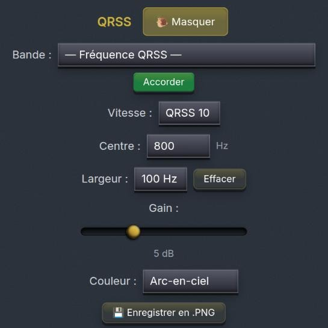{w=204,side}
- **Bande** — liste des fenêtres QRSS connues (10140,00 kHz sur 30 m — la principale —, 7039,90 et 7000,85 kHz sur 40 m, 14096,90 kHz sur 20 m, 80 m, 160 m, 630 m, 2200 m, 60 m, 17 m…), puis **Accorder**.
- **Vitesse** — QRSS 3, 10, 30… : détermine la finesse de l'analyse temps-fréquence.
- **Centre** — fréquence audio centrale observée (Hz).
- **Largeur** — fenêtre affichée autour du centre ; **Effacer** remet l'affichage à zéro.
- **Gain** — contraste de l'overlay (dB).
- **Couleur** — palette propre à l'overlay (Arc-en-ciel…).
- **Enregistrer en .PNG** — sauvegarde une image de l'overlay.

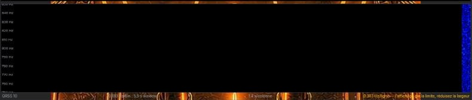{w=482}

La ligne d'indicateurs sous l'overlay rappelle la résolution d'analyse en cours. Lorsque la résolution verticale est signalée comme limite d'affichage, réduisez la **Largeur** pour gagner en définition. Pendant le QRSS, l'AGC passe automatiquement en mode lent.

> [Astuce] Les traces QRSS se construisent en plusieurs minutes : laissez l'overlay tourner sur la fenêtre choisie (par exemple 10 140 kHz sur 30 m) avant de conclure à l'absence de signal.

# 7. Enregistrement

La section **Options d'enregistrement** propose trois captures locales, enregistrées sur votre ordinateur :

- **Audio** — enregistre uniquement l'audio démodulé, au format WAV.
- **Vidéo** — enregistre le waterfall en même temps que l'audio démodulé.
- **Zone** — tracez à la souris une zone sur le waterfall pour n'enregistrer que cette partie ; sans zone définie, le panneau complet est enregistré.
Un nouveau clic arrête l'enregistrement et propose le téléchargement du fichier produit.

> [Astuce] L'enregistrement capture exactement ce que vous entendez, filtres et DSP compris : vérifiez mode, fréquence et réglages avant de lancer la capture.

# 8. Réception en diversité

La **réception en diversité** associe ORSAT à un **récepteur partenaire** situé à plusieurs centaines de kilomètres. Les deux sites ne subissent pas les mêmes évanouissements (QSB) : ORSAT vous fait entendre à chaque instant **le meilleur des deux**. Le panneau se trouve dans la colonne centrale, sous l'accord fin ; cliquez sur sa barre dorée (**Ouvrir ▸**) pour le déplier.

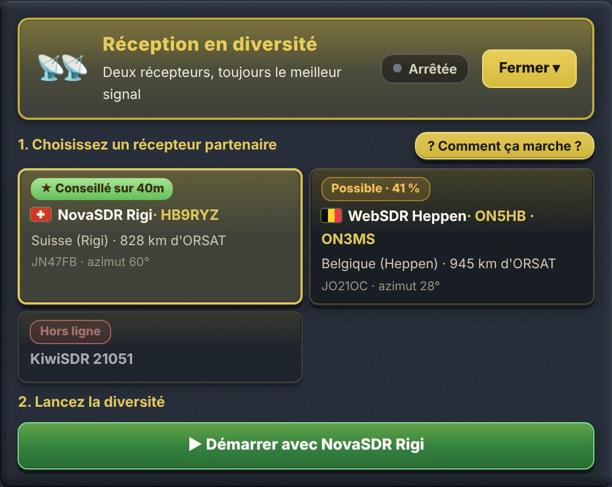{w=330}

1. **Choisissez un récepteur partenaire** — les vignettes présentent les récepteurs retenus par le sysop d'ORSAT : drapeau, nom et indicatif, lieu et distance, **locator** et **azimut** vus d'ORSAT.
2. **Lancez la diversité** — le grand bouton vert **▶ Démarrer avec…** ; il devient **■ Arrêter la diversité** pendant l'écoute.
3. **Écoutez** — « 🎧 Vous écoutez : ORSAT » ou le nom du partenaire, l'état en clair (synchronisation, puis « Synchronisé ✓ »), deux barres de qualité du signal et la part du temps passée sur le partenaire.

Sur chaque vignette, un badge donne le conseil du moment **pour la bande écoutée** ; il suit la fréquence quand vous changez de bande :

| Badge | Signification |
| ★ Conseillé sur 40m | Le meilleur partenaire en ce moment : il entend la même zone qu'ORSAT, par un autre chemin |
| Possible · 41 % | Utile en partie : il entend environ ce pourcentage de la zone entendue par ORSAT |
| Peu utile sur 40m | Il n'entend pas les mêmes stations qu'ORSAT sur cette bande en ce moment |
| Hors ligne | Le récepteur ne répond pas (vérifié par le serveur toutes les 10 minutes) |

La synchronisation des deux récepteurs prend **10 à 15 secondes** et demande qu'une station transmette. Le partenaire est réglé automatiquement sur la même fréquence, le même mode et le même filtre qu'ORSAT, et suit chaque changement d'accord.

La diversité n'est applicable que pour les **modes phonie** (USB, LSB, AM, SAM, QUAM, FM, WBFM) : elle est désactivée si vous utilisez un décodeur, et s'arrête dès qu'un décodeur démarre ou que vous changez pour un autre mode.

> [Attention] **L'utilisation de la réception en diversité augmente sensiblement le temps de latence de la réception.** Pour un QSO en direct, arrêtez-la.

> [Astuce] Le guide détaillé « Réception en diversité » (menu Informations) explique le principe, la synchronisation, les indicateurs et le dépannage.

# 9. Décodeurs

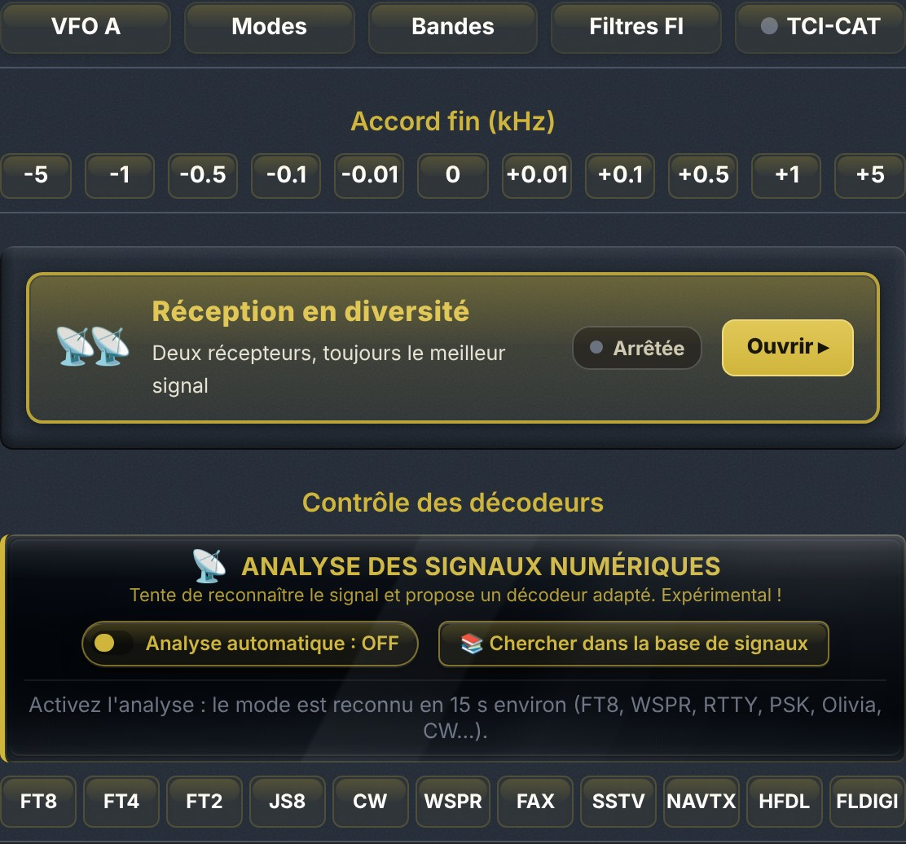{w=410}

## 9.1 Décodeurs numériques

La rangée **Contrôle des décodeurs** propose onze décodeurs activables d'un clic (un second clic les arrête) :

| Bouton | Décodeur | Usage |
| FT8 / FT4 / FT2 | Modes numériques faible signal WSJT | Trafic DX, propagation |
| JS8 | JS8Call | Messagerie clavier faible signal |
| CW | Télégraphie Morse | Lecture automatique du Morse |
| WSPR | Balises WSPR | Étude de propagation |
| FAX | HF FAX / WEFAX | Cartes météo radio-fac-similé |
| SSTV | Télévision à balayage lent | Images radioamateurs |
| NAVTX | NAVTEX | Avis aux navigateurs (518 / 490 kHz) |
| HFDL | HF Data Link | Messages ACARS des avions en ondes courtes |
| FLDIGI | Famille fldigi | RTTY, SITOR, PSK31, Olivia, MFSK, DominoEX, THOR, THROB, Hellschreiber, MT63, Packet, APRS |

{w=375}

- **Forme d'onde audio** — les repères jaunes marquent chaque signal décodé dans la bande passante.
- **Farthest Distance** — distance du contact le plus lointain depuis le début de la session.
- **Décalage de synchro** — correction du décalage temporel, ajustée seule lorsque **Auto** est coché.
- **Tableau** — une ligne par décodage : MODE, DB (niveau), HZ (fréquence audio), DT (écart de synchro), MESSAGE, LOCATOR (grid Maidenhead) et DIST (distance estimée).
> [Astuce] Les décodeurs FT8/FT4/WSPR exigent d'être accordé sur la fréquence du mode (par ex. 7074 kHz USB pour FT8 sur 40 m).

**Fréquences connues.** Les panneaux FT8 / FT4 / FT2, JS8, WSPR et SSTV ont un menu **Fréquences connues** : choisir une bande accorde directement le récepteur sur la fréquence d'usage du mode, en USB.

**Carte des stations.** Les panneaux FT8 / FT4 / FT2, WSPR et JS8 ont un bouton **🗺 Carte (n)** : chaque station entendue dont le message contient un locator y est placée (les appels CQ en contiennent presque toujours). **⤢ Grand format** ouvre la carte dans une fenêtre flottante, déplaçable et redimensionnable ; le survol d'un point montre l'indicatif et le message, un clic ouvre sa fiche QRZ.

## 9.2 Analyse des signaux numériques

Le module **Analyse des signaux numériques**, juste au-dessus de la rangée des décodeurs, **tente de reconnaître le mode** du signal écouté (FT8, WSPR, RTTY, PSK, Olivia, CW…) et **propose le décodeur adapté**. Cette fonction est **expérimentale**.

{w=380}

- **Analyse automatique : OFF / ON** — lance l'analyse continue du signal présent dans la bande passante. Le mode est en général reconnu en une quinzaine de secondes.
- **Mesure en cours** — le mode reconnu et ce qui a été mesuré : largeur, écart entre tonalités (shift), vitesse en bauds, cadence, rapport signal/bruit.
- **Modes reconnus, par pertinence** — les modes déjà vus restent listés avec leur score, le nombre de détections et l'ancienneté ; le bouton **▶ Lancer** ouvre le décodeur correspondant et l’icône **i** affiche la fiche de référence du mode.
- **Recentrer & réessayer** — apparaît quand le signal est trop près du bord du filtre, où la mesure n'est pas fiable.
- **📚 Chercher dans la base de signaux** — ouvre la fenêtre « Identifier un signal » (section 9.3).

> [Astuce] L'analyse automatique est désactivée par défaut : elle ne consomme du processeur que lorsqu'elle est en marche. Elle ne change jamais de décodeur toute seule : elle se contente de proposer.

## 9.3 Identifier un signal (base Artemis)

Le bouton **📚 Chercher dans la base de signaux** ouvre une fenêtre qui recherche, parmi **583 signaux de référence** (base Artemis, issue du Signal Identification Wiki), ce qui correspond à la fréquence, à la largeur du filtre et à la démodulation en cours. Les signaux sont classés par pourcentage de correspondance.

{w=440}

- **Fenêtre flottante** — elle s'ouvre en bas de l'écran sans masquer le waterfall ; on la **déplace** en tirant sa barre de titre (⠿) et on la **redimensionne** par son coin inférieur droit. Échap ou ✕ la ferme.
- **Fréquence**, **Largeur**, **Démodulation** — critères de classement, modifiables.
- **Filtre** — menu déroulant des catégories : radioamateur, militaire, maritime, aviation, radiodiffusion analogique, numérique, signaux horaires, radar, satellites, brouillages, stations de nombres… Une catégorie affiche toutes ses fiches, même hors de la fréquence en cours.
- **Recherche** — texte libre : nom ou modulation.
- **Ascenseurs larges et dorés** — à saisir à la souris, ou à cliquer pour avancer d'une page.

Un clic sur une entrée affiche sa **fiche** : spectrogramme de référence, **échantillon audio** à écouter pour comparer (le son du récepteur est coupé pendant l'écoute), largeur, modulation, mode de réception, plage de fréquences, catégorie, zone, description et lien vers la fiche complète du Signal Identification Wiki.

## 9.4 Décodeur FLDIGI (FSK / RTTY et autres modes)

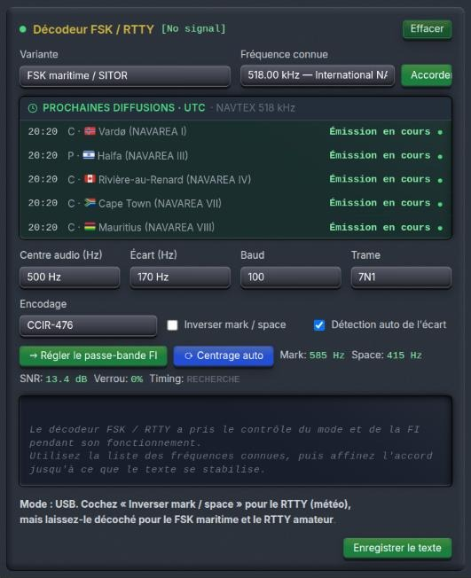{w=204,side}
- **Variante** — FSK maritime / SITOR, RTTY météo, RTTY amateur, PSK31, Olivia, MFSK16·32·64, DominoEX, THOR, THROB, Hellschreiber, MT63, Packet (AX.25), APRS.
- **Fréquence connue** — liste de fréquences de référence (NAVTEX 518 / 490 kHz, SITOR MSI HF, NBDP…), puis **Accorder**.
- **Prochaines diffusions · UTC** — horaires des stations NAVTEX en cours et à venir.
- **Centre audio**, **Écart** (shift), **Baud**, **Trame** et **Encodage** (CCIR-476, ITA2/Baudot, ASCII).
- **Inverser mark / space** — à cocher pour le RTTY météo, à laisser décoché pour le FSK maritime et le RTTY amateur ; **Détection auto de l'écart**.
- **Régler le passe-bande FI** et **Centrage auto** ; indicateurs Mark / Space, SNR, Verrou et Timing.
- Zone de texte décodé, **Effacer** et **Enregistrer le texte**.

> [Astuce] Pendant son fonctionnement, ce décodeur prend le contrôle du mode et du filtre FI : choisissez une fréquence connue, puis affinez l'accord jusqu'à ce que le texte se stabilise.

## 9.5 Décodeur HFDL

{w=204,side}
- **Station sol** — choisissez une station HFDL (Shannon, Reykjavik, Canarias, Riverhead, Johannesburg…) et une de ses fréquences, puis **Accorder & régler la FI**.
- L'indicateur **Dial** signale si vous êtes hors fréquence HFDL ; **Bruit**, **Trames**, **Rythme**, compteurs de **Messages** et de **Squitters** suivent le décodage.
- Cochez **Squitters** pour afficher aussi les balises des stations sol.
- Survolez un message pour voir la trame complète ; **Enregistrer** et **Effacer** gèrent le journal.

**Identifiants cliquables.** Dans la liste des messages, le **numéro de vol**, l'**immatriculation** et le **code ICAO** (adresse du transpondeur) de l'avion sont des liens : un clic ouvre sa fiche **FlightAware** dans un nouvel onglet. Le lien par code ICAO retrouve souvent l'avion même quand le vol n'a pas de fiche.

**Carte des avions.** Le bouton **🗺 Carte** affiche, sous les commandes, les avions dont une position a été reçue ; **⤢ Grand format** ouvre la même carte dans une **grande fenêtre flottante**, déplaçable par sa barre de titre et redimensionnable par son coin ; **⌖ Tout voir** recadre sur l'ensemble des avions, Échap ou ✕ la ferme.

- Chaque avion est un **petit avion doré orienté selon son cap**, calculé d'après ses deux dernières positions.
- Sa **trace** est tracée en **rouge**.
- **Un clic sur l'avion** ouvre sa fiche FlightAware (vol, sinon immatriculation, sinon code ICAO).

> [Astuce] Les stations sol émettent un squitter toutes les 32 s et les avions répondent quand ils ont du trafic : patientez quelques minutes et préférez une fréquence où la propagation est ouverte vers la station choisie. Seuls certains messages (rapports de position) contiennent une position : la carte se remplit peu à peu.

# 10. Commandes du waterfall

Ces commandes, en haut de la colonne de droite, ne modifient que l'affichage du spectre et de la cascade, jamais l'audio.

## 10.1 Réglage automatique et réglage manuel

- **Réglage automatique** — grand bouton doré, **actif dès l'ouverture de la page** : c'est le réglage normal et recommandé. Il mesure en continu le bruit de fond sur toute la largeur affichée, en fait un fond sombre et uniforme et fait ressortir les signaux faibles, quelle que soit la palette. Un clic le désactive ; le bouton indique alors « Revenir au réglage automatique ».
- **Réglage manuel** — cadre regroupant deux curseurs, utilisables seulement quand le réglage automatique est coupé (en automatique, ils sont grisés et montrent les valeurs choisies par l'automatisme) :
- **Fond (bruit)** — niveau affiché en noir : montez-le pour assombrir le bruit de fond.
- **Signaux forts** — niveau affiché en pleine couleur : baissez-le pour faire ressortir les signaux faibles.

## 10.2 Couleurs

Le menu déroulant **Couleurs** choisit la palette de la cascade ; un fin trait montre le dégradé de chaque palette : Turbo, Gqrx, Twente, Twente v2, SpectraVU, Jet, Perso et PhantomSDR. Le choix est mémorisé par le navigateur.

## 10.3 Spectre 3D

Le petit bouton **3D** (pyramide), à droite de **Réglage automatique**, affiche le spectre **en relief** : les dernières traces s'empilent en perspective au-dessus de la cascade, la plus récente devant. La fréquence est en largeur, le temps en profondeur et l'intensité en hauteur et en couleur.

{w=482}

- La vue suit le **zoom** et le **glissement** de la cascade ; on continue d'accorder en cliquant sur la cascade ou la règle de fréquences.
- **Échelle en dB** à droite : hauteur des crêtes au-dessus du bruit de fond (+10, +20, +30 dB…).
- **Repères de temps** en profondeur : −5 s, −10 s… selon la vitesse de défilement.
- Les couleurs suivent la **palette choisie pour la cascade** (menu **Couleurs**).
- **✕ 2D** ou un nouveau clic sur **3D** ramène le spectre classique.

> [Remarque] Le spectre 3D est calculé par la carte graphique de votre ordinateur (WebGL2) et ne sollicite pas le serveur. Il est désactivé par défaut ; le bouton n'apparaît pas si le navigateur ne gère pas WebGL2.

## 10.4 Œil magique, zoom et connexion

- **Œil magique** — barre verte lumineuse sensible à la puissance du signal reçu, comme sur les anciens récepteurs à lampes.
- **Zoom** — **Vers la bande** cadre le waterfall sur la bande de la fréquence accordée ; **Avant**, **Arrière**, **Max**, **Min**. La molette de la souris zoome aussi directement sur la cascade.
- **Indicateur de connexion** — nombre d'utilisateurs connectés et débit reçu (kbit/s) par votre navigateur.

> [Astuce] Laissez le réglage automatique actif : il donne d'emblée une cascade lisible. Le réglage manuel ne sert que pour un besoin particulier, par exemple faire ressortir un signal très faible.

# 11. Analyseur audio

Le bouton **📊 Show / Hide** de l'**Analyseur audio**, dans la colonne de droite, ouvre au-dessus des panneaux un analyseur du signal de votre correspondant. Il travaille sur l'**audio brut** du récepteur : avant le muet, le squelch, l'AGC, la réduction de bruit, le notch et l'égaliseur. Il juge donc la modulation de la station, pas vos réglages d'écoute, et **continue de fonctionner quand le son est coupé**. Le réglage **Gain** n'agit que sur l'affichage.

L'affichage s'adapte tout seul au mode : spectre audio en USB, LSB et CW ; **vue RF** en AM et FM.

> [Astuce] Un guide détaillé et illustré de l'analyseur audio est disponible dans le menu « Informations », rubrique **Guide de l'analyseur audio**.

## 11.1 Fréquence de base et lecture au survol

- Un bandeau rappelle en clair la **fréquence de base** (celle du cadran) et le mode ; à droite, le bouton **Couper le son** coupe le son du récepteur sans arrêter l'analyse.
- Un **trait or** la situe dans le spectre : à 0 Hz audio en SSB (la porteuse supprimée), sur la note à 750 Hz en CW.
- Au **survol de la souris**, une bulle donne la **fréquence RF exacte** du point visé et sa fréquence audio.
- En **LSB**, l'axe est **inversé** (aigus à gauche) pour suivre le sens du spectre RF ; la mention « LSB : axe inversé » le rappelle.

## 11.2 Balises de largeur de bande et filtre

- Des **balises** permanentes montrent la largeur préconisée pour le mode : **SSB standard 300–2700 Hz** et **ESSB 50–4000 Hz** ; **CW 500 Hz** et **250 Hz** ; en AM, **±4,5 kHz** (radiodiffusion) et **±3 kHz** (radioamateur) ; en FM étroite, **±5,5 kHz** (largeur de Carson).
- Un cadre en pointillés blancs montre le **filtre actuel** du récepteur.

## 11.3 Largeur occupée et splatter

L'analyseur mesure sur la cascade la **largeur occupée** par la station accordée (méthode « −26 dB », sur 6 s, parasites statiques ignorés) et la compare aux normes du mode. Une ligne sous le spectre donne le verdict : conforme, un peu large, ou **splatter probable** ; le débordement est coloré en ambre ou en rouge sur le spectre.

> [Astuce] La mesure a besoin d'une cascade assez fine : zoomez sur la station. Sinon, l'analyseur affiche « Zoomez sur la station dans la cascade… ».

## 11.4 Vue RF en AM et FM

En AM et FM, l'audio démodulé n'a plus de porteuse (elle passe à 0 Hz et les deux bandes latérales se superposent). L'analyseur montre donc automatiquement la station **telle qu'elle est en RF** : **porteuse au centre** (trait or), bandes latérales de part et d'autre, axe gradué en écart à la porteuse et niveau en dB au-dessus du bruit. La symétrie des bandes latérales et le niveau de porteuse se lisent d'un coup d'œil. Largeur affichée : ±6 kHz en AM, ±8 kHz en FM, ±120 kHz en FM large.

## 11.5 Bilan audio SSB

En **USB** et **LSB**, un encadré **Bilan audio SSB** analyse la modulation sur 20 s glissantes, uniquement pendant que la station parle. Les verdicts apparaissent après 3 s de voix ; chaque ligne a un voyant vert, orange ou rouge (gris : non mesurable, avec la raison).

| Critère | Ce qui est mesuré |
| Graves 100–300 Hz | Énergie des graves par rapport au médium, comparée à la référence choisie |
| Présence 1,5–2,7 kHz | Énergie de la présence par rapport au médium : voix sourde ou criarde |
| Compression | Rapport crête / moyenne de la voix : peu compressée, correcte, sur-compressée |
| Ronflette secteur | Raies stables à 50/100/150 Hz (ou 60/120/180 Hz) |
| Porteuse résiduelle | Niveau de la porteuse sous les crêtes de voix, mesuré sur la cascade |
| Bande opposée | Énergie de l'autre bande latérale ; une autre station présente est signalée (QRM) |
| Largeur occupée | Reprise de la mesure de splatter |

- **Juger la voix par rapport à :** — **SSB standard**, **DX / punch** (présence renforcée) ou **ESSB / hi-fi** (graves conservés) : l'équilibre est jugé par rapport à ce choix.
- **Courbe bleue « voix moyenne »** — forme moyenne de la voix, tracée sur le spectre.
- **Mémoriser A** — fige cette courbe en pointillés blancs : le correspondant modifie son réglage et l'on compare l'avant et l'après (écarts des graves et de la présence affichés). **Effacer A** la retire.
- **↺ Recommencer** — repart de zéro (fait aussi automatiquement au changement de fréquence ou de mode).
- **🎧 Générer un rapport d'écoute** — télécharge un fichier HTML à envoyer au correspondant : fréquence, mode, verdicts, image du spectre et les 20 dernières secondes de son (WAV).
- Les **parasites statiques** (claquements brefs à spectre plat) sont écartés ; leur proportion est indiquée lorsqu'elle dépasse 10 %.

> [Astuce] Un opérateur peut analyser sa propre émission : il s'écoute sur ORSAT en coupant le son (bouton **COUPER L'AUDIO**), pour ne pas renvoyer l'audio dans son micro, et lit son bilan.

> [Remarque] Mesure indicative : le fading, le filtre du récepteur et la faiblesse du signal influent. Pour juger les graves, le filtre doit descendre vers 120 Hz ; pour la présence, monter vers 2,6 kHz.

# 12. Favoris

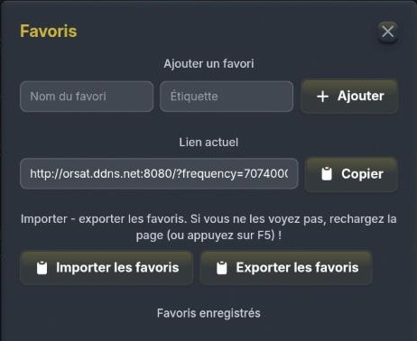{w=198,side}
- **Ajouter un favori** — saisissez un Nom et une Étiquette courte, puis **Ajouter** : la fréquence et les réglages d'accord en cours sont mémorisés.
- **Lien actuel** — URL de la fréquence et du mode en cours, à partager via **Copier**.
- **Importer / Exporter les favoris** — sauvegarde ou restauration de la liste dans un fichier. Rechargez la page (F5) si les favoris importés n'apparaissent pas.
- **Favoris enregistrés** — un clic sur une entrée accorde le récepteur.

> [Astuce] Les favoris sont mémorisés dans votre navigateur, sur votre ordinateur : pensez à les exporter pour les retrouver sur un autre poste.

# 13. Menu « Informations »

Le bouton central du bandeau déplie ce menu, qui rassemble les outils annexes : hamdash, synchronisation DX cluster, configuration de la station, liens et manuels.

{w=482}

## 13.1 Outils hamdash

La ligne **hamdash** rappelle l'indicatif (ORSAT) et le locator de la station ; **Copier** les place dans le presse-papiers pour les coller dans hamdash. Les sept boutons ouvrent les tableaux de bord correspondants :

| Bouton | Contenu |
| Propagation | Prévisions de propagation HF |
| Météo spatiale | Vent solaire, indices K et A, éruptions |
| Météo &amp; alertes | Météo locale et alertes orages |
| DX Cluster | Spots du DX cluster en direct |
| Carte en direct | Carte des bandes et des stations actives |
| Concours | Calendrier des concours |
| Satellites | Passages des satellites radioamateurs |

Le grand bouton **Synchroniser le récepteur avec le DX cluster** ouvre la fenêtre décrite en section 14.

## 13.2 Installation & configuration

- **ORSAT 1.0** et **base 5.1.0** — version d'ORSAT et version de PhantomSDR-Plus sur laquelle elle repose.
- **CAT sync** et **AetherSDR - TCI** — fonctions de synchronisation disponibles sur ce récepteur (section 4.5).
- **PC** — matériel et système du serveur.
- **Ressources système** — fenêtre de charge du serveur (ci-dessous).

{w=299}

Elle affiche l'utilisation et la fréquence du processeur, le nombre de cœurs utilisés, sa température, les processus les plus gourmands et l'occupation mémoire — utile pour comprendre un éventuel ralentissement. Fermeture par Échap ou par la croix.

## 13.3 Récepteur, antenne et liens

- **Récepteur** : RX888 MkII — **Antenne** : LOOP.
- **Github — source originale (SV1BTL)**, **version ORSAT modifiée (F1NSK)** et **Artemis** (base d'identification des signaux).
- **Applications desktop** — téléchargement de PhantomSDR+ Desktop pour Linux et Windows, pour écouter depuis une application native.
- **Liens externes** — accès rapides aux cartes PSK Reporter **FT8**, **FT4**, **JS8**, au **Journal WSPR** et à la **Carte WSPR**.

## 13.4 Manuels utilisateur

La rubrique **Manuel de l'utilisateur** regroupe les trois versions de ce document : **Manuel Utilisateur**, **User Manual** et **Manual de Usuario**. Chacun s'ouvre dans une fenêtre dédiée, refermable par la croix ou la touche Échap.

# 14. DX Cluster

La fenêtre **DX Cluster · DX Summit** affiche en temps réel les spots publiés par la communauté radioamateur mondiale : heure UTC, fréquence (kHz), indicatif DX, auteur du spot (spotter) et commentaire.

{w=344}

- **Clic sur une fréquence bleue** — accorde immédiatement le récepteur sur le spot.
- Les spots grisés concernent des fréquences que le récepteur ne couvre pas (VHF/UHF, par exemple).
- **Filtre de bande** — Toutes bandes, ou une bande de 160 m à 6 m.
- **↻** — rafraîchissement immédiat ; la liste se met à jour seule toutes les 30 s. **×** ferme la fenêtre.
> [Astuce] Le DX cluster et la fenêtre Utilisateurs (bouton TUNE) sont les deux moyens les plus rapides de « suivre le DX » signalé par d'autres opérateurs ou écouté par les autres auditeurs.

# 15. Conseils, dépannage et bonnes pratiques

## 15.1 Qualité d'écoute

- Choisissez d'abord un filtre FI adapté au mode (large en AM/FM, étroit en CW), puis activez les filtres de bruit un par un.
- En SSB ou AM, essayez le **Filtre audio IA** à 50 % avant de pousser son dosage.
- Laissez le **réglage automatique** de la cascade actif pour bien distinguer les signaux faibles du bruit de fond.

## 15.2 Coupures ou latence audio

- Augmentez le **tampon** audio (section 5.1) sur une connexion lente ou instable.
- Consultez les **Ressources système** (section 13.2) : une charge serveur élevée peut expliquer un ralentissement.
- Surveillez le **débit** affiché en bas de la colonne de droite.

## 15.3 Décodeurs

- En cas de doute sur un signal, lancez l'**analyse automatique** ou cherchez-le dans la **base de signaux** avant de choisir un décodeur.
- N'activez qu'un décodeur à la fois et accordez-vous sur la fréquence propre au mode.

## 15.4 Utilisation collaborative

- Plusieurs auditeurs partagent le même récepteur, chacun avec son propre accord et ses propres réglages audio, sans influer sur ceux des autres.
- Les étiquettes sous la cascade et la fenêtre Utilisateurs montrent où écoutent les autres ; le message ★ ADMIN informe de la vie du site.
